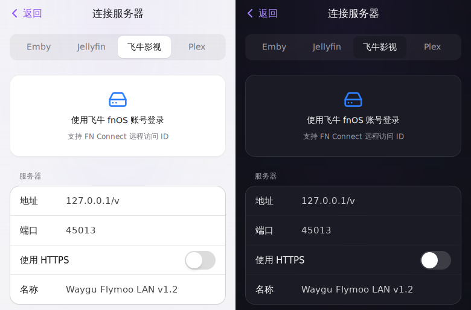

# Add media source review

[Scenra design](../../design/add-source.scenra) · 390 × 1180 px per image · Linux GTK at 1× scale · `zh-Hans` · a fresh profile, active Emby and Jellyfin Docker servers, and a local Flymoo DNS-SD fixture. The design renderer is Scenra `88548db091cd`. The baseline app is `0c494bb`.

Each strip shows the baseline app on the left, the Scenra reference in the center, and the revised app on the right.

## Light

## Dark

## Findings

| Area | Baseline | Revised capture and remaining work |
| --- | --- | --- |
| Header | Generic page header and chooser heading. | The back action has the reference's icon and text treatment. The 28 pt title and subtitle now occupy their own group. The reference's 44 pt phone system bar is absent from the Linux client capture. Verify the corresponding safe area on phones. |
| LAN discovery | Missing. | The violet panel uses the reference’s radar header, provider badges, card spacing and Add controls. The live results appear in arrival order and include a third card for Emby. Shorter fixture captions fit on one line. The Flymoo card displays the advertised host and port and keeps the media path for the connection form. |
| Media servers | Four separate centered outline buttons. | Emby, Jellyfin, Flymoo, and Plex use the reference's grouped rows, 28 pt color badges, dividers, and chevrons. Flymoo also shows the `fnOS` value. |
| Other sources | Missing. | Network shares and local files remain pending. Cloud drive integration is deferred by the product scope. |

## Flymoo discovered source

The captures show the connection form immediately after selecting the Flymoo result. The display name and port come from the announcement. The address includes the `/v` media gateway path. The review waits for Scan again, checks that it sends a new query, then selects the rediscovered result. The form stays idle until the user requests a test or supplies account details. With the fixture, the test completes sign-in and imports the library. [Source connection flow](../../design/flows/source-connect.scenra) · [Discovery and sign-in checks](../../integration/servers/TESTING.md#flymoo-lan-discovery)

`TestSourceReview` opens the source chooser and checks back navigation in both appearances. `TestDockerSourceReview` receives replies from the live Docker servers, selects the Emby result, and verifies that the address and advertised port reach the connection form. `TestDiscoverUDP` checks that invalid replies are discarded.

UDP broadcast discovery on iPhone and iPad requires Apple's multicast networking entitlement in the signed app. The project still needs that entitlement and a device capture. Manual server entry is available through the server rows. [Apple local network privacy](https://developer.apple.com/documentation/technotes/tn3179-understanding-local-network-privacy)

Flymoo uses the advertised `_trim_media._tcp` service. Apple clients use Bonjour with the declared service type. The multicast round trip and UI were checked on Linux, and device checks remain pending. [Flymoo TV installation](https://help.fnnas.com/articles/v1/start/install-tv) · [Feiniu TV Lite discovery](https://github.com/greatbody/feiniu-tv-lite/blob/7688390e3bb6207d0fb806d9b8648257afecf229/app/src/main/java/ink/sunrui/feiniutv/modules/server/ScanDeviceActivity.kt#L29-L34)

The other media servers follow their UDP discovery protocols. [Emby server discovery](https://dev.emby.media/doc/restapi/Locating-the-Server.html) · [Jellyfin networking](https://github.com/jellyfin/jellyfin.org/blob/master/docs/general/post-install/networking/index.md)
