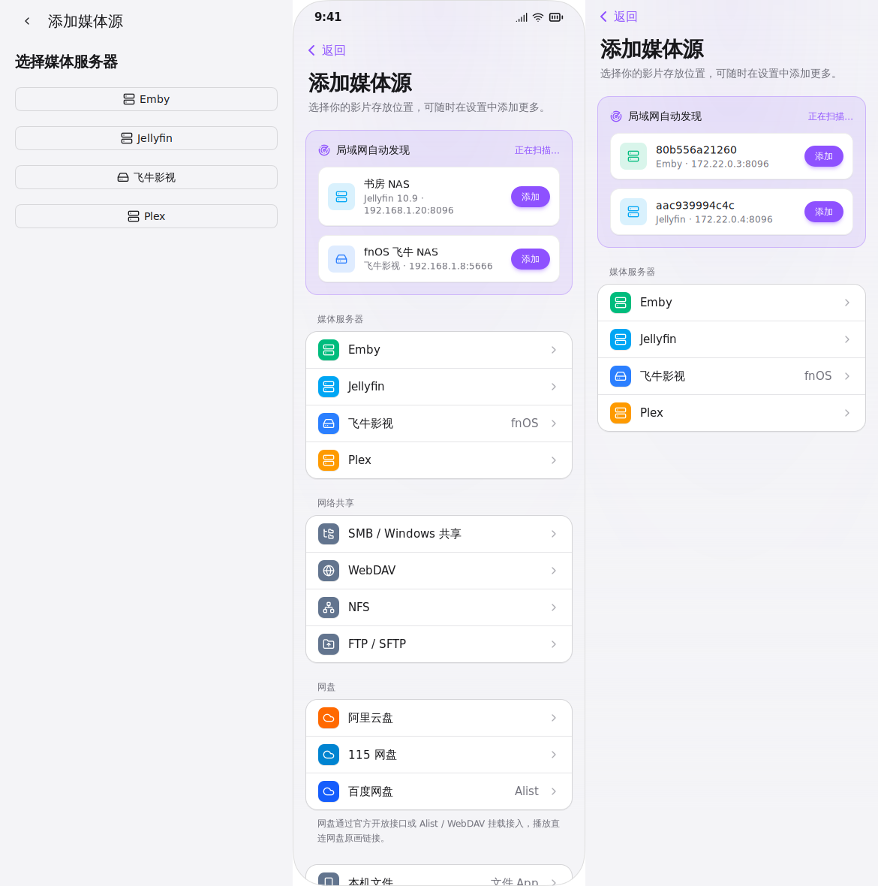
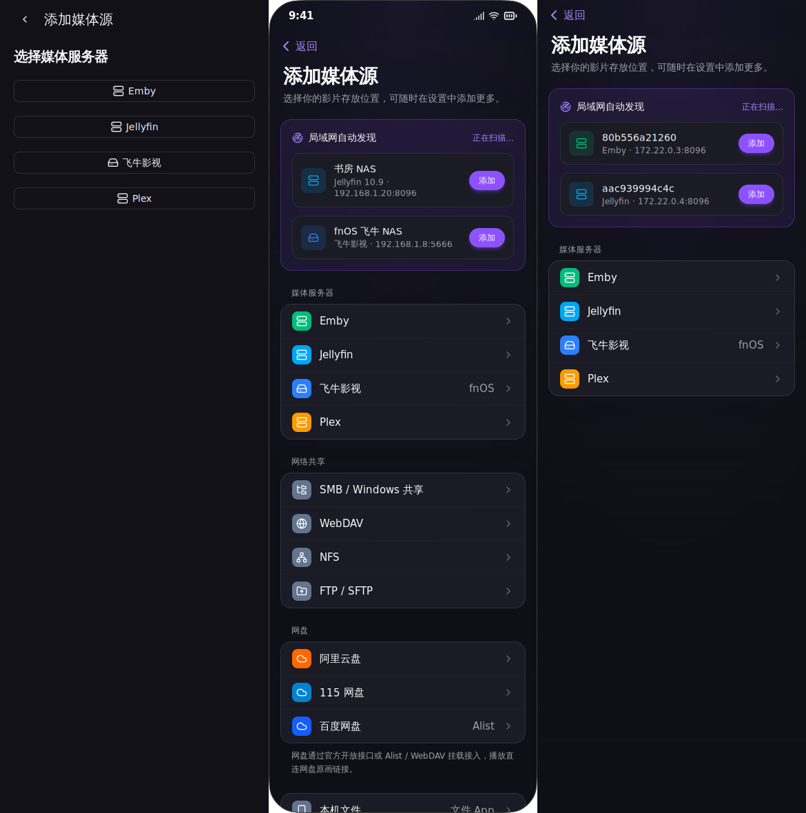

# Add media source review

[Scenra design](../../design/add-source.scenra) · 390 × 1180 px per image · Linux GTK at 1× scale · `zh-Hans` · a fresh profile and active Emby and Jellyfin Docker test servers. The design renderer is Scenra `88548db091cd`. The baseline app is `0c494bb`.

Each strip shows the baseline app on the left, the Scenra reference in the center, and the revised app on the right.

## Light

## Dark

## Findings

| Area | Baseline | Revised capture and remaining work |
| --- | --- | --- |
| Header | Generic page header and chooser heading. | The back action has the reference's icon and text treatment. The 28 pt title and subtitle now occupy their own group. The reference's 44 pt phone system bar is absent from the Linux client capture. Verify the corresponding safe area on phones. |
| LAN discovery | Missing. | The violet panel has a radar header and live results. The Docker fixture names and private IP addresses replace the sample names. The discovery response supplies no version field. The shorter details give one fewer text line than the reference. Flymoo discovery remains pending. |
| Media servers | Four separate centered outline buttons. | Emby, Jellyfin, Flymoo, and Plex use the reference's grouped rows, 28 pt color badges, dividers, and chevrons. Flymoo also shows the `fnOS` value. |
| Other sources | Missing. | Network shares and local files remain pending. Cloud drive integration is deferred by the product scope. |

`TestSourceReview` opens the source chooser and checks back navigation in both appearances. `TestDockerSourceReview` receives replies from the live Docker servers, selects the Emby result, and verifies that the address and advertised port reach the connection form. `TestDiscoverUDP` checks that invalid replies are discarded.

UDP broadcast discovery on iPhone and iPad requires Apple's multicast networking entitlement in the signed app. The project still needs that entitlement and a device capture. Manual server entry is available through the server rows. [Apple local network privacy](https://developer.apple.com/documentation/technotes/tn3179-understanding-local-network-privacy)

The page follows the public discovery protocols. [Emby server discovery](https://dev.emby.media/doc/restapi/Locating-the-Server.html) · [Jellyfin networking](https://github.com/jellyfin/jellyfin.org/blob/master/docs/general/post-install/networking/index.md)
