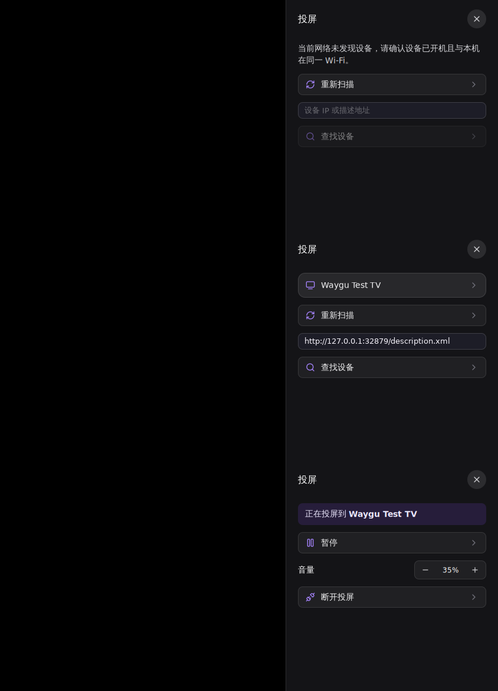

# DLNA casting

The phone player keeps the cast control in the upper-right group from the Scenra design. The refreshed phone movie, phone player and desktop player comparisons show where the controls appear. The casting flow defines the device list and its states in notes. The open picker uses the player's 360 pt dark side panel, with the same header, grouped rows, and close control as the subtitle panel. [Casting flow](../../design/flows/casting.scenra) · [Phone movie](phone-movie.md) · [Phone player](phone-player.md) · [Desktop player](desktop-player.md)

| Flow step | Implementation and check |
| --- | --- |
| Open | The movie detail cast icon opens the player with the picker. Series detail opens it for the selected episode through More. The phone, tablet and desktop players can open the picker during playback. The TV player has no sender control. |
| Discover | The picker searches with IPv4 SSDP and refreshes every ten seconds while open. It can also send unicast SSDP to an entered LAN IP or read an explicit HTTP UPnP description URL. It shows the empty state when there are no results. |
| Select and play | The app compares the stream MIME type with the renderer's ConnectionManager declarations. Compatible files are served through a temporary URL restricted to the receiver's IP. For renderers that advertise HLS, the app can ask Emby, Jellyfin or Plex for an H.264/AAC stream. The tests decode one frame through the receiver URL for each server. [MediaRenderer standard](https://upnp.org/specs/av/UPnP-av-MediaRenderer-v3-Device.pdf) |
| Control | Opening a remote stream pauses the local decoder. The sender uses AVTransport for play, pause and seek, and RenderingControl for volume. Every five seconds it reads the remote position and playback state. [AVTransport](https://upnp.org/specs/av/UPnP-av-AVTransport-v3-Service.pdf) · [RenderingControl](https://upnp.org/specs/av/UPnP-av-RenderingControl-v3-Service.pdf) |
| Disconnect | Manual disconnect revokes the media URL and resumes at the last receiver position. The app also falls back to local playback if polling fails twice or the receiver switches to another stream. The sender leaves a replacement stream playing. |

The recordings use Linux GTK at 844 × 390 pt with an Emby clip and a local receiver fixture. The test decodes a frame through the scoped address, checks a byte range and watches local playback advance after disconnecting. A separate run with GMediaRender and GStreamer discovered the receiver over multicast, advanced its playback clock on the Emby original, sought to 8 seconds, paused, and read back 30% volume. [Verification commands](../../integration/servers/TESTING.md#dlna-casting)

Physical TVs, AirPlay, Chromecast, remote track changes, and sending from HarmonyOS remain pending. iOS multicast discovery requires Apple's multicast entitlement. The manual IP and description address paths still need iOS device verification. [Apple multicast networking](https://developer.apple.com/documentation/bundleresources/entitlements/com.apple.developer.networking.multicast)
