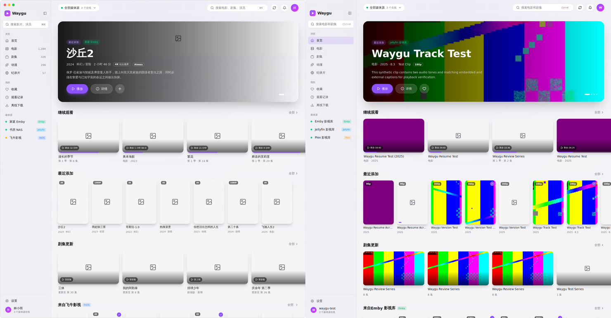
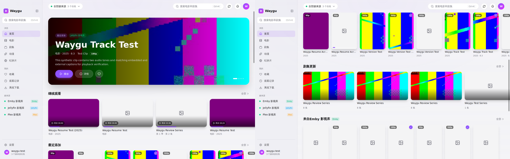

# Desktop home review

Scenra is on the left and the Linux GTK app is on the right. Both use the Simplified Chinese layout at 1440 × 1500 pt. The app shows the libraries, artwork, media providers, profile and watch progress supplied by the local Emby, Jellyfin and Plex fixtures. [Scenra design](../../design/desktop-main.scenra)

## Light

## Dark

## Window and scrolling

The captures show the same app at its normal 1440 × 900 pt window size. The toolbar and sidebar stay visible while the content pane scrolls through the shelves.

| Area | Comparison |
| --- | --- |
| Sidebar | The 240 pt sidebar has collapsible navigation, a search shortcut, the four library categories, personal items, source status and profile. The category rows still need the per-category totals drawn by Scenra. |
| Toolbar | The 64 pt toolbar includes the aggregate source picker, current online count, search, refresh, source notices and profile. The notice button opens a list of source failures when present. |
| Carousel | The hero is 380 pt tall with 32 pt margins. The app shows actual media artwork, source, metadata, picture format and synopsis when available, and playback, detail and favorite actions. The indicator buttons select a title, and the carousel advances after eight seconds unless reduced motion is enabled. The audio format badge remains pending. |
| Shelves | Continue Watching and Series Updates use 288 × 160 pt artwork. Recent titles and source shelves use 144 × 208 pt posters with a quality badge when the source reports a picture format. Series cards use the latest catalog metadata and include an episode count when the server supplies one. |
| Window controls | Scenra draws the macOS controls. The GTK capture renders the application content. Native macOS and Windows screenshots remain pending. |

`TestDockerDesktopHomeReview` checks the sidebar width, hero height, timed and manual selection, collapse and reopen, search, and source filtering. The desktop library, movie detail and settings each have a separate Scenra design.
