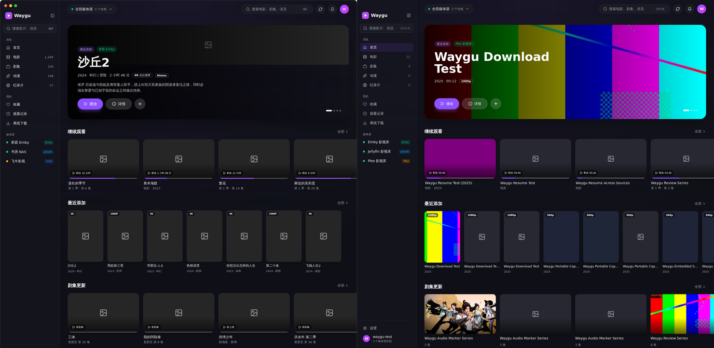
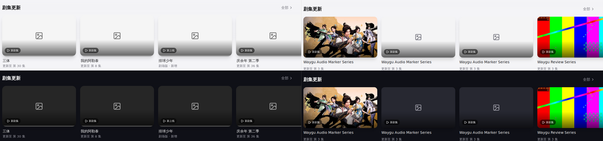
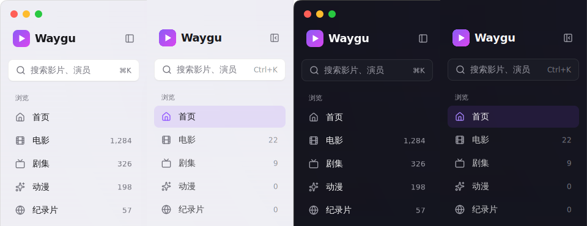
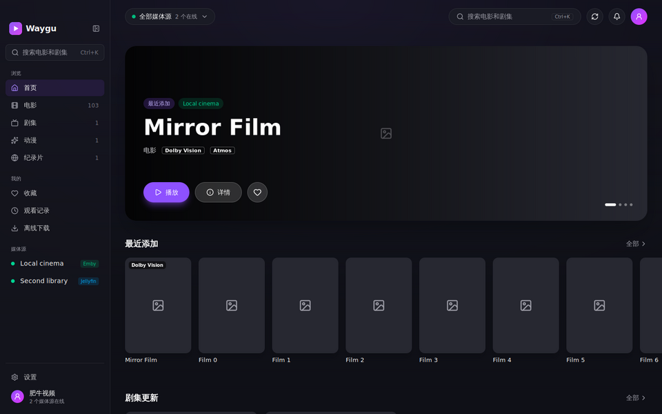
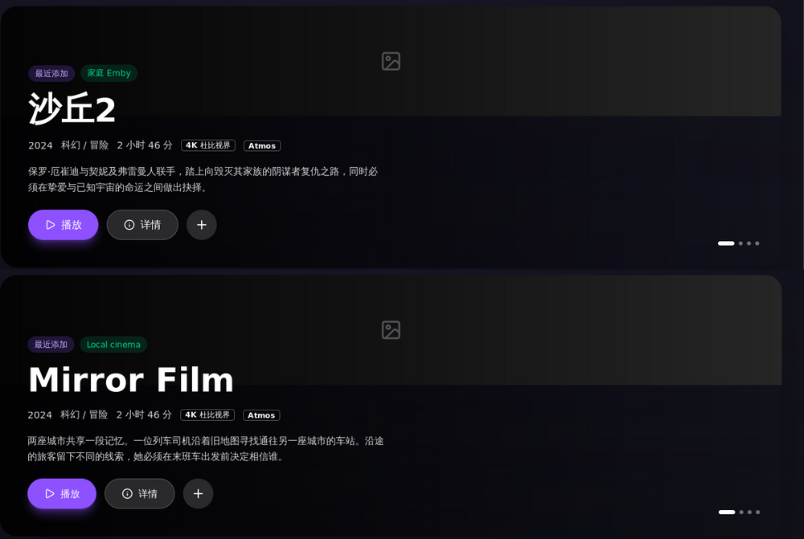
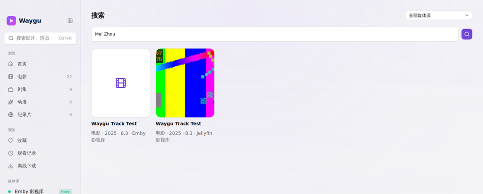
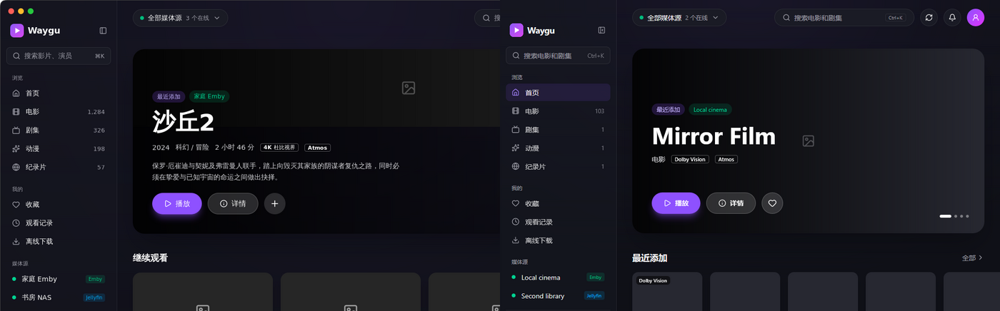
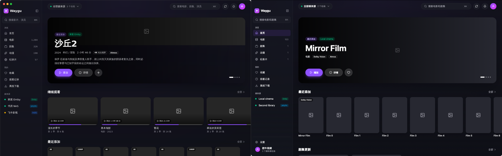
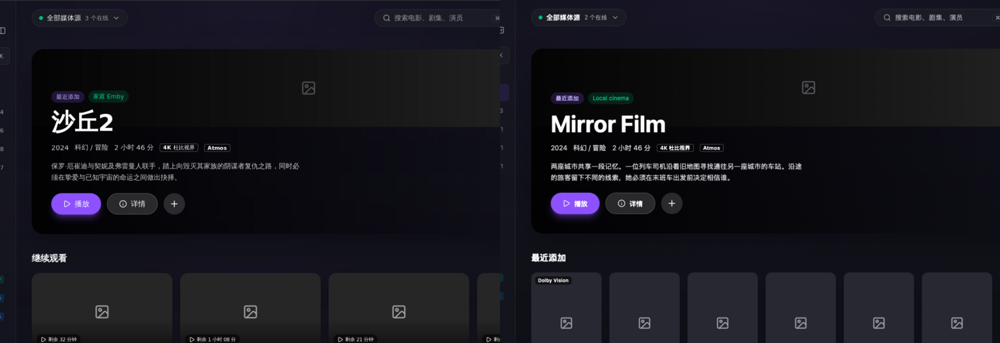

# Desktop home review

Scenra is on the left and the Linux GTK app is on the right. Both use Simplified Chinese and show the same 1440 × 1403 px region of the 1440 × 1500 pt layout. The app uses the libraries, artwork, media providers, profile and watch progress supplied by the local Emby, Jellyfin and Plex fixtures. [Scenra design](../../design/desktop-main.scenra)

## Light


## Dark



## Window and scrolling

The captures show the same app at its normal 1440 × 900 pt window size. The toolbar and sidebar stay visible while the content pane scrolls through the shelves.


| Area | Comparison |
| --- | --- |
| Sidebar | The 240 pt sidebar has collapsible navigation, a search shortcut, the four library categories, personal items, source status and profile. The category rows include right-aligned, localized totals. [Sidebar comparison](#category-totals-and-atmos) |
| Toolbar | The 64 pt toolbar includes the aggregate source picker, current online count, search, refresh, source notices and profile. The notice button opens a list of source failures when present. The search labels in the toolbar and sidebar use the Scenra wording. |
| Carousel | The hero is 380 pt tall with 32 pt margins. The app shows artwork, source, year, genres, localized runtime, picture and sound badges and synopsis when the catalog supplies them. The indicator buttons select a title, and the carousel advances after eight seconds unless reduced motion is enabled. |
| Shelves | Continue Watching and Series Updates use 288 × 160 pt artwork. Recent titles and source shelves use 144 × 208 pt posters with a quality badge when the source reports a picture format. Series Updates uses the latest indexed episode to order its cards and display the “Updated to episode” caption. Cards keep the design’s 288 × 160 pt backdrop and “New episode” pill. |
| Window controls | Scenra draws the macOS controls. The native comparison images show the application content. |

`TestDockerDesktopHomeReview` checks the sidebar width, hero height, timed and manual selection, collapse and reopen, search, and source filtering. The desktop library, movie detail and settings each have a separate Scenra design.

## Series updates

The crops show the current Series Updates row in Scenra and GTK. The full-page strips above record the previous cards. Provider names, artwork and episode numbers come from the Docker libraries. Tap a card to open the series copy that supplied the newest indexed episode. [Episode selection checks](home.md#interaction-checks)



## Category totals and Atmos

The first two frames compare the light Scenra sidebar with GTK. The next two compare the dark sidebars. The row heights, search copy and trailing count alignment follow the reference. The Docker fixture reports 22 movies, nine series, zero anime and zero documentaries. GTK shows Ctrl+K and the active Home row uses the selected tint defined in the sidebar component. Scenra shows macOS window controls and its exported image shows the rows in their default state.



The totals count titles in accessible imported libraries. They follow the configured default source, category overrides and title merging. A hidden library contributes no titles. A library hidden from Home still contributes to its category. Counts are withheld until a complete catalog is available.



The synthetic catalog shows 103 distinct movies, one series, one anime and one documentary. It shares a movie across two sources and uses multiple pages for the mixed library. Emby and Jellyfin use their catalog audio stream metadata. Plex uses its catalog media and stream labels. The Atmos badge follows the audio metadata of the featured item. [Emby catalog fields](https://dev.emby.media/doc/restapi/Item-Information.html)

## Featured artwork and actions



The two crops use the same 1168 × 392 px region. The missing-artwork panel, three metadata fields, picture and audio badges and action row follow the reference. The fixture uses the same year, genres, runtime and formats with a different title and synopsis. The first two actions open playback and details. The 44 pt favorite button shows a plus before saving and a check after saving. `TestDesktopSidebarCounts` verifies the text and size, adds and removes the favorite, switches to a title without Atmos, and reconciles the counts with the opened categories.

## Search by title and actor



The toolbar and sidebar open search. The Docker check searches for actor Mei Zhou, selects the Jellyfin scope, then submits the movie title and selects the Plex scope. Emby and Jellyfin return the movie by its credited actor. Jellyfin and Plex return it by title. The Plex credit mapping is covered by a wire-format test because the unclaimed Docker server returns an empty credits hub. [Catalog fixture verification](../../integration/servers/TESTING.md#catalog-and-player-fixtures)

To capture both sides on Linux, start the Docker fixtures and run these commands from the repository root with a display large enough for the requested viewport.

```sh
go tool nsgo test -target linux -env WAYGU_REVIEW_DESIGN=desktop-main.scenra \
  -run '^TestDesignReferences$' -screenshots .nsgo/ui-review/desktop-reference ./build/ui-review/reference
go tool nsgo test -target linux -env WAYGU_TEST_SERVERS=1 \
  -run '^(TestDockerDesktopHomeReview|TestDesktopSidebarCounts)$' -screenshots .nsgo/ui-review/desktop .
```

## Desktop runner captures

The runner images below record the earlier category-count and Atmos milestone.



The Windows comparison crops the same upper-left region from the Scenra design and the native 1028 × 749 px capture. The sidebar width, trailing count alignment, carousel top edge and action row positions line up. The active Home row, search copy and shortcut, hero gradient, favorite icon and picture format label differ from the reference. The synthetic catalog starts with Recently Added because it has no in-progress titles. Windows amd64 and arm64 both passed the native count check and produced captures with five differing pixels.

Linux amd64 and arm64 passed the native count check and generated 1280 × 937 px captures. Their runner images lacked CJK fonts and rendered Chinese as missing glyphs. The local GTK comparisons above use installed Chinese fonts. Subsequent Linux runner reviews install Noto CJK and use an Xvfb display that fits the requested viewport. Windows and Linux on both architectures also passed the native sample video decode and produced application packages. [Desktop matrix](https://github.com/vicnoah/waygu-video/actions/runs/45153238364)



Both macOS comparison frames cover 1440 × 900 px. The native amd64 capture shows the Command shortcut, the four category totals and the Atmos badge. Sidebar and carousel dimensions align with Scenra. Window controls, the active row tint, and the hero and search treatments retain the differences shown above. The native sample video decode passed and the amd64 package was built. The same run exposed a playback version fixture that waited for the runner's network response on arm64. The fixture now supplies a fixed network response. [Earlier macOS desktop run](https://github.com/vicnoah/waygu-video/actions/runs/45154718688)

### Apple silicon



The current desktop milestone passed the native Home and sample video tests and built packages on both macOS architectures. The Apple silicon capture has a visible 1024 × 705 px region inside its 1440 × 900 px image. Both comparison frames crop that same region. The placeholder, separate metadata fields, format badges and plus action are visible. The runner clips most of the sidebar and outer window edges. [Desktop milestone run](https://github.com/vicnoah/waygu-video/actions/runs/45182834079)
