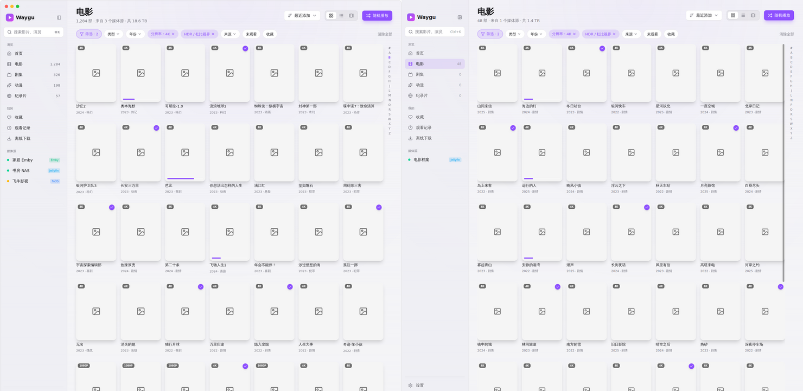
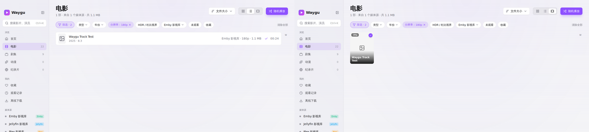
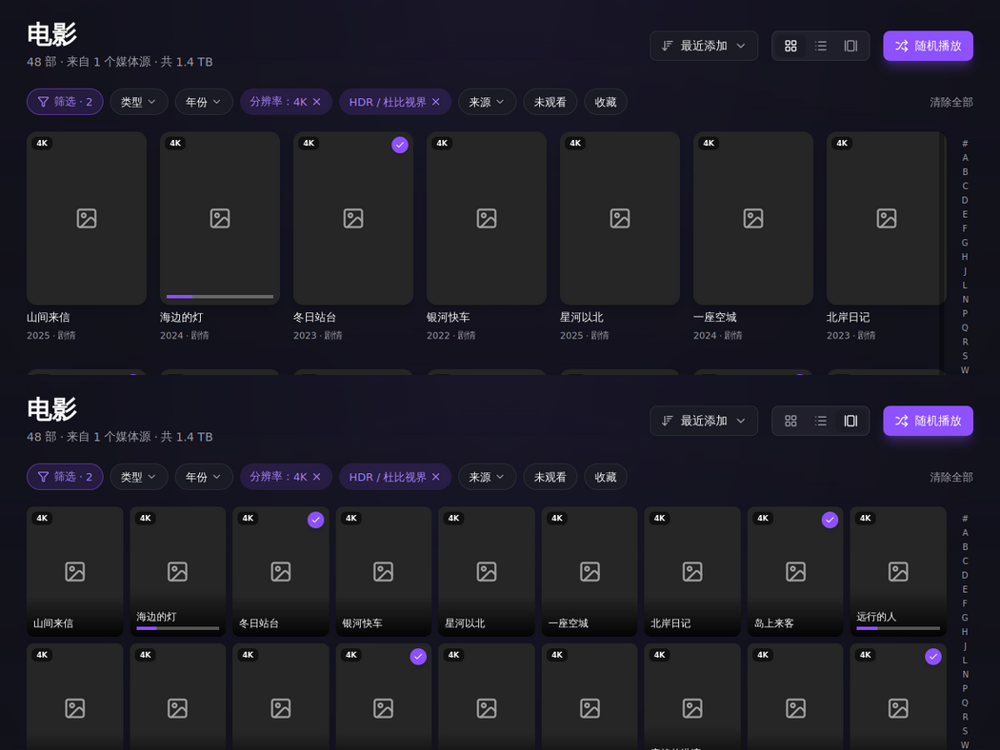

# Desktop movie library review

The Scenra reference is on the left and the Linux GTK app is on the right. The pairs show the same 1440 × 1403 px region of the 1440 × 1500 pt layout in Simplified Chinese with the 4K and HDR filters enabled. The app uses 48 synthetic titles with format metadata and sample watch states. A separate Docker test exercises the same UI with Emby, Jellyfin and Plex. [Scenra design](../../design/views/desktop-library.scenra)

## Light

## Dark

## List and poster wall

Scenra specifies both modes through the toolbar. The light GTK captures use the same Emby movie with an active 180p filter. The list shows resolution, dynamic range and file size when available. The wall uses smaller artwork with the title overlaid.

The dark GTK captures use the same 4K HDR catalog in the grid above and the wall below. Both overlays use the poster component's quality badge, watched check and progress bar. The wall places the progress bar below the title. The first title also has an 8K SDR rendition. Under the combined filter the grid and wall show 4K, and the list shows 4K HDR10.

| Area | Comparison |
| --- | --- |
| Grid | The viewport shows seven 144 × 208 pt covers with 16 pt horizontal gaps at the reference width. The card exposes the format badge, watched state, progress, title and first genre. The bottom inset scrolls out of view when more rows follow. |
| Header and filters | The header shows the filtered count and reports known file sizes. The seven sort options, three view modes and shuffle are available. Genre, year, resolution, video range, source, unwatched and favorite filters can be combined. If a source fails, the library keeps the available titles and offers a retry. |
| Index | The right-hand rail shows initials present in the current results. Titles use Mandarin pinyin or a Latin initial where available. Numeric titles and titles without a Latin initial sort together under `#`. The GTK test verifies jumps to Z and `#` at the normal window height. |
| Sidebar | The application highlights the active destination and shows the current server names and status. Category totals use the visible library inventory. The counts stay in place while library filters change. [Sidebar comparison](desktop-home.md#category-totals-and-atmos) |
| Smart collections | The filter dialog saves the current filters and sort order to a named sidebar entry. The interaction checks cover saving, reopening, deleting and restoring an entry from storage. Scenra describes this interaction without supplying a dialog frame. |

`TestDockerDesktopLibraryReview` covers the three Docker sources, resolution and HDR filters, file-size sorting, all three layouts, a detail round trip, smart collections and shuffle. `TestDesktopLibraryGridReview` checks the first-row column count, the format in each mode, the wall badges and the index jumps.

The side-by-side references retain the platform window controls and the default sidebar rows drawn by Scenra. GTK displays the active category tint and the native Ctrl+K shortcut.
