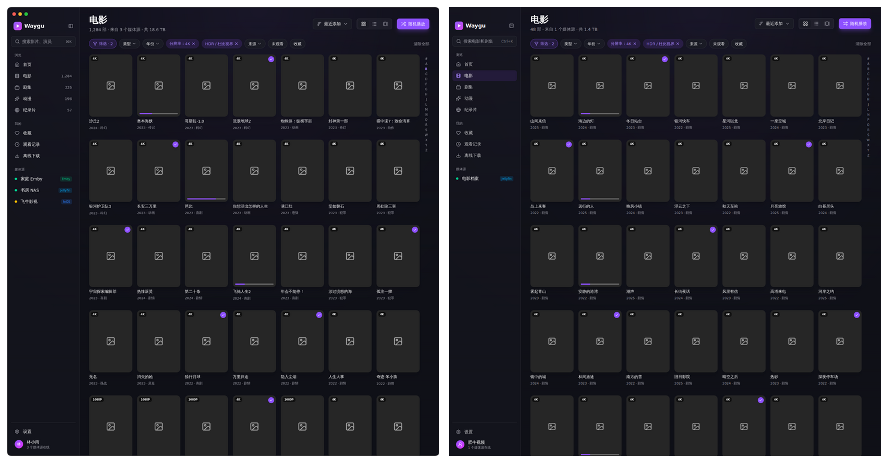

# Desktop movie library review

The Scenra reference is on the left and the Linux GTK app is on the right. Both use Simplified Chinese at 1440 × 1500 pt with the 4K and HDR filters enabled. The application capture uses a 48-title catalog with synthetic titles, 4K HDR metadata and sample watch states. The separate Docker test exercises the same UI with real Emby, Jellyfin and Plex responses. [Scenra design](../../design/views/desktop-library.scenra)

## Light

## Dark

## List and poster wall

Scenra specifies both modes through the toolbar. These app captures use an Emby movie filtered by source and resolution. The list shows playback metadata in a row. The poster wall shows smaller artwork with the title overlaid.

| Area | Comparison |
| --- | --- |
| Grid | The viewport shows seven 144 × 208 pt covers with 16 pt horizontal gaps at the reference width. The card exposes the format badge, watched state, progress, title and first genre. The bottom inset scrolls out of view when more rows follow. |
| Header and filters | The header shows the filtered count and reports known file sizes. The seven sort options, three view modes and shuffle are available. Genre, year, resolution, video range, source, unwatched and favorite filters can be combined. |
| Index | The right-hand rail shows initials present in the current results. Titles use Mandarin pinyin or a Latin initial where available. The GTK test clicks Z and verifies the grid scrolls to the corresponding titles at 1440 × 900 pt. |
| Sidebar | The application highlights the active destination and shows the current server names and status. Category totals and the native macOS window controls shown in Scenra remain pending. |
| Smart collections | The filter dialog saves the current filters and sort order to a named sidebar entry. The interaction checks cover saving, reopening, deleting and restoring an entry from storage. Scenra describes this interaction without supplying a dialog frame. |

`TestDockerDesktopLibraryReview` covers the three Docker sources, resolution and HDR filters, file-size sorting, all three layouts, a detail round trip, smart collections and shuffle. `TestDesktopLibraryGridReview` verifies the dense grid and the pinyin jump. Native macOS and Windows captures remain pending.
