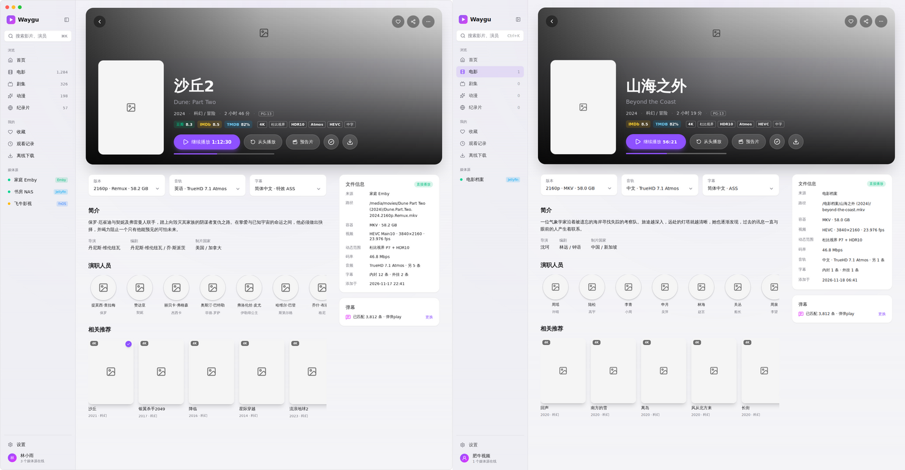
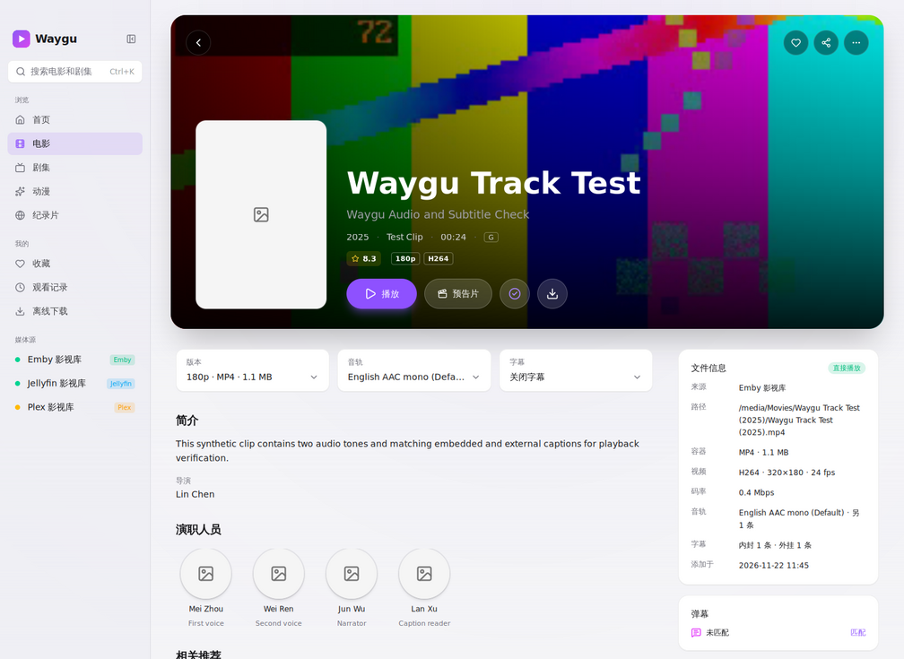
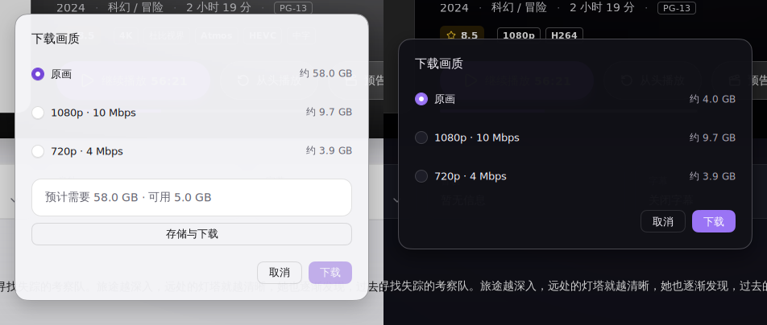

# Desktop movie detail review

Scenra is on the left and the Linux GTK app is on the right. Both use Simplified Chinese and a 1440 × 1500 pt client area. The app captures use synthetic film metadata, credits, video versions, captions and a saved DandanPlay link. The Docker test opens fixture films from Emby, Jellyfin and Plex. [Scenra design](../../design/views/desktop-movie.scenra)

## Light

## Dark

## Emby fixture

The application capture shows a real library's artwork and the available metadata and playback controls for its track test movie.

| Area | Comparison |
| --- | --- |
| Window and hero | The sidebar stays visible. The 500 pt hero has a 32 pt horizontal inset, a 208 × 300 pt poster, two overlays and the round actions. Back returns to the previous title or library. Narrow panes stack the information column below the main content and omit the hero poster when space is limited. |
| Playback | Resume, start from the beginning, trailer, watched state and the download action appear according to the item and server capabilities. The hero shows available picture and audio formats. [Download picker](#download-picker) |
| Ratings | IMDb uses the amber badge and one decimal place. TMDB uses the sky-blue badge and a percentage, as in both designs. A server score appears beside a star when it is the only available rating. A data source for the Douban badge remains pending. [Rating data and tests](#rating-badges) |
| Versions and tracks | Three equal-width controls select the version, audio and subtitles available before playback. The version choice persists when reopening a title. Embedded-only subtitles remain selectable in the libmpv player. |
| Synopsis and shelves | The overview includes available directors, writers and production countries. Cast portraits and recommended posters scroll horizontally. A recommendation opens another detail page inside the window. |
| File information | The 320 pt card shows the selected copy and available path, container, size, codec, dimensions, frame rate, range, bitrate and track counts. The source control switches between matched server copies. The fixture shows Dolby Vision P7 with HDR10 compatibility. [Video range](#video-range) |
| Danmaku and more actions | The danmaku card shows the matched provider and its comment count. The Change action opens the DandanPlay and configured Logvar match forms. The more menu marks watched or unwatched, reloads details, and opens the DLNA picker. Server-side metadata editing and rescanning remain pending. [Danmaku counts](#danmaku-counts) · [Casting comparison](casting.md) |
| Window controls | Scenra draws macOS window controls. The comparison captures GTK, and native macOS and Windows captures remain pending. A separate comparison covers the sidebar category totals. [Sidebar review](desktop-home.md#category-totals-and-atmos) |

`TestDesktopMovieDesignReview` covers both appearances, version and track controls, version persistence, and the sidebar at two window widths. `TestDockerDesktopMovieReview` verifies file data in all three providers, favorite and watched changes, the matching dialog, trailer playback, start from the beginning, recommendations, and switching a matched copy from Emby to Jellyfin.

## Video range

The 4K fixture shows separate Dolby Vision and HDR10 badges in the hero and `杜比视界 P7 + HDR10` in the file card, matching both Scenra appearances. The details test switches to the 1080p SDR version and checks that the previous range information disappears. Phone and tablet file information use the same version metadata. [Phone file comparison](phone-movie.md#video-range)

The local Docker test reads a generated 10-bit HEVC HDR10 clip through Emby, Jellyfin and Plex and verifies the range in each version and detail payload. Protocol fixtures cover Dolby Vision profile data, HDR10 and HDR10+ compatible layers, HLG and a rejected Dolby Vision label with independently identified HDR10. Flymoo's reference stream mapping supplies dimensions and codec. Its range metadata and physical HDR output verification remain open. [Test setup](../../integration/servers/TESTING.md#video-range) · [Jellyfin classifier](https://github.com/jellyfin/jellyfin/blob/master/MediaBrowser.Model/Entities/MediaStream.cs) · [Emby stream schema](https://dev.emby.media/reference/pluginapi/MediaBrowser.Model.Entities.MediaStream.html)

## Rating badges

Plex can supply IMDb and TMDB scores with provider identifiers in the title response. The app supports both the ratings array and the legacy image identifiers. With the existing TMDB metadata supplement enabled, a movie can also obtain a TMDB score from the matched title's votes. The configured metadata preference determines which TMDB value wins when both sources report one. [Plex rating fields](https://developer.plex.tv/pms/) · [TMDB movie details](https://developer.themoviedb.org/reference/movie-details)

The light and dark desktop captures display fixture scores of IMDb 8.5 and TMDB 82%. The Emby Docker fixture supplies an 8.3 community score and the test verifies the unlabeled star presentation. Plex API fixtures cover attribution and precedence. The TMDB fixture covers lookup for a fully described title and omission when there are zero votes. [Phone comparison](phone-movie.md#rating-badges)

## Danmaku counts

Both desktop comparisons show the matched card with the grouped count of 3,812 beside DandanPlay. With two matched providers, the card shows a line for each. The count measures playable comments before display filters. The app uses stored counts from prior loads and fetches missing counts for saved matches through the playback cache. An unavailable count leaves the provider's matched status visible. [DandanPlay API](https://api.dandanplay.net/swagger/index.html) · [Logvar API](https://github.com/huangxd-/danmu_api)

`TestMovieDanmakuCountsFollowBindings` opens both detail layouts with older saved matches, changes each provider's match, loads a match with zero playable comments, unbinds Logvar and reopens the title. `TestMovieDanmakuCountFromDownload` reads the saved track and checks the local count in both presentations. The live Logvar test verifies search and comment decoding against the configured test server. [Phone comparison](phone-movie.md#danmaku-counts)

## Download picker

The workflow calls for estimates and a space check before enqueueing. The detail toolbar opens the same picker used for season downloads. For Emby, Jellyfin and Plex it offers Original, 1080p and 720p. Original uses the selected version's size when available. Transcodes estimate from the runtime and target bitrate. Flymoo offers Original. The screenshot shows the light picker with the 58.0 GB 4K original on the left and the dark picker after choosing the 4.0 GB 1080p source version on the right. [Scenra workflow](../../design/flows/offline-download.scenra)

The desktop fixture checks a 5.0 GB app quota in light appearance and 5.0 GB of reported disk space in dark appearance. The 4K original and the 9.7 GB 1080p transcode are blocked. The 720p transcode and the 4.0 GB 1080p original can be confirmed. The space message opens Storage and Downloads, and leaving or cancelling the picker leaves the queue empty. The Docker regression downloads the Emby fixture at 720p from desktop detail and opens the local copy. Phone tests exercise the same picker and offline playback with all three servers. [Download quality review](storage-downloads.md#download-quality)
