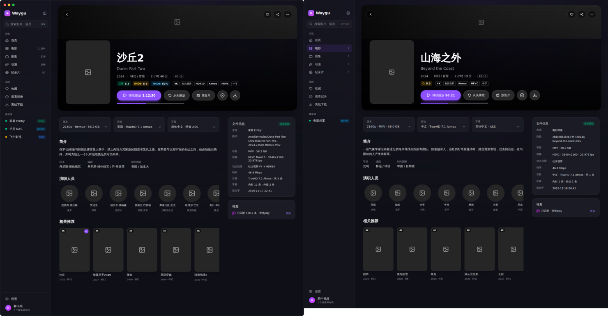

# Desktop movie detail review

Scenra is on the left and the Linux GTK app is on the right. Both use Simplified Chinese at 1440 × 1500 pt. The app captures use synthetic film metadata, credits, video versions, captions and a saved DandanPlay link so the same elements can be compared. The Docker test opens actual fixture films from Emby, Jellyfin and Plex. [Scenra design](../../design/views/desktop-movie.scenra)

## Light

## Dark

## Emby fixture

The application capture shows a real library's artwork and the available metadata and playback controls for its track test movie.

| Area | Comparison |
| --- | --- |
| Window and hero | The sidebar stays visible. The 500 pt hero has a 32 pt horizontal inset, a 208 × 300 pt poster, two overlays and the round actions. Back returns to the previous title or library. Narrow panes stack the information column below the main content and omit the hero poster when space is limited. |
| Playback | Resume, start from the beginning, trailer, watched state and the download action appear according to the item and server capabilities. The toolbar shows available picture and audio format badges. The rating badge shows the server's score. The three named rating badges require source-specific ratings. |
| Versions and tracks | Three equal-width controls select the version, audio and subtitles available before playback. The version choice persists when reopening a title. Embedded-only subtitles remain selectable in the libmpv player. |
| Synopsis and shelves | The overview includes available directors, writers and production countries. Cast portraits and recommended posters scroll horizontally. A recommendation opens another detail page inside the window. |
| File information | The 320 pt card shows the selected copy and available path, container, size, codec, dimensions, frame rate, range, bitrate and track counts. The source control switches between matched server copies. |
| Danmaku and more actions | The danmaku card opens DandanPlay matching and shows the saved match status. The more menu marks watched or unwatched, reloads details, and opens the DLNA picker. [Casting comparison](casting.md) The comment count, server-side metadata editing and rescanning, and transcoded download selection remain pending. |
| Window controls | Scenra draws macOS window controls and sidebar category totals. Native macOS and Windows captures and sidebar counts remain pending. |

`TestDesktopMovieDesignReview` covers both appearances, version and track controls, version persistence, and the sidebar at two window widths. `TestDockerDesktopMovieReview` verifies file data in all three providers, favorite and watched changes, the matching dialog, trailer playback, start from the beginning, recommendations, and switching a matched copy from Emby to Jellyfin.
