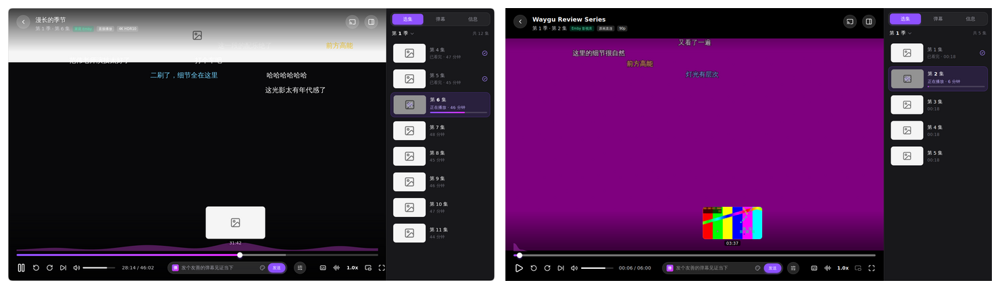
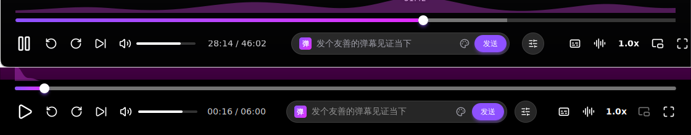
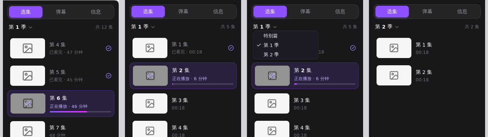
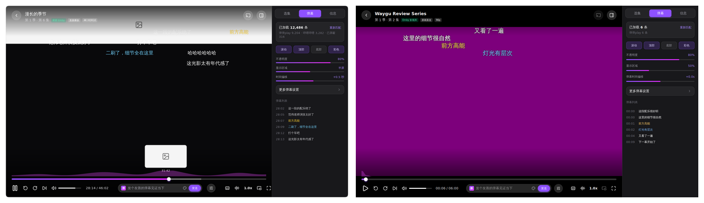
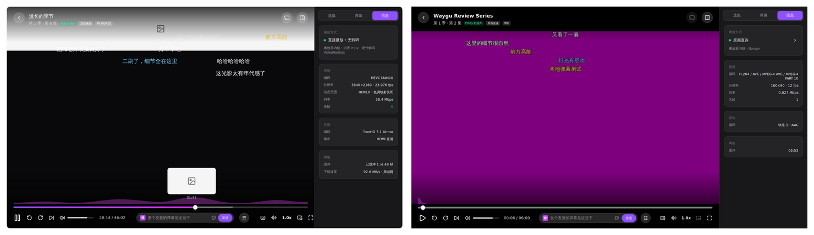

# Desktop player review

Scenra is on the left and the Linux GTK app is on the right at 1440 × 810 pt. The application plays an Emby fixture episode. The review uses a repeatable DandanPlay response and a still from the local Emby library for the seek preview. The app also accepts actual thumbnails through the server preview API when a source supplies them. [Scenra design](../../design/desktop-player.scenra)

## Episodes and timeline

The timeline strip shows the lower controls at the same scale. The GTK capture samples libmpv's seekable cache intervals on an authenticated Emby stream. The 6 pt rail uses Scenra's 45% white for the cached section and 20% for the rest. The purple played segment stays above both. The episode fixture fits in cache, so its pale section extends to the end of the rail. [libmpv cache properties](https://mpv.io/manual/stable/#command-interface-demuxer-cache-state)

### Season selection

The four crops show the 320 pt sidebar at 1× scale. The watched titles use the reference's zinc-400 text and the inactive rows use its 2 pt metadata gap. The standalone Scenra frame draws a 1 pt outline and a rounded outer corner. The GTK screenshots use the Emby fixture with five episodes in season one and two in season two. Selecting season two updates the sidebar label, count, and rows during playback. The Scenra frame supplies the closed trigger and the sidebar layout. The open menu and selected second season record the app's interaction.

`TestDesktopSeasonMenuSurvivesEpisodeLoad` holds the first season's episode response until the menu is open. It then checks that the episode rows and count update, the second season remains selectable, and the menu closes after selection. The test reproduced the disappearing menu before the fix and passes in the headless and GTK hosts. The trigger keeps its state while the episode list updates. [NSGo reactive bindings](https://nsgo.dev/docs/components/#signals)

## Danmaku

## Playback information

The application capture uses libmpv. Its decoder and network rows reflect the values available during the test.

| Area | Comparison |
| --- | --- |
| Frame and controls | The player stays dark and uses the two gradient control bars. The 320 pt sidebar leaves a 1120 pt playback pane at reference size. Collapsing it expands playback to the full window without reopening the stream. The fixture has letterboxing and a different picture. |
| Timeline | The played segment, white thumb, hover time and 176 × 96 pt preview appear at the bottom. The heatmap comes from scheduled comments. Buffered intervals are drawn from libmpv's demuxer and keep their gaps after seeking. The system player reports the buffering state. |
| Episodes | The current episode uses the violet outline and shows its progress. The season menu and episode cards open actual Emby episodes. The sample series has five episodes in its first season and two in its second. |
| Danmaku | The sidebar shows the comment count and source, type and color filters, opacity, area and a per-title time offset. Color and position chosen in the composer are retained for the next message. The composer saves its comments on this device. Shared sending and the additional online sources drawn in Scenra remain pending. |
| Information | The mode, engine, resolution and available video, audio and network metadata appear in four groups. With libmpv the app samples the decoder, frame rate, dropped frames, buffer and read speed about once a second when available. The current libmpv backend uses software decoding. [libmpv playback properties](https://mpv.io/manual/stable/) |
| Window and remote output | Full-screen entry and exit requests are verified in the headless window model. The top-bar cast button opens the DLNA device picker. Desktop Picture in Picture and native macOS and Windows captures remain pending. [Casting comparison](casting.md) · [NSGo video Picture in Picture](https://nsgo.dev/docs/picture-in-picture/) |

`TestDockerDesktopPlayerReview` checks actual desktop playback, pause, preview hover, the panel widths, danmaku filters and saved comments, episode selection and keyboard transport. The headless mode also checks the ten-second seek, volume update and full-screen requests. The same native test runs with the system player and with libmpv. The libmpv package tests verify volume, codec and frame-rate reporting, ASS rendering and embedded track changes.
