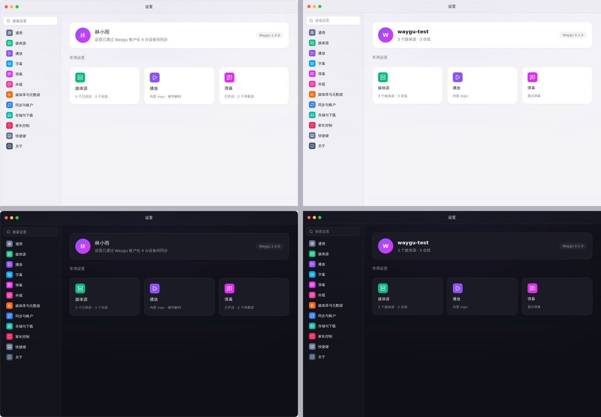
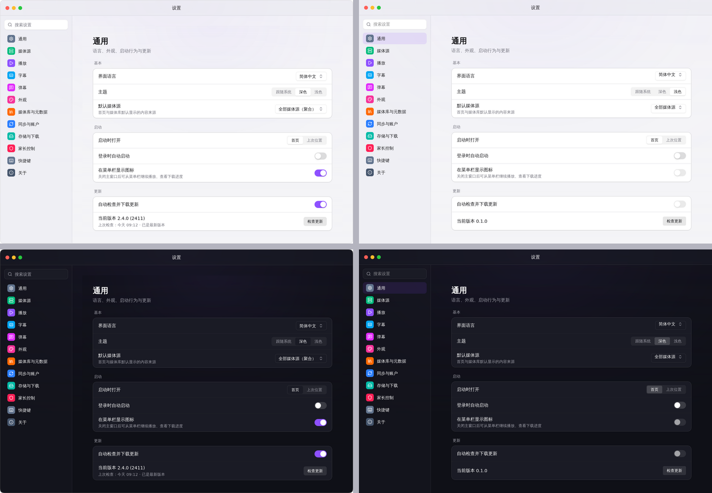
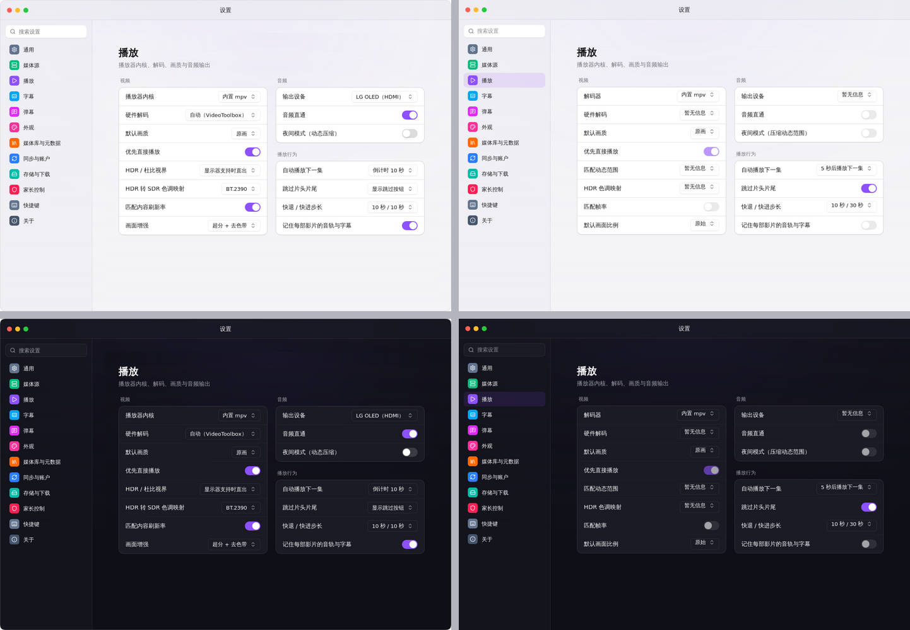
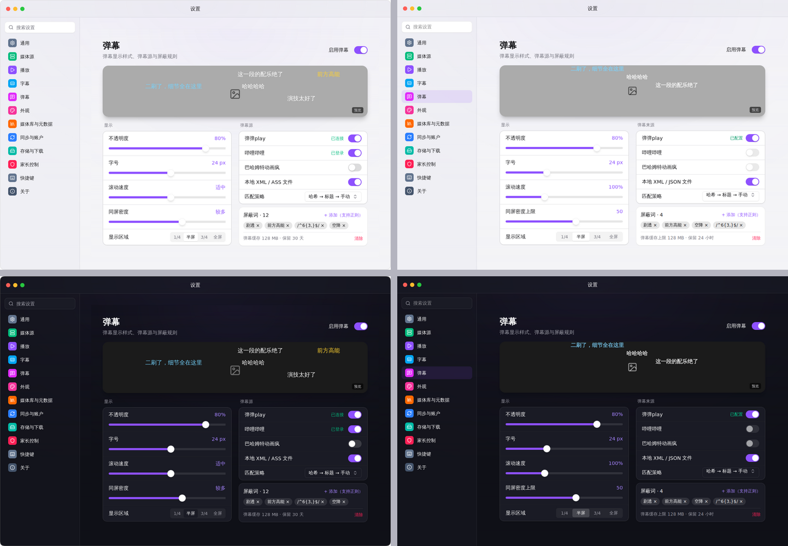
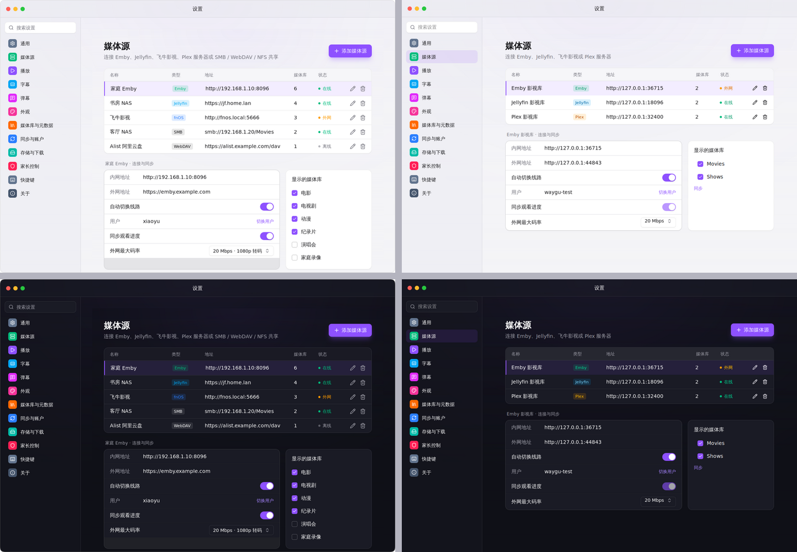

# Desktop Settings review

Scenra is on the left and the Linux GTK app is on the right. Light appears above dark. Each pair uses the same 1100 × 760 pt viewport. The application opens Settings as a separate window with the three title bar controls wired to the window. It uses a 224 pt sidebar and the selected section stays highlighted.

## Overview

The profile card and source count come from the signed-in Docker fixtures. The three common settings cards open the corresponding sections. The app displays its own version and saved playback and danmaku preferences. The design's Waygu account and device count depend on account sync, which is still pending. [Scenra overview](../../design/desktop-settings.scenra)

## General

The basic, startup and update groups match the order and spacing of the design. Language and theme apply immediately. The app saves the default media source and can restore the last main page. Login startup uses the desktop platform API. Update checks look up the latest published GitHub release. The menu bar and automatic update controls are disabled. [Scenra General](../../design/views/desktop-settings-general.scenra)

## Playback

The page matches the video column and the stacked audio and behavior groups. Engine, default bitrate, direct play preference, picture scaling, seek steps, the next-episode countdown and the skip intros and credits switch are saved. Prefer direct play uses the same preference and server negotiation as the phone setting. Hardware decoding, refresh rate, HDR and tone mapping, image enhancement, audio output and processing, and per-title track memory still need their platform or player implementations. The picture scaling control currently occupies the image enhancement row. [Scenra Playback](../../design/views/desktop-settings-playback.scenra) · [Streaming quality evidence](../../integration/servers/TESTING.md#streaming-quality) · [Marker playback evidence](phone-player.md#intro-and-credit-skips)

## Danmaku

The preview shows a sampled instant from the app's danmaku scheduler over a placeholder. The four sliders, area selector and enable switch update the saved preferences and preview. DandanPlay credentials use the platform secret store and the connection label indicates when credentials are configured. Open the DandanPlay configuration dialog and choose **Custom danmaku server** to add Logvar. Local XML, JSON and ASS comments are supported. Filter chips use the saved keywords and regular expressions. Cache clearing removes downloaded comment files for both online providers. Each provider's cache retains files for 24 hours with a 128 MB limit. Standalone Bilibili and Bahamut remain pending. [Scenra Danmaku](../../design/views/desktop-settings-danmaku.scenra) · [Logvar form](phone-danmaku-settings.md#custom-logvar-server)

## Media Sources

The fixture rows are actual Emby, Jellyfin and Plex connections. The selected row switches the connection details and the visible-library checklist. Add and edit open the existing server setup flow and return to the Settings window. The library sync action refreshes the server's list and preserves existing visibility preferences. The connection card displays the configured local and backup addresses. It saves a per-source route switch and bitrate cap. The captures use Emby through its backup gateway and show the amber remote status. The router gives the local address priority. The desktop design also specifies choosing by measured latency, which remains pending. Playback progress continues to synchronize with the configured sources by default. [Scenra Media Sources](../../design/views/desktop-settings-sources.scenra) · [Router checks](../../integration/servers/TESTING.md#media-source-routes)

`TestDesktopSettingsWindow` checks opening, closing and reopening the window, search, danmaku filters, saved appearance, language, seek and countdown choices, and returning from the media-source wizard. `TestDesktopSettingsRestore` checks startup and last-page persistence. `TestDockerDesktopSettingsReview` produces all ten captures, verifies the three online sources, and changes and refreshes a Jellyfin library's visibility. Native macOS and Windows window behavior and app account sync have verification outstanding. The desktop parental settings use the shared controls. Their separate window still needs a desktop capture. [Reproduction commands](README.md)
