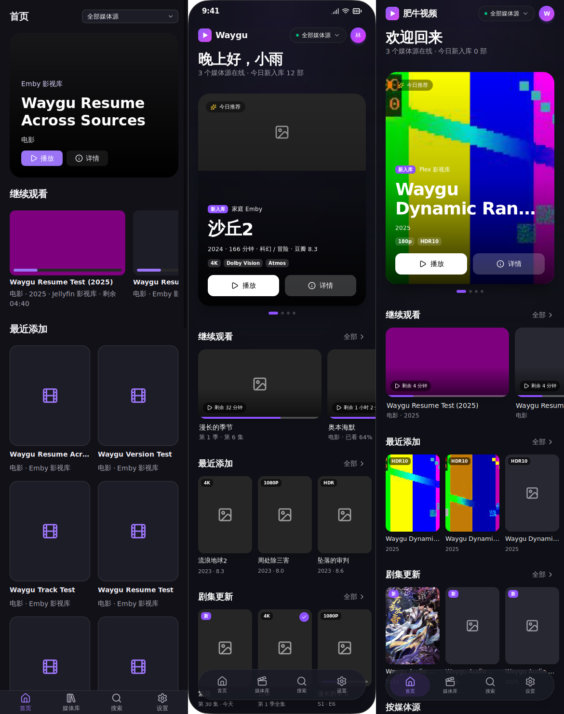
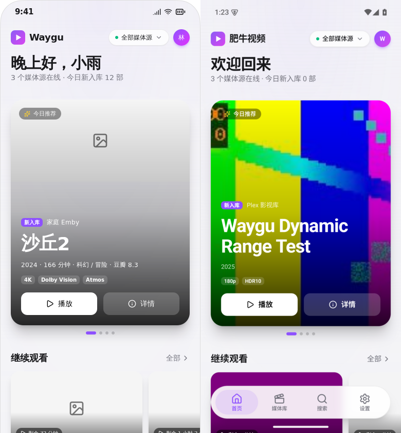
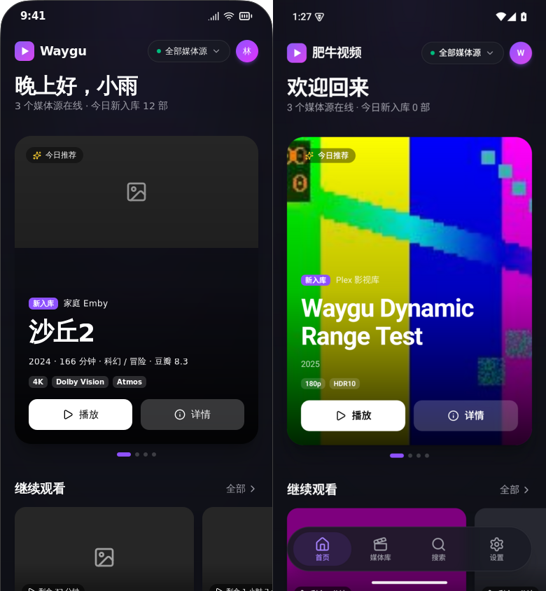
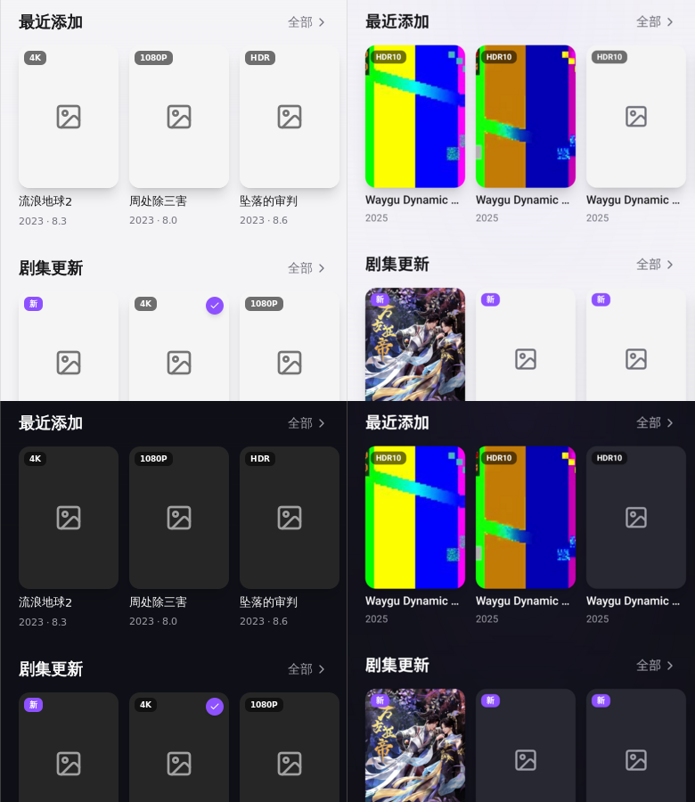
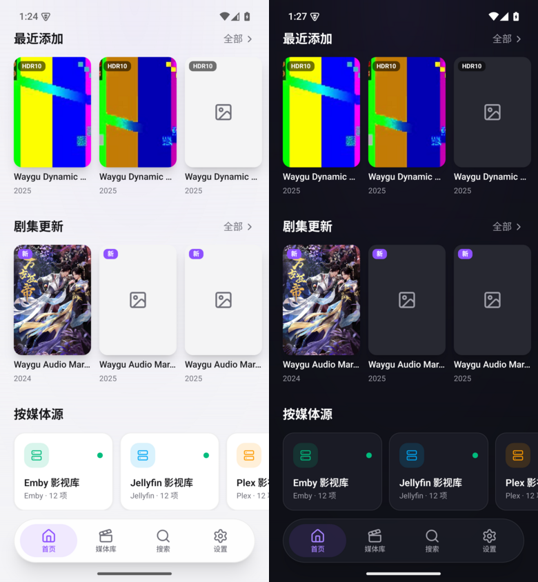

# Phone home review

[Scenra design](../../design/home.scenra) · 390 × 1480 px per image · Linux GTK at 1× scale · `zh-Hans`. The native captures use actual Emby, Jellyfin, and Plex Docker catalogs and test clips. The design renderer is Scenra `88548db091cd`.

Each strip shows the app at `9f57403` on the left, the Scenra reference in the center, and the revised app on the right. The baseline selected that commit's phone shell explicitly in the GTK harness. The revised app uses the compact layout on phones and desktop windows narrower than 560 pt.

## Light


## Dark



## Android phone

The top pairs show a 390 × 844 pt crop of the Scenra drawing on the left and the Android 15 Pixel 7 emulator display on the right, using NSGo 0.3.0. The emulator captures use 1170 × 2532 px at 480 dpi with gesture navigation. The full-height design places its floating tab bar at the bottom of the 1480 pt drawing. The app keeps the tab bar inside the shorter phone viewport.





The rail crops align Recent at the top for both appearances. The source cards sit below the full-height design’s crop.





## Findings

| Area | Baseline | Revised capture and remaining work |
| --- | --- | --- |
| Header | Page title and rectangular source selector. | A 28 pt brand mark, 32 pt source capsule and avatar, greeting, and live source summary now occupy the header. The reference includes a 44 pt phone system bar and a device frame. Android supplies the status bar and its safe-area inset. The foreground follows the app theme. The account initial comes from the fixture. The addition count uses the device’s calendar day and the selected sources, excluding titles hidden from Home or restricted by parental settings. The aggregate merges matching titles when combining is enabled. |
| Featured title | A 300 pt card with two small actions and a fixed item. | The 440 pt card has a gradient overlay, recommendation badge, two 44 pt actions, and position indicators. It rotates every eight seconds, uses the current library selection, and supports manual selection. The fixture title wraps onto two lines. The year, runtime, genres and attributed score use the selected catalog entry. The media stream badges use its reported resolution, dynamic range and Atmos audio, when available. Android verifies the HDR10 badge with a Docker title and the metadata fixture verifies 4K, Dolby Vision and Atmos together. A data source for the design’s Douban score remains pending. |
| Continue watching | A 240 × 135 pt art tile with a small inset progress bar and remaining time under it. | The 256 × 144 pt art tile has a remaining-time pill and a 4 pt bottom track. The fixture's remaining times and poster colors come from the servers. Time badges display localized hours and minutes. |
| Recent titles and series | Movies and series shared a poster grid. | Separate horizontal rails use 112 × 160 pt artwork, rounded corners, metadata, and applicable format, progress and watched badges. Series order uses catalog additions. Latest episode badges and episode-level update sorting remain pending. |
| Source shelf and tab bar | The selector was the only way to filter by source. The tab bar sat flush with the bottom. | The source rail has 144 pt cards with live connection status and item counts. Selecting a card filters the home catalog. The tab bar is a 64 pt floating capsule with an active tab highlight. The emulator shows the app’s floating capsule above Android’s gesture indicator. Android and iOS hardware capture, keyboard insets, and native blur remain open. |

The 1480 px reference clips the source cards. These cropped native captures show that section after scrolling, in light and dark appearance.


## Interaction checks

`TestDockerHomeReview` waits for the addition count from the three Docker libraries and measures the card and tab-bar heights. It selects a carousel item, waits for the eight-second advance, expands and collapses the recent shelf, filters with the Emby card, restores the aggregate view and enters the featured detail and player. The date test covers paging past 100 results, source deduplication and resetting at local midnight. Flymoo uses reported creation timestamps. If a server leaves an addition date unknown, the summary still displays the online-source status. [Docker fixture setup](../../integration/servers/TESTING.md)

Run one appearance per Android test installation. The emulator must reach the Docker ports through the adb reverse rules used by the device fixtures.

```sh
sh build/android/package.sh test -device "$ANDROID_SERIAL" -env WAYGU_TEST_SERVERS=1 \
  -run '^TestDockerHomeReview$/^light$' -screenshots .nsgo/phone-home-light .
sh build/android/package.sh test -device "$ANDROID_SERIAL" -env WAYGU_TEST_SERVERS=1 \
  -run '^TestDockerHomeReview$/^dark$' -screenshots .nsgo/phone-home-dark .
```

The Docker media suite checks the underlying playback endpoints. `TestNativeVideoDecodes` separately checks the GTK decoder.

The test lab uses Cairo for GTK screenshot rendering and preloads its installed libsoup 3 so remote fixture artwork loads before the screenshots. The images show the actual artwork served by the fixtures. The [tablet home review](tablet-home.md) covers the tablet layout. The [screen inventory](screens.md) links the desktop and TV home reviews.
