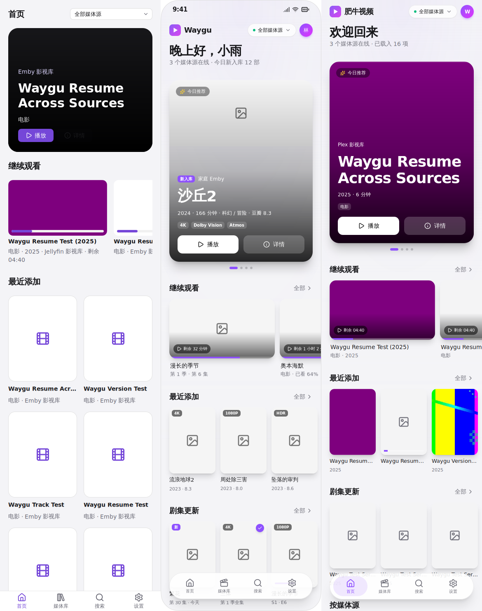
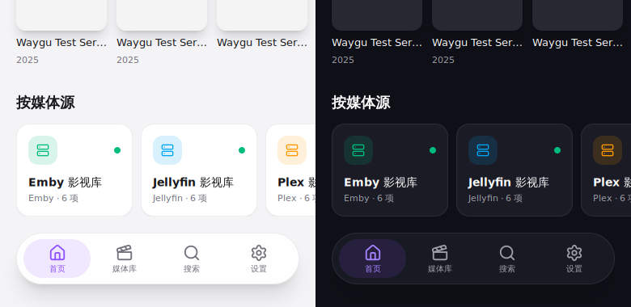

# Phone home review

[Scenra design](../../design/home.scenra) · 390 × 1480 px per image · Linux GTK at 1× scale · `zh-Hans`. The native captures use actual Emby, Jellyfin, and Plex Docker catalogs and test clips. The design renderer is Scenra `88548db091cd`.

Each strip shows the app at `9f57403` on the left, the Scenra reference in the center, and the revised app on the right. The baseline selected that commit's phone shell explicitly in the GTK harness. The revised app uses the compact layout on phones and desktop windows narrower than 560 pt.

## Light

## Dark

## Findings

| Area | Baseline | Revised capture and remaining work |
| --- | --- | --- |
| Header | Page title and rectangular source selector. | A 28 pt brand mark, 32 pt source capsule and avatar, greeting, and live source summary now occupy the header. The reference includes a 44 pt phone system bar and a device frame. Verify safe-area placement on phones. The account initial and loaded-item count come from the fixture. |
| Featured title | A 300 pt card with two small actions and a fixed item. | The 440 pt card has a gradient overlay, recommendation badge, two 44 pt actions, and position indicators. It rotates every eight seconds, uses the current library selection, and supports manual selection. The fixture title wraps onto two lines. Resolution, HDR, and audio badges still need stream metadata. |
| Continue watching | A 240 × 135 pt art tile with a small inset progress bar and remaining time under it. | The 256 × 144 pt art tile has a remaining-time pill and a 4 pt bottom track. The fixture's remaining times and poster colors are read from the servers. |
| Recent titles and series | Movies and series shared a poster grid. | Separate horizontal rails use 112 × 160 pt artwork, rounded corners, metadata, and applicable progress, watched, and recent badges. Series order uses catalog additions. Latest episode badges and episode-level update sorting remain pending. |
| Source shelf and tab bar | The selector was the only way to filter by source. The tab bar sat flush with the bottom. | The source rail has 144 pt cards with live connection status and item counts. Selecting a card filters the home catalog. The tab bar is a 64 pt floating capsule with an active tab highlight. Phone system chrome, keyboard insets, and platform blur still need device review. |

The 1480 px reference clips the source cards. These cropped native captures show that section after scrolling, in light and dark appearance.

## Interaction checks

`TestDockerHomeReview` checks the card and tab-bar heights, selects a carousel item, advances the clock by eight seconds, expands and collapses the recent shelf, filters by an Emby card, restores all sources through the selector, opens details, and enters the player. The existing Docker media suite checks the underlying playback endpoints. The GTK test run also passed the native video decode check.

The test lab uses Cairo for GTK screenshot rendering and preloads its installed libsoup 3 so remote fixture artwork loads before the screenshots. The images show the actual artwork served by the fixtures. Tablet, desktop, TV home designs, and native phone captures remain in the [screen inventory](screens.md).
