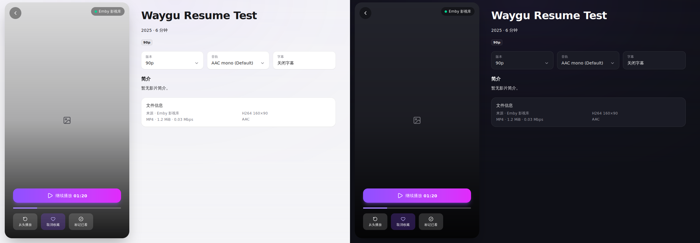
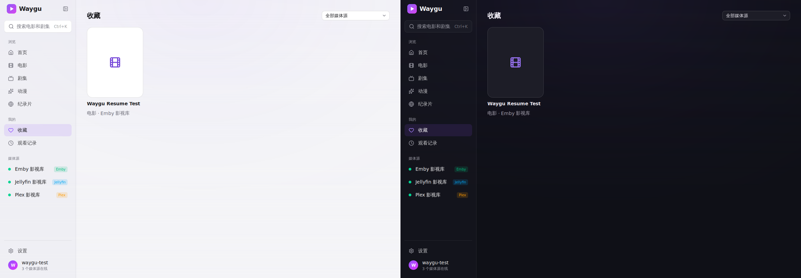
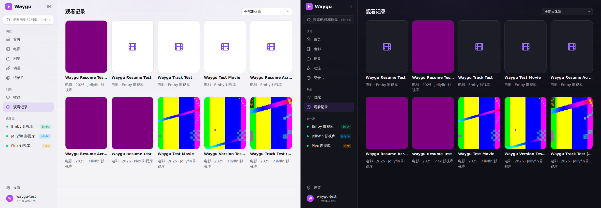

# Personal library review

The tablet [home](../../design/tablet-home.scenra) and [movie detail](../../design/tablet-detail.scenra) drawings define the personal section and poster actions. The [shared sidebar](../../design/components/sidebar.scenra) places Favorites and Watch history in the My library group. Its destinations reuse the catalog grid. The Scenra project has no standalone drawings for those destinations.

The GTK captures use the tablet layout at 1180 × 820 pt and 1× scale in `zh-Hans`. Each pair shows light appearance on the left and dark appearance on the right. Emby supplies the fixture's film, favorite flag, and watch state.

## Comparison

| Area | Evidence and remaining differences |
| --- | --- |
| Sidebar | Favorites and Watch history use the 36 pt navigation rows and violet selection treatment of the shared sidebar. The Downloads row opens the local queue. The updated [tablet home strips](tablet-home.md) show their placement in both appearances. |
| Poster actions | The 82 × 56 pt buttons use the heart and check icons from the detail drawing. The active state uses a violet accent and a reversible action label. The [tablet detail strips](tablet-detail.md) show the default actions and the saved-position state. The fourth action adds the source version to the local queue. |
| Personal results | Favorites follows the connected account's server state and the app's visible libraries. Watch history groups viewed titles in reverse order of the confirmed timestamps where supplied. These destinations use the shared catalog grid. |
| Provider behavior | Emby, Jellyfin, and Flymoo support favorite actions. Plex supports the watched action and watch history. Flymoo uses the watched list from the reference protocol and can omit viewing timestamps. Both its favorite and watched mutations were checked against protocol fixtures. |
| Responsive entry points | The desktop and tablet sidebars have entries for both views. TV has a remote-focusable Favorites entry, and the phone and TV library screens expose the three library views. The GTK captures verify the tablet screens. Phone, TV, and tablet device checks remain pending. |

## Verification

`TestDockerPersonalLibraryReview` marks a resumed fixture as favorite, opens it from the server-backed favorites grid, marks it watched, verifies the resume bar drops out, reopens it from history, and clears both flags. `TestDockerServers` checks server state readback and library-scoped personal results against Emby, Jellyfin, and Plex.

The Flymoo fixture verifies the request methods, signed authentication headers, `item_guid` payloads, and query results using the [FnMovie favorite and watched list implementation](https://github.com/vicnoah/fnmovie/blob/de2b3dd817011de1e5f54b65b5bcb8310431b306/internal/app/server.go) and [Feiniu TV Lite's watched actions](https://github.com/greatbody/feiniu-tv-lite/blob/7688390e3bb6207d0fb806d9b8648257afecf229/app/src/main/java/ink/sunrui/feiniutv/network/NasApiClient.kt#L819). Actual Flymoo hardware remains unverified for these actions.
