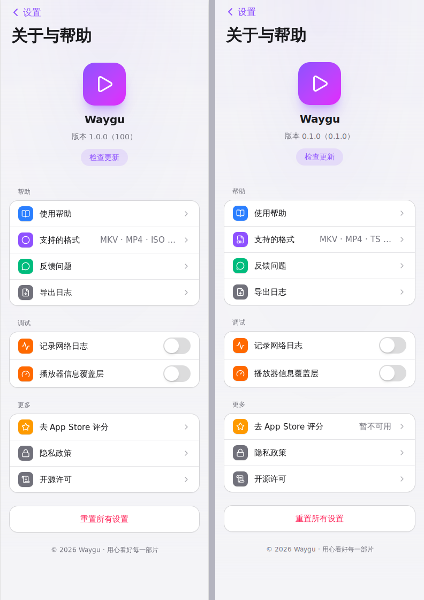
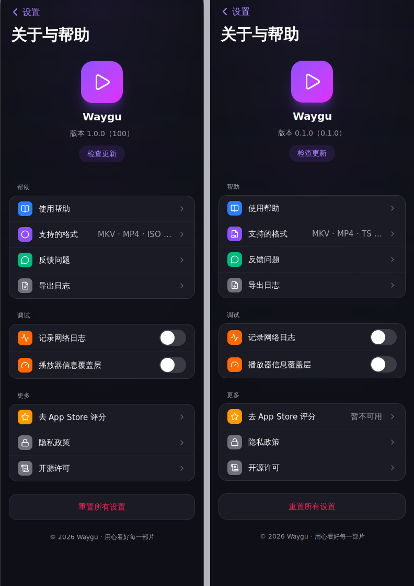
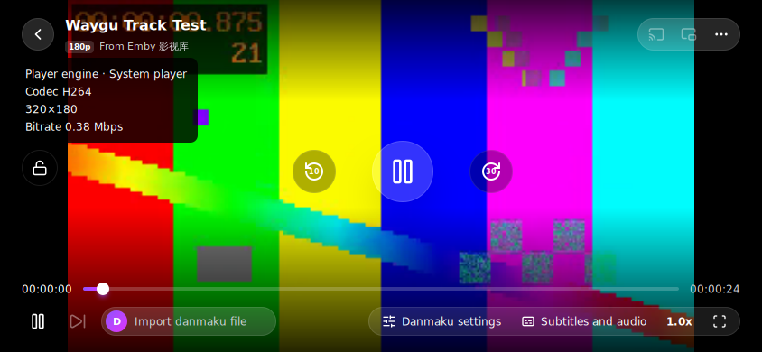

# Phone About and help

The Scenra reference is on the left and the running Linux GTK app is on the right at 390 pt, 1× scale and `zh-Hans`. The comparison starts below the reference’s 44 pt status bar and covers the last footer. [Scenra design](../../design/settings-about.scenra)

| Area | Comparison and verification |
| --- | --- |
| Header and version | The Waygu mark, version and update button have the reference placement. The app shows its configured version and build value. Checking updates queries GitHub for the latest published release and can open the release page. A fixture covers a published version. The project has no published release at the time of this comparison. [GitHub releases API](https://docs.github.com/en/rest/releases/releases#get-the-latest-release) |
| Help | The four rows open an in-app guide, a format reference, the repository’s issue form, and a save dialog for the log archive. The formats row uses the native file-video glyph while the Scenra exporter draws its fallback icon. The subtitle and video examples reflect the app’s available decoders and file imports. |
| Diagnostics | The switches save independently. Logging is off by default. Each completed media-server API request can record its provider, HTTP method, result code, time, and duration. Stored fields exclude URLs, server names, request and response bodies, passwords, and tokens. The app caps each day’s file at 256 KiB and exports up to seven UTC dates. It saves a ZIP to a user-selected destination. The overlay includes decoded size and buffering state, stream metadata where available, and live dropped-frame and buffer metrics with libmpv. [NSGo platform services](https://nsgo.dev/docs/services/) |
| More | The privacy and dependency license panels work offline. The App Store row is unavailable because the build has no listing ID. |
| Reset | The destructive row opens a confirmation and restores the default preferences when confirmed. Media sources, credentials, downloads, history, local libraries and parental controls are preserved. The test verifies both cancellation and confirmation. |
| Devices | The capture uses the compact layout on GTK. The desktop About category and the TV About entry use the same preferences. Device saves, app store links and TV remote behavior still need platform verification. |

`TestPhoneAboutReview` captures both appearances and checks the panels and reset. `TestAboutDiagnosticsArchive` verifies a real local API request and checks the archive for credentials, URLs and expired logs. `TestAboutExportAndPlayerDiagnostics` covers the save request and verifies the overlay through the playback surface. `TestDockerAboutPlayerOverlay` checks the native decoder against the Emby clip. [Reproduction commands](README.md)
