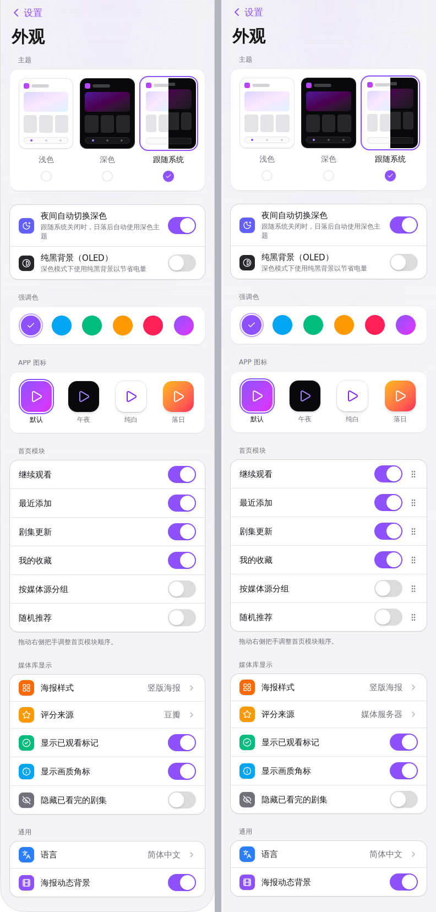
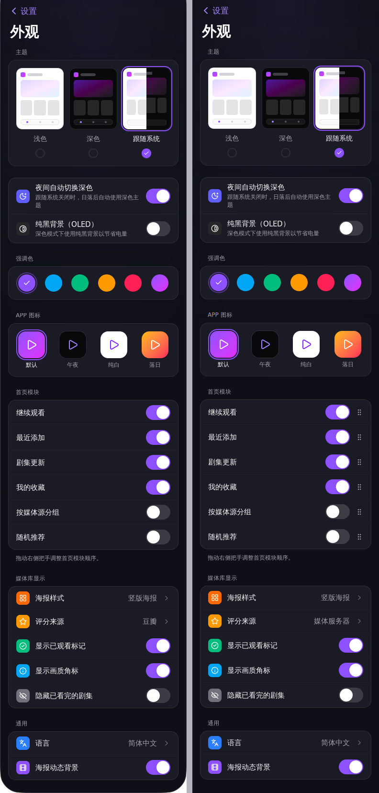

# Phone Appearance

The Scenra reference is on the left and the running Linux GTK app is on the right at 390 pt, 1× scale and `zh-Hans`. The comparison starts below the reference’s 44 pt status bar and covers all settings through the language selector. The reference keeps its phone frame at the edges. [Scenra design](../../design/settings-appearance.scenra)

| Area | Comparison and verification |
| --- | --- |
| Theme and colors | The native view shows the three theme previews, the six accent swatches and the switches in the reference order. The selected accent applies to navigation, interactive controls and highlights. With OLED enabled, the dark page background becomes black. The appearance test changes these settings through the form and checks storage. |
| Night mode | When light mode is selected, the schedule changes the visible page to dark after sunset and back to light after sunrise. Enabling it can request approximate location. The app rounds a fix to one degree and stores it locally. Without a fix, the schedule uses 18:00–06:00 local time. Tests cover the live switch and polar day and night. The permission prompt still needs device verification. [NSGo permissions](https://nsgo.dev/docs/permissions/) · [NOAA solar equations](https://gml.noaa.gov/grad/solcalc/solareqns.PDF) |
| App icons | The form shows the four launcher icon previews. Alternate icons are disabled because the pinned NSGo integration exposes launcher icons through build configuration. [NSGo build configuration](https://nsgo.dev/docs/building/) |
| Home module order | Six rows map to the Home shelves and save visibility and order. The design specifies a drag handle in its notes. The running app draws it and gives it space to the right of each switch. A focused handle also accepts Up and Down. The Docker test checks real favorites and resume data, then verifies visibility, source grouping and recommendations through Home. The Favorites shelf includes data from servers that expose a favorites API in Waygu. |
| Library and language | Poster, landscape still and list modes are available on phone and desktop. The library controls cover watched labels, quality labels and hiding watched episodes. The Docker test checks a real widescreen cover with the quality label turned off. Poster-based home color is available on phone, tablet and desktop. The color sampler test verifies it uses artwork from the same server as the media source. The rating row shows the server rating. Separate ratings from external services remain pending. Changing language updates labels immediately. |
| Devices | The screenshots use the phone layout on the native GTK backend. Desktop and TV use the shared appearance settings, and both inherit the saved appearance choices. Touch behavior, platform status bars and TV remote interaction still need target-device captures. |

`TestPhoneAppearanceReview` captures the native form in both appearances and checks theme, accent, OLED, module reordering, poster style and language. `TestAppearanceNightResolvesRunningTheme` advances the clock while Home is visible and checks its page color. `TestAppearanceNightAndPosterColor` checks the solar schedule and poster sampling. `TestDockerHomeAppearance` verifies the changes through Home and Library with the local media servers. [Reproduction commands](README.md)
