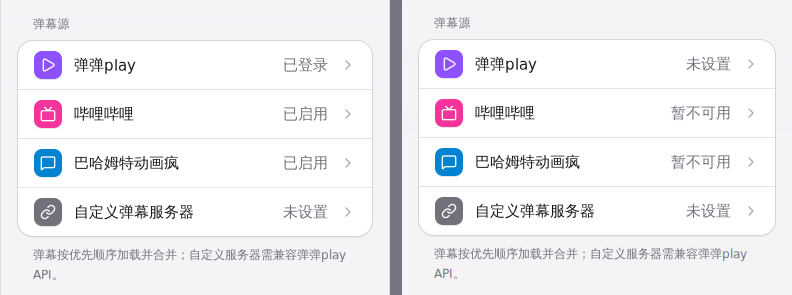
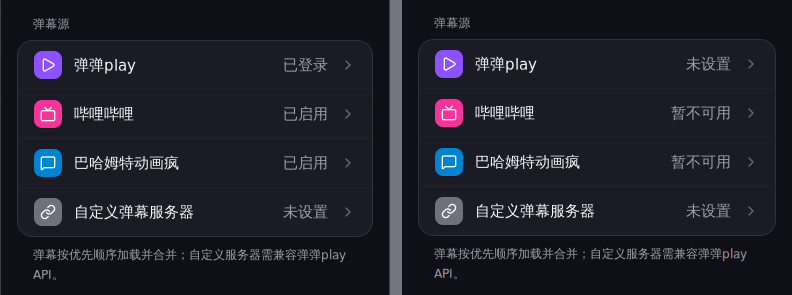
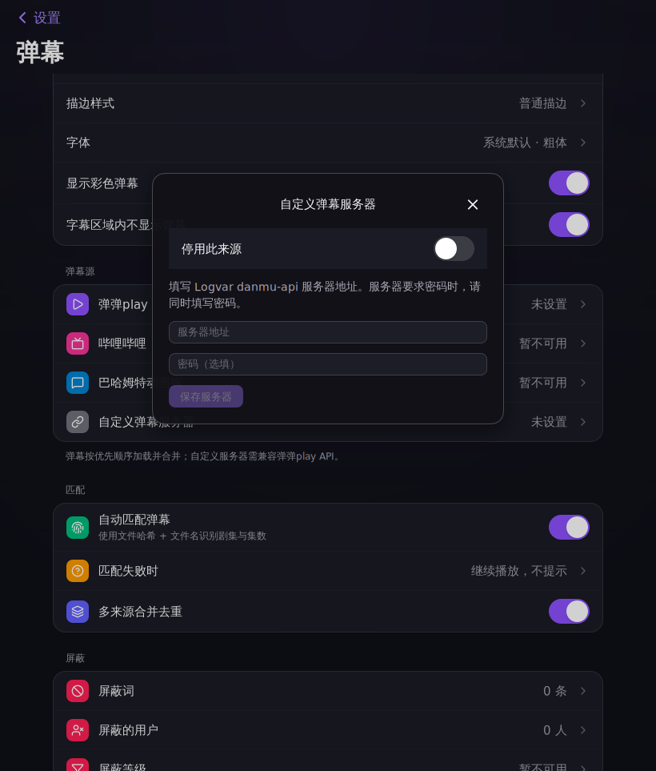
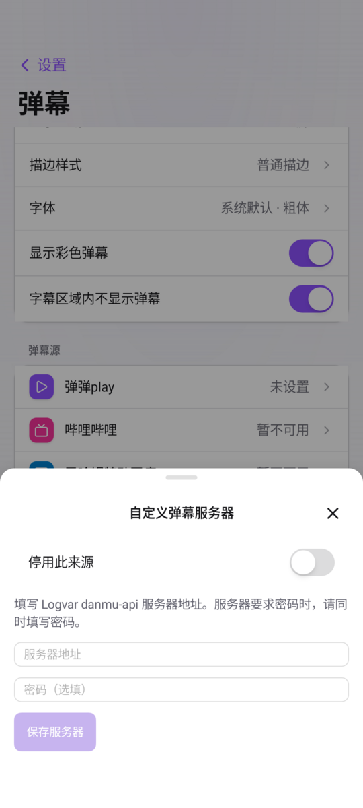
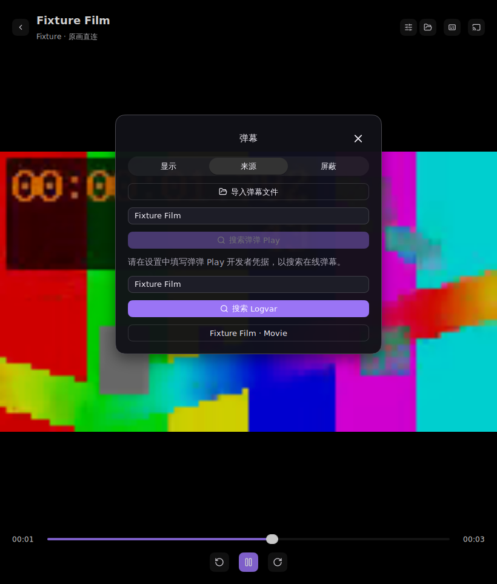

# Phone danmaku settings

The Scenra reference is on the left and the running Linux GTK app is on the right at 390 pt, 1× scale and `zh-Hans`. The comparison starts below the reference’s 44 pt status bar and covers the preview and all five settings groups. The updated source group appears in the Logvar comparison below. [Scenra design](../../design/settings-danmaku.scenra)

| Area | Comparison and verification |
| --- | --- |
| Preview | Both appearances show a rounded 176 pt preview and a shaded area. The reference image has no asset. The app uses the same neutral placeholder and draws the sample comments with the native player’s scheduler and drawing code. Opacity, font size, speed, display area, font weight, color and outline update the preview. The sample text has a visible outline. [NSGo canvas](https://nsgo.dev/docs/canvas/) |
| Basic settings | The primary switch and four sliders precede the display area, outline, system font weight, colored comments and subtitle-area switches. Slider thumb positions reflect the supported playback ranges, which produce different positions from some of the sample fills. The app stores settings for both native playback and libmpv. |
| Sources and matching | DandanPlay supplies its own comments and related comments through the same endpoint. Its matching uses the original file fingerprint when available and falls back to episode search. The custom-server row opens Logvar configuration and uses title and episode numbers for matching. An optional prompt opens manual search when automatic matching returns no result. Standalone Bilibili and Bahamut remain unavailable. [弹弹play开放弹幕网络](https://www.dandanplay.com/) · [DandanPlay API](https://api.dandanplay.net/swagger/index.html) |
| Filters | The app shows saved rule and sender counts. Keywords, regular expressions and exact sender IDs apply before scheduling comments. Bilibili-compatible XML and DandanPlay JSON use their own sender fields. The filter level selector is displayed as unavailable. |
| Sending and cache | The app shows the disk usage for downloaded DandanPlay and Logvar comments and asks for confirmation before clearing them. Local user-authored comments and media files are kept. Public account sign-in and comment sending remain pending. |
| Devices | The comparison uses the native GTK backend at phone width. Phone status bars, touch behavior and rendering on target devices still need verification. |

`TestPhoneDanmakuSettingsReview` captures both appearances and verifies that the preview and saved settings respond to edits. `TestPlayerBindsDandanPlayAndReusesComments` exercises credentials, manual matching, local cache reuse and unlinking with a local API transport. `TestPlayerPromptsForMissingDanmaku` verifies that the manual panel opens when automatic matching fails. The cache and scheduler tests verify clearing, byte counts and filtering both sender formats. [Reproduction commands](README.md)

## Custom Logvar server

The strips show the source group at 390 pt in both appearances. The icon, row, `未设置` state and footer follow the Scenra reference. The test account has no DandanPlay credentials. Bilibili and Bahamut show their unavailable state. [Source group design](../../design/settings-danmaku.scenra)

Choose **自定义弹幕服务器** in **设置 → 弹幕**. Enter the Logvar URL and leave the password blank if the deployment uses no password. A password is stored in the platform secret store. The settings dialog and manual search results reuse the app's dialog controls. Scenra supplies the settings row and matching flow. It has no separate frame for the custom server form. [Danmaku matching flow](../../design/flows/danmaku-matching.scenra) · [Logvar server documentation](https://github.com/huangxd-/danmu_api)

The GTK tests save a password-free configuration and play an automatically matched comment. With a password-protected local fixture, they select a result manually, reopen the video from its stored binding and verify that the offline download path can fetch its linked comments. The Android phone emulator verified the password-free setup and playback. NSGo presents the form as a bottom sheet on the phone. The live test exercises filename match, episode search and comment retrieval with the password-free deployment. Physical device comparison remains open. [Test commands](../../integration/servers/TESTING.md#logvar-danmaku)
