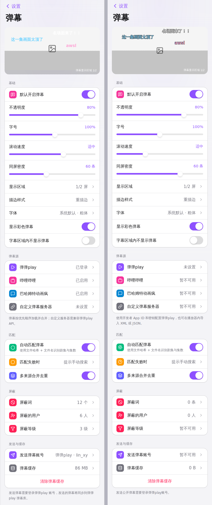
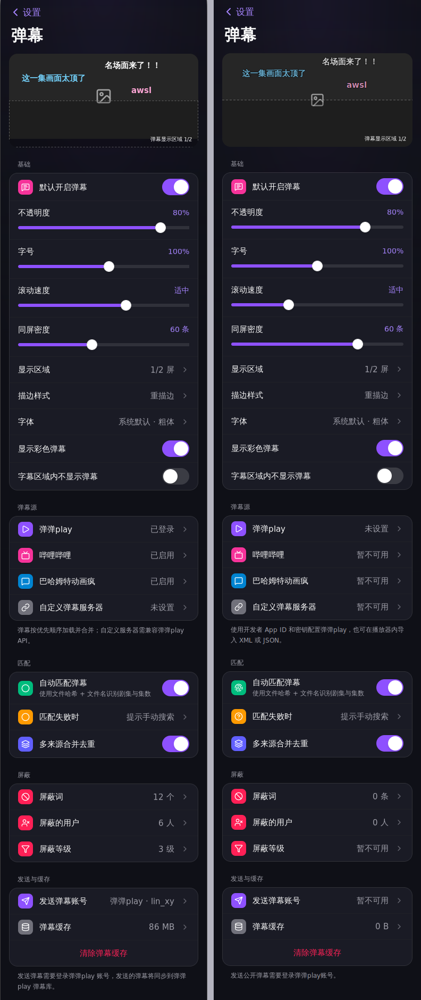

# Phone danmaku settings

The Scenra reference is on the left and the running Linux GTK app is on the right at 390 pt, 1× scale and `zh-Hans`. The comparison starts below the reference’s 44 pt status bar and covers the preview and all five settings groups. The app shows its saved settings and actual cache size. [Scenra design](../../design/settings-danmaku.scenra)

| Area | Comparison and verification |
| --- | --- |
| Preview | Both appearances show a rounded 176 pt preview and a shaded area. The reference image has no asset. The app uses the same neutral placeholder and draws the sample comments with the native player’s scheduler and drawing code. Opacity, font size, speed, display area, font weight, color and outline update the preview. The sample text has a visible outline. [NSGo canvas](https://nsgo.dev/docs/canvas/) |
| Basic settings | The primary switch and four sliders precede the display area, outline, system font weight, colored comments and subtitle-area switches. Slider thumb positions reflect the supported playback ranges, which produce different positions from some of the sample fills. The app stores settings for both native playback and libmpv. |
| Sources and matching | The credentials form saves the app ID and secret into the platform secret store. DandanPlay supplies its own comments and related third-party comments through the same endpoint. The standalone Bilibili, Bahamut and custom-server rows are displayed as unavailable. Auto matching uses the original file fingerprint when available and falls back to episode search. An optional prompt opens the manual search panel when automatic matching returns no result. [弹弹play开放弹幕网络](https://www.dandanplay.com/) · [DandanPlay API](https://api.dandanplay.net/swagger/index.html) |
| Filters | The app shows saved rule and sender counts. Keywords, regular expressions and exact sender IDs apply before scheduling comments. Bilibili-compatible XML and DandanPlay JSON use their own sender fields. The filter level selector is displayed as unavailable. |
| Sending and cache | The app shows the disk usage for downloaded DandanPlay comments and asks for confirmation before clearing them. Local user-authored comments and media files are kept. Public account sign-in and comment sending remain pending. |
| Devices | The comparison uses the native GTK backend at phone width. Phone status bars, touch behavior and rendering on target devices still need verification. |

`TestPhoneDanmakuSettingsReview` captures both appearances and verifies that the preview and saved settings respond to edits. `TestPlayerBindsDandanPlayAndReusesComments` exercises credentials, manual matching, local cache reuse and unlinking with a local API transport. `TestPlayerPromptsForMissingDanmaku` verifies that the manual panel opens when automatic matching fails. The cache and scheduler tests verify clearing, byte counts and filtering both sender formats. [Reproduction commands](README.md)
