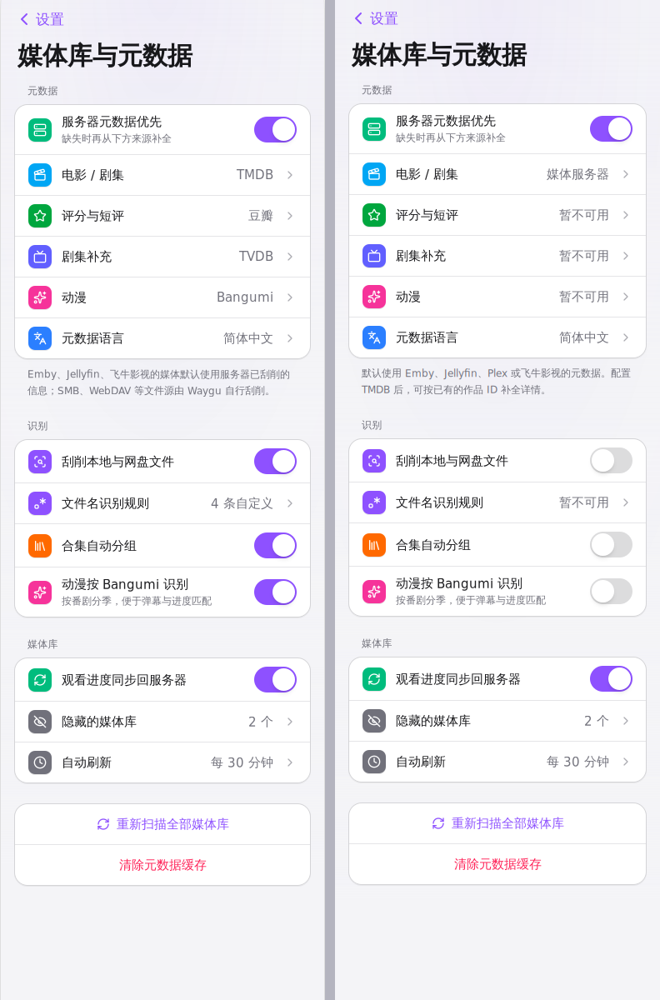
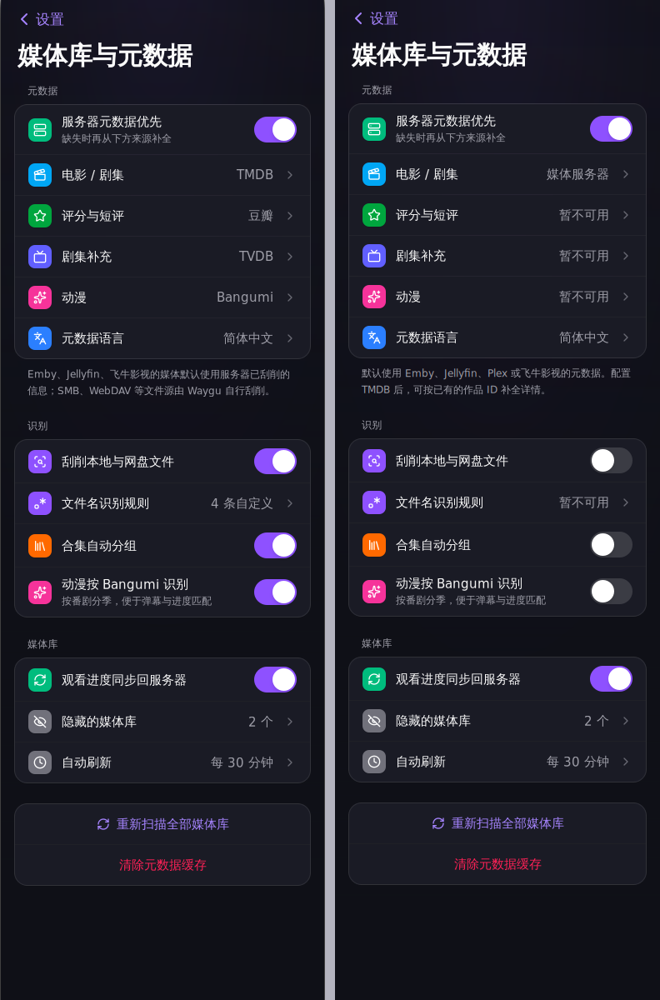

# Phone Library and metadata

The Scenra reference is on the left and the running Linux GTK app is on the right at 390 pt, 1× scale and `zh-Hans`. Each image starts below the reference’s 44 pt status bar and includes both actions at the bottom. The media libraries and preferences in the capture come from test fixtures. [Scenra design](../../design/settings-library.scenra)

| Area | Comparison and verification |
| --- | --- |
| Metadata sources | The two appearances preserve the group order, icons and selector placement. The film and series row shows the media server until a TMDB API read token is saved. TMDB is optional and uses an existing TMDB or IMDb title ID. It can fill blank details or supply the preferred title, synopsis and artwork. Server IDs, user data, ratings and parental classification are preserved. The language selector determines the locale requested from TMDB. Requests and artwork URLs were verified with API fixtures. A real TMDB account was not used. [TMDB lookup by ID](https://developer.themoviedb.org/reference/find-by-id) · [TMDB language codes](https://developer.themoviedb.org/docs/languages) |
| Identification | The separate Douban, TVDB and Bangumi sources and the identification settings remain unavailable. The reference displays enabled identification switches and sample rule counts. The app displays the current availability. File and cloud sources remain outside this milestone. |
| Library controls | The hidden library count reflects imported libraries. Restoring a hidden library preserves its category. Automatic refresh checks the catalog and reconciles imports at the selected interval while the app runs. Existing categories and visibility are retained, and newly discovered libraries are hidden. Playback progress saved while sync is off stays on the device when sync is restored. The simulated playback check verifies the saved position by reopening the player from Details. |
| Rescan and cache | The confirmed action refreshes the app’s imports and asks Emby, Jellyfin and Plex to begin a server-side scan where the current account permits it. The reported status distinguishes an accepted request from a refreshed list. Flymoo currently refreshes its list. The three Docker servers accepted scan requests and still returned their imported libraries. The cache action clears the session’s TMDB lookup cache. [Emby library refresh](https://dev.emby.media/reference/RestAPI/LibraryService/postLibraryRefresh.html) · [Jellyfin library refresh](https://typescript-sdk.jellyfin.org/classes/generated-client.LibraryApi.html#refreshLibrary) · [Plex section refresh](https://developer.plex.tv/pms/) |
| Devices | The compact layout is compared on the native GTK backend. The desktop and TV settings link to the same feature. Phone device captures and TV remote verification remain pending. |

`TestPhoneLibraryMetadataReview` captures both appearances and exercises saving the token in the credential store, retaining hidden and categorized libraries during a rescan, clearing the cache, and reloading at the scheduled interval. `TestMetadataPlaybackRemainsLocalWhenSyncDisabled` verifies that local playback can resume and that the opted-out progress is absent from live reports and recovery requests. `TestEnrichChecksTitleIDsLanguageAndCache` verifies the request and cache behavior. [Reproduction commands](README.md)
