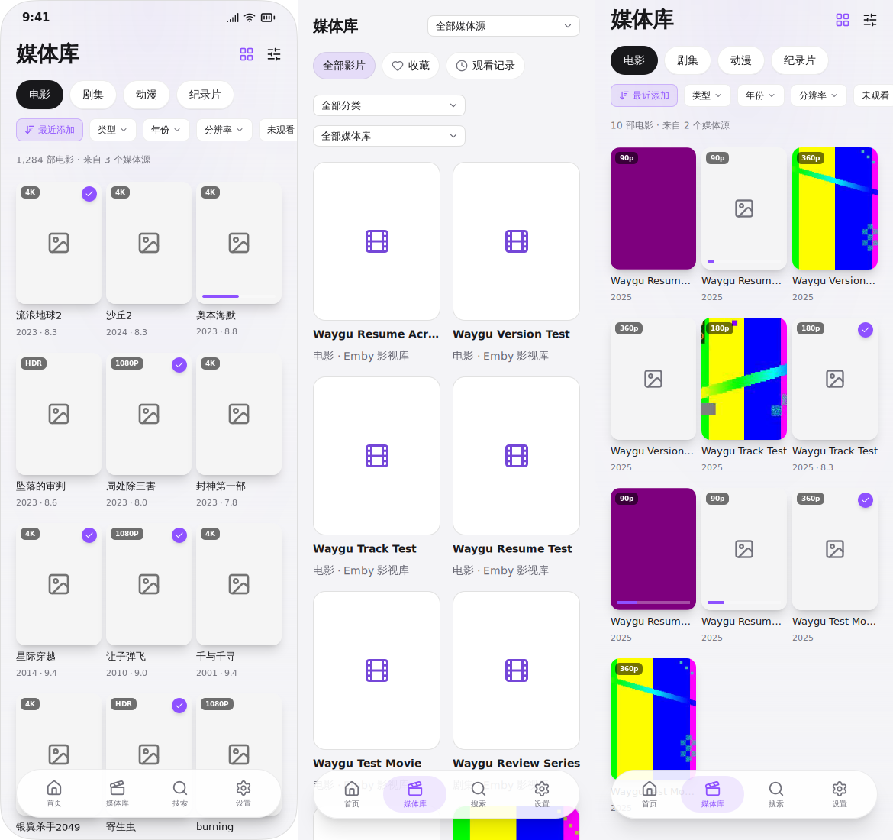
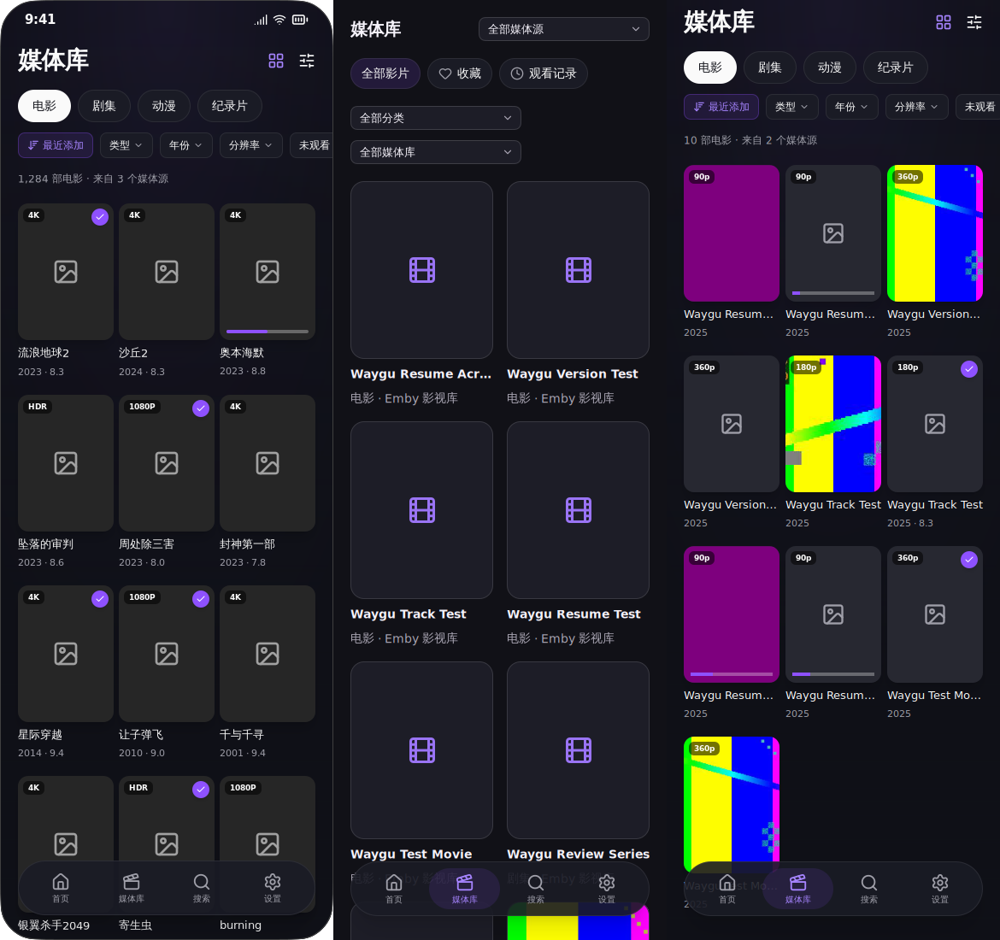
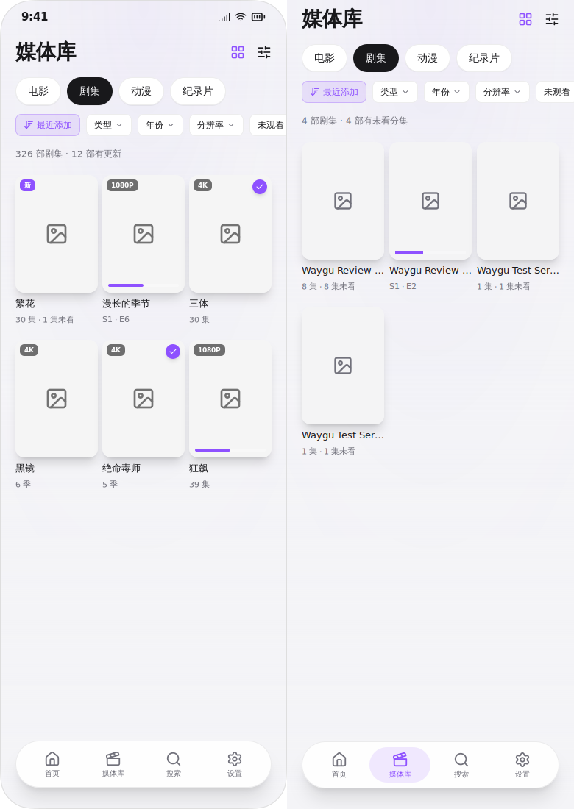
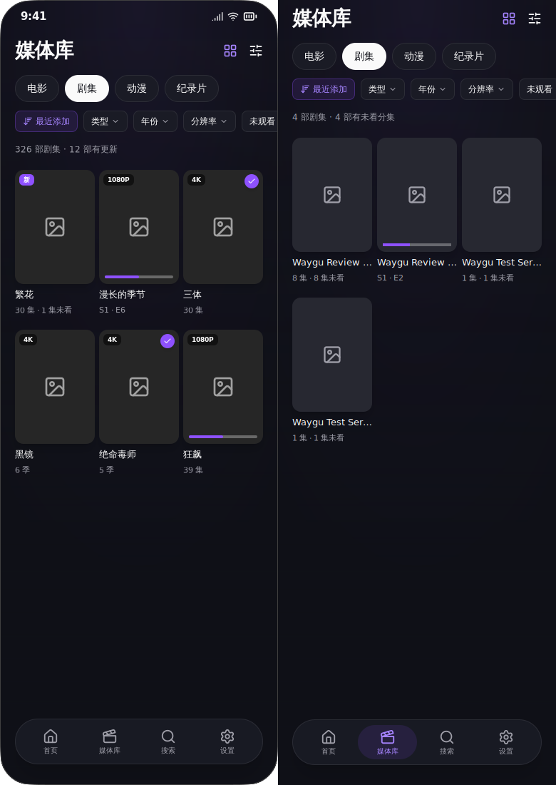
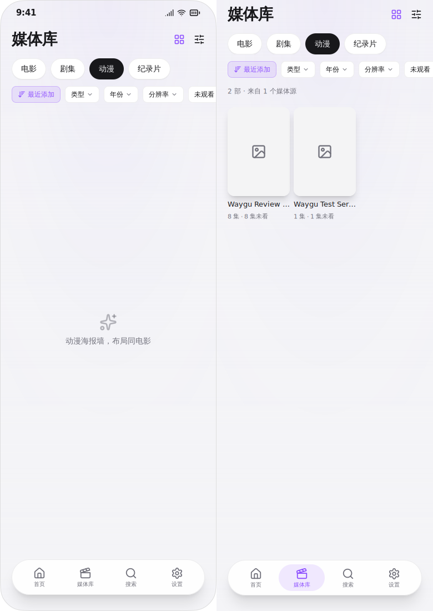
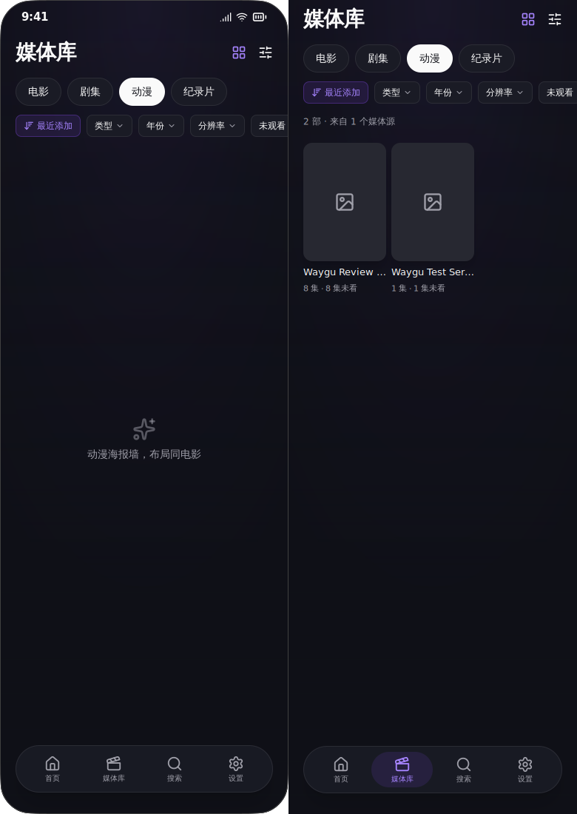
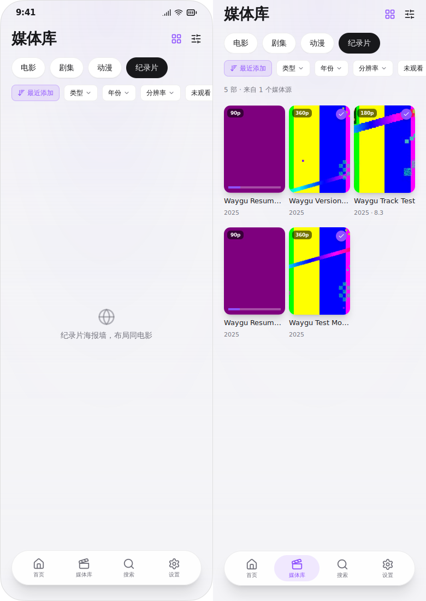
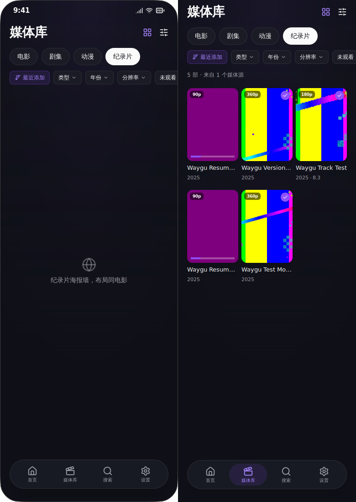
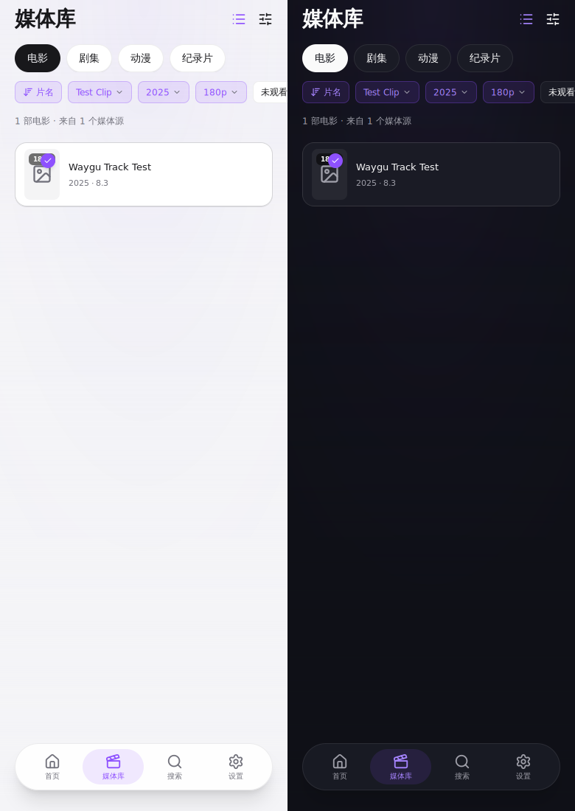
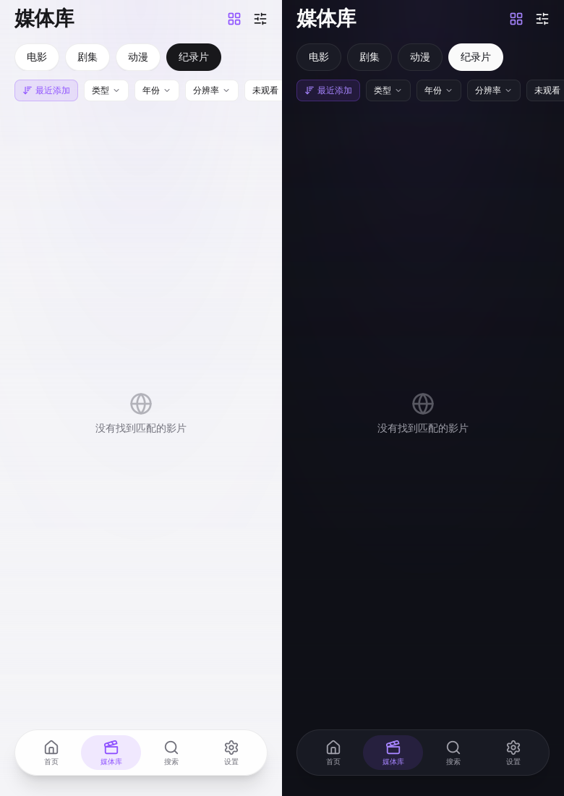

# Phone library review

[Scenra design](../../design/library.scenra) · 390 × 1100 pt · Linux GTK at 1× scale · `zh-Hans` · Scenra `88548db091cd`. The movie strips show the reference, the previous app, and the current app. The other category strips show the reference and current app.

## Movies

## Series

## Anime

## Documentaries

## Additional states

## Findings

| Area | Result |
| --- | --- |
| Navigation and filters | The title, category pills, and filter chips use the design dimensions and colors. The filter sheet contains source and collection choices and access to favorites and history. The Scenra file specifies the filter icon. The app supplies the sheet controls. GTK has no 44 pt mobile status bar. The app highlights Library in the shared bottom bar. |
| Poster wall | The 390 pt fixture measures 112 × 160 pt for each poster, with three columns and the watched, progress and quality treatments. Image content and supplied formats vary by source. A title can contribute a resolution from any visible copy. |
| Metadata | Real series data provides episode counts, unwatched counts and the active episode bookmark. The list preview retains the layout and filters after opening and closing a title. Movie counts reflect the merged results from the chosen sources. Large collections show a partial count while later pages load. |
| Anime and documentaries | The design uses placeholders for both panels and specifies movie-style poster walls. The app shows the same poster layout when a category contains titles. This review assigns the two Jellyfin fixture libraries to anime and documentaries using the app's category overrides. The empty state uses the panel icon. |

`TestDockerPhoneLibraryReview` exercises category, source, collection, year, genre, resolution, watch-state and layout controls with three servers. `TestDockerLibraryFormats` reads real format metadata from Emby, Jellyfin and Plex. The multi-page test finds a matching title beyond item 200. Device screenshots and metadata available only from a separate Flymoo playback lookup remain pending. [Fixture setup](../../integration/servers/TESTING.md) · [Capture commands](README.md)
