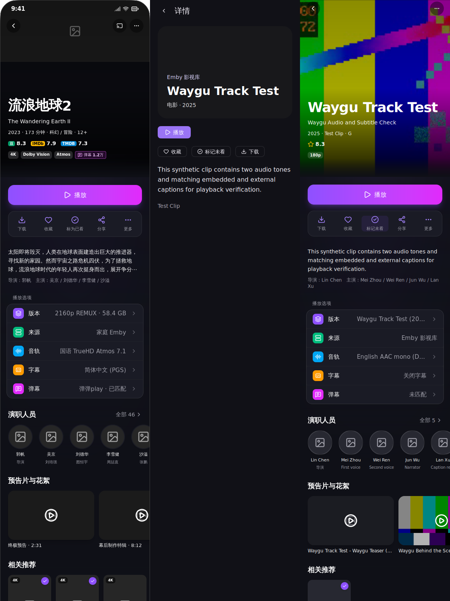
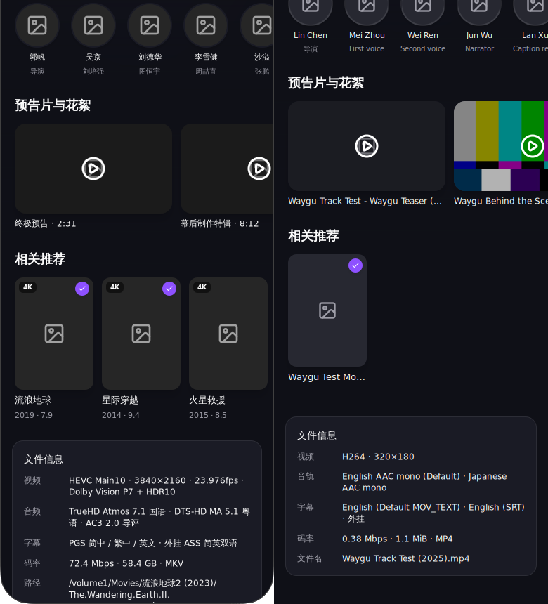
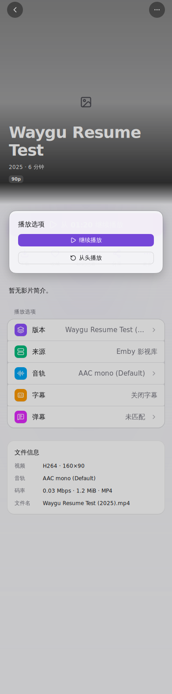

# Phone movie detail review

[Scenra design](../../design/movie-detail.scenra) · 390 pt wide · Linux GTK at 1× scale · `zh-Hans`. Scenra version `88548db091cd`. Each top strip shows the design, the previous app, and the current app. The bottom strips show the design and current app after scrolling to the end. The requested 1960 pt canvas is taller than this GTK test window, so the captures overlap.

## Light appearance

## Dark appearance

## Findings

| Area | Result |
| --- | --- |
| Hero | The 460 pt backdrop, scrims, circular navigation and bottom-aligned title follow the design. GTK has no mobile system status bar, so its buttons sit higher than the reference. Casting remains pending. The server score uses a single star. Individual rating provider badges and the danmaku count pill remain pending. |
| Actions | The test measures the 52 pt play button. The action strip uses the design's five cells with Emby. Source capabilities control favorite and watched actions. The tested resume sheet starts from zero. Sharing sends the title through the system share sheet. The more menu reloads details and offers restart when applicable. Editing, metadata rematching, and server deletion remain pending. |
| Playback options | The five stacked rows use the settings colors and icons. Sources, versions, audio and subtitle choices pass through to the shared playback resolver. Chevrons indicate available choices. Manual danmaku matching opens the existing search and binding UI. The details page can show the saved binding. |
| Credits and rails | Credits, the cast list, playable server extras and same-library recommendations use real fixture data. The recommendation rail falls back to titles sharing a genre from the same library when the server supplies no relevant items. Card quantities and artwork vary with the source. |
| File information | The card shows video dimensions and codec, available track descriptions, bitrate, size and container. It shows the media file's name. Full path, frame-rate and profile details remain pending. |

`TestDockerPhoneMovieReview` verifies the cast list, danmaku matching entry, track choices, recommendation navigation and long-press restart. The GTK run opens the local trailer and confirms that the playback clock advances. `TestDockerMovieFeatures` checks the server endpoints and resolves local extra clips from Emby and Jellyfin. The unclaimed Plex fixture returned an empty extras list. Real devices and Plex extras playback remain pending. [Capture commands](README.md) · [Fixture setup](../../integration/servers/TESTING.md)
