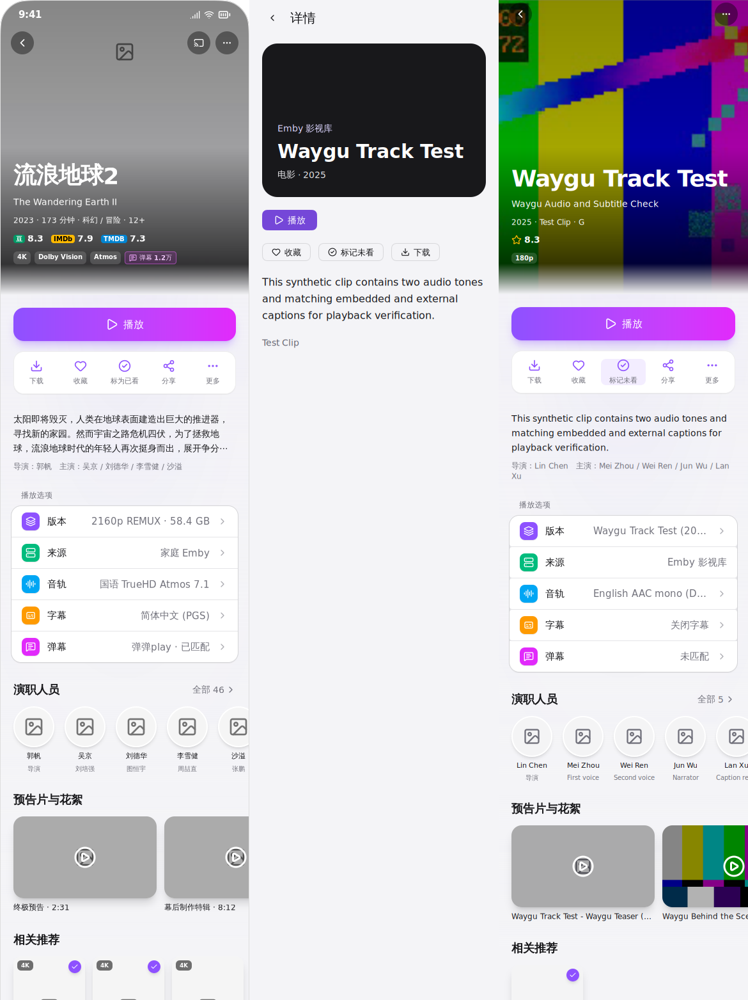
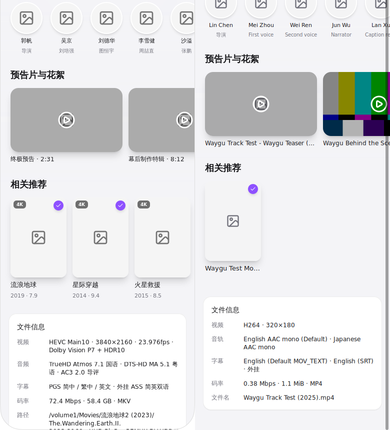
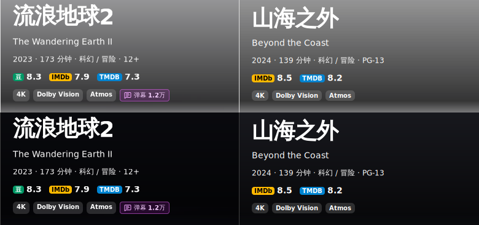
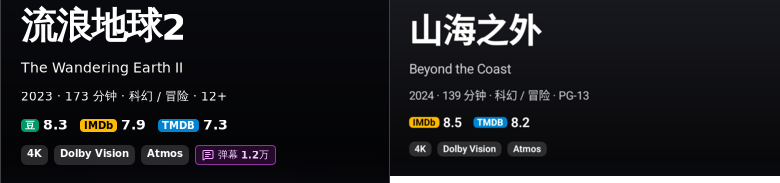
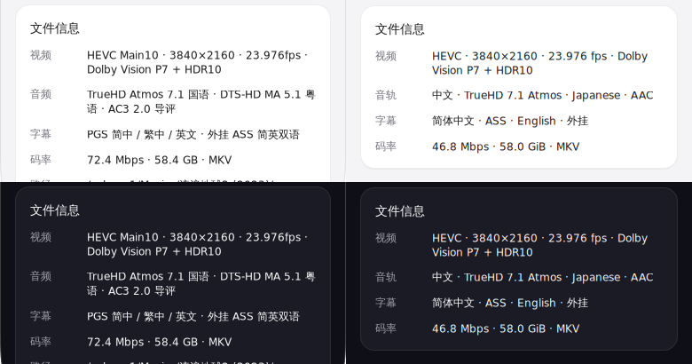
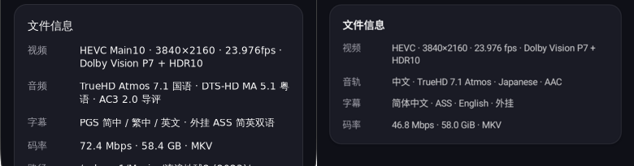

# Phone movie detail review

[Scenra design](../../design/movie-detail.scenra) · 390 pt wide · Linux GTK at 1× scale · `zh-Hans`. Scenra version `88548db091cd`. Each top strip shows the design, the previous app, and the current app. The bottom strips show the design and current app after scrolling to the end. The requested 1960 pt canvas is taller than this GTK test window, so the captures overlap.

## Light appearance





## Dark appearance


## Findings

| Area | Result |
| --- | --- |
| Hero | The 460 pt backdrop, scrims, circular navigation and bottom-aligned title follow the design. GTK has no mobile system status bar, so its buttons sit higher than the reference. The cast icon opens the DLNA picker. The hero shows named IMDb and TMDB ratings, marks Atmos when the selected rendition reports it and shows the number of playable comments. The Douban score remains pending. [Casting comparison](casting.md) · [Badges](#rating-badges) |
| Actions | The test measures the 52 pt play button. The action strip uses the design's five cells with Emby. Source capabilities control favorite and watched actions. The tested resume sheet starts from zero. Sharing sends the title through the system share sheet. The more menu reloads details and offers restart when applicable. Editing, metadata rematching, and server deletion remain pending. |
| Playback options | The five stacked rows use the settings colors and icons. Sources, versions, audio and subtitle choices pass through to the shared playback resolver. Chevrons indicate available choices. The danmaku row names matched sources and opens the DandanPlay and configured Logvar search forms. [Danmaku counts](#danmaku-counts) |
| Credits and rails | Credits, the cast list, playable server extras and same-library recommendations use real fixture data. The recommendation rail falls back to titles sharing a genre from the same library when the server supplies no relevant items. Card quantities and artwork vary with the source. |
| File information | The card shows codec, dimensions, frame rate, dynamic range and Dolby Vision profile when available. It includes the track descriptions, bitrate, size, container and file name. [Video range](#video-range) |


`TestDockerPhoneMovieReview` verifies the cast list, danmaku matching entry, track choices, recommendation navigation and long-press restart. The GTK run opens the local trailer and confirms that the playback clock advances. `TestDockerMovieFeatures` checks the server endpoints and resolves local extra clips from Emby and Jellyfin. The unclaimed Plex fixture returned an empty extras list. Real devices and Plex extras playback remain pending. [Capture commands](README.md) · [Fixture setup](../../integration/servers/TESTING.md)

## Rating badges



The crops show Scenra on the left and the GTK phone layout on the right, with light above dark. IMDb and TMDB use the design's colored labels with scores to one decimal place. The fixture selects a 4K Dolby Vision version with an Atmos audio track. `TestPhoneMovieRatingReview` verifies both appearances and `TestDockerPhoneMovieReview` checks the standalone star against Emby's 8.3 community score. [Desktop presentation and data sources](desktop-movie.md#rating-badges)



The dark capture shows the same rating and danmaku badges on the Android 15 phone emulator. The right crop is scaled to the reference width.

```sh
sh build/android/package.sh test -device <serial> \
  -run '^TestPhoneMovieRatingReview$/^dark$' -screenshots .nsgo/ui-review/phone-movie-ratings-android
```

## Danmaku counts

The fuchsia pill in the hero comparisons shows 1.2万 from a fixture with 12,000 playable comments. It sums the known counts from matched DandanPlay and Logvar sources. A downloaded title shows the number of comments saved with its local file. The matching test verifies changes and unbinding through the movie detail dialog. [Desktop card and tests](desktop-movie.md#danmaku-counts)

## Video range



Scenra is on the left in both comparisons. The GTK crops show light above dark. The selected version reports 23.976 fps, Dolby Vision P7 and a compatible HDR10 layer. The phone hero uses the short Dolby Vision badge. [Desktop comparison and media server tests](desktop-movie.md#video-range)



The Android 15 crop is scaled to the 390 pt reference width. Android draws the card heading heavier than Scenra and wraps the video row after the plus sign. The GTK and Android fixture responses have no phone file name, so their cards end at the bitrate row.
