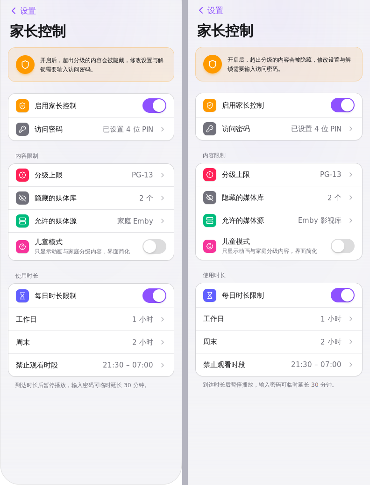
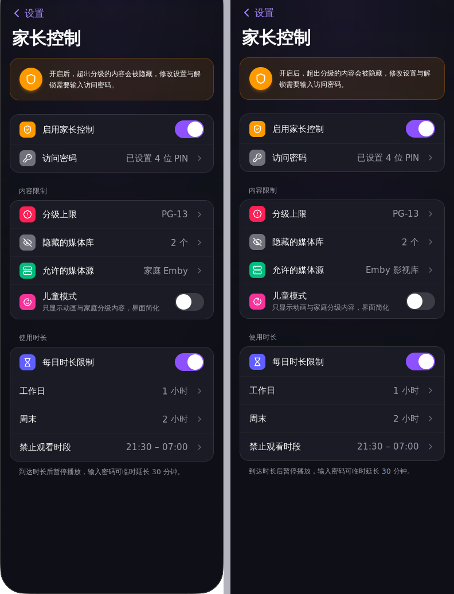

# Phone parental controls

Scenra is on the left and the Linux GTK app is on the right at 390 pt, once in each appearance. The comparison starts below the design's 44 pt status bar. The phone frame is visible at the design edges. The running page uses the Chinese catalog and the local Docker library names. [Scenra design](../../design/settings-parental.scenra)

| Area | Comparison and verification |
| --- | --- |
| Layout | The shared navigation bar, warning card, three settings groups, colored row icons, switches and viewing-time footer use the reference order and spacing in both appearances. GTK captures the app viewport. Native phone status bars and device rendering remain to be checked. |
| Access PIN | Enabling controls first asks for a four-digit PIN and confirmation. Changes require it after returning to the page. The PIN verifier is kept in the platform secret store. Source setup and connection changes accessible through the server wizard also require the PIN while restrictions are active. [NSGo platform secret store](https://nsgo.dev/docs/services/) |
| Content | Limits apply to catalog and search results, resumed titles, recommendations, downloaded titles and playback. Restricted sources and libraries are filtered using the saved identifiers. Tests confirm Emby and Jellyfin return the age rating from the G-rated video fixture and an unrated Emby fixture is hidden. Searches can show locked placeholders for unrated titles, with a PIN prompt before revealing or playing that title. Approvals last for the app session. |
| Rating and kids mode | The selected ceiling uses recognized US film and TV ratings. Other rating systems and providers without a rating are treated as unrated. Kids mode permits general-audience titles and PG family or animation titles, and simplifies personal shortcuts on supported layouts. [Emby item fields](https://dev.emby.media/doc/restapi/Item-Information.html) · [Plex metadata model](https://developer.plex.tv/pms/) |
| Viewing time | The app counts time while media is playing and stores daily usage on the device. Weekday and weekend allowances differ. The blocked schedule can cross midnight. Running out pauses the player, and the correct PIN adds 30 minutes to that day's allowance. Quiet hours still apply. When viewing limits are enabled, picture-in-picture is disabled so playback stays under the same controls. Settings and usage are local to the device. |

`TestPhoneParentalControlsAndPlaybackLimit` configures the PIN through the app, hides a library, checks missing posters, approves a masked search result, and exercises pausing and the PIN-protected extension using the simulated video clock. It verifies source setup prompts for a PIN after returning to Settings. `TestParentalRules` covers rating decisions and the overnight schedule. `TestDockerPhoneParentalReview` captures both themes and verifies source permissions alongside metadata from the local fixtures. The same rules run on tablet, desktop and TV. The desktop and TV navigation tests open the parental controls entry points. The TV settings route currently opens the shared form, whose remote and on-screen keyboard behavior still needs device verification. [Reproduction commands](README.md)
