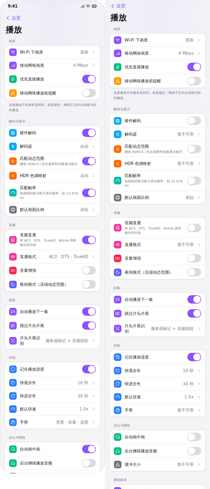
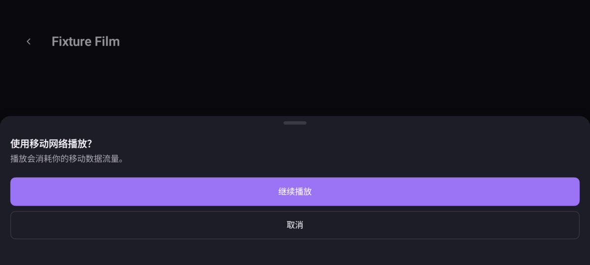
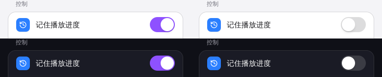
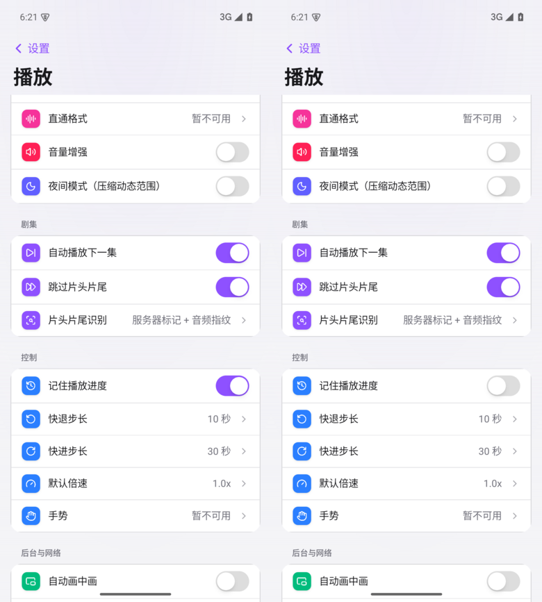
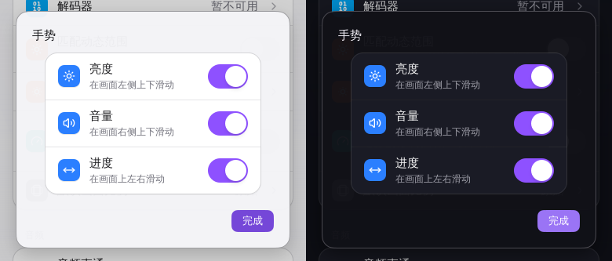
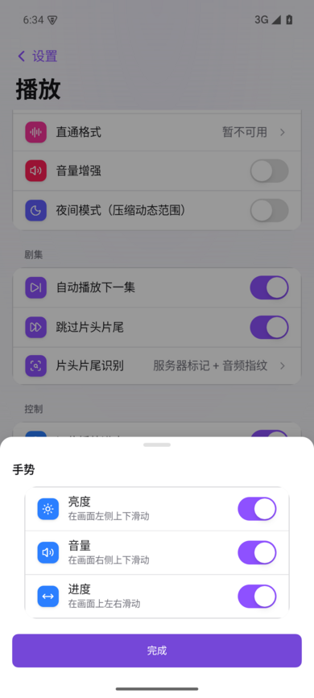
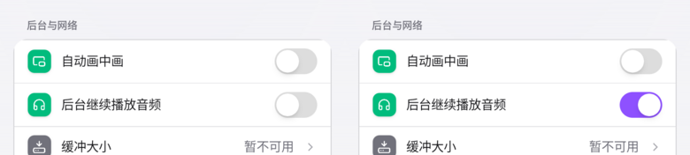
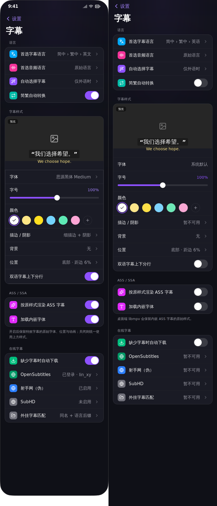

# Phone playback and subtitle settings

390 pt wide · Linux GTK at 1× scale · `zh-Hans` · Scenra `88548db091cd`. Each main image shows the design on the left and the app on the right. The light and dark language editor captures show the saved order after adding, removing and moving languages. [Playback design](../../design/settings-playback.scenra) · [Subtitle design](../../design/settings-subtitles.scenra)

## Playback

The quality group shows the Wi-Fi and mobile data values from separate preferences. The defaults are Original and 4 Mbps. Changing one value leaves the other at its saved value. When the mobile data warning is enabled, opening a title on cellular waits for Continue playing or Cancel before starting playback.

Prefer direct play defaults to on and shares its saved value with desktop settings. Turning it off asks Emby, Jellyfin and Plex to transcode from the start, including after a version or audio change. With it on, the selected bitrate, rendition and decoder capabilities can still require transcoding. Throughput measurement and switching playback methods midstream remain pending. [Docker playback evidence](../../integration/servers/TESTING.md#streaming-quality)

The Pixel 7 emulator check used Android 15. With Wi-Fi active the fixture requested the saved 1080p and 20 Mbps Wi-Fi profile. After switching the emulator's default network to cellular, the same test requested the saved 720p and 8 Mbps cellular profile. The screenshot records the warning before a stream opens. The test checks Continue and Cancel through the native screen. [Android test commands](../../build/android/PACKAGING.md)

### Remember playback progress

The Controls group uses the design's history icon, 28 pt badge and 51 × 31 pt switch. These GTK crops show the enabled state on the left and the disabled state on the right, with light above dark.

On the Android 15 Pixel 7 emulator, the test scrolled to Controls, tapped the switch, and checked the saved state after reopening the page. The installed x86-64 APK kept the saved value after its process restarted. The system screenshots show the actual rounded group corners and status bar. NSGo's software screenshots show square group corners when the capture bypasses Android's hardware clipping. [Capture commands](README.md)

The switch defaults to on. Turning it off prevents future playback sessions from saving or sending new progress and from changing an existing resume point for a download. Existing resume points and manual watched actions remain available. Enabling it again restores progress recording and honors the source's writeback setting. [Docker progress evidence](../../integration/servers/TESTING.md#remember-playback-progress) · [Per-source writeback](phone-sync-accounts.md)

### Playback gestures

The Gestures row uses the design's hand badge, right chevron and default summary, “亮度 · 音量 · 进度”. The design shows the entry. The app opens its standard dialog or touch sheet to set the three swipes individually. The summary lists the enabled swipes. The screenshots show the dialog in GTK light and dark appearance. [Scenra playback settings](../../design/settings-playback.scenra#L46) · [NSGo dialog](https://nsgo.dev/docs/ui/dialog/)

The Pixel 7 Android 15 system screenshot records the bottom sheet. Disabling volume and closing the sheet changes the summary to “亮度 · 进度”.

The player uses the saved options from the start of each session. Tap controls, double tap, hold for 2× and timeline dragging remain available, and screen lock continues to block surface gestures. [Player gesture evidence](phone-player.md)

### Background audio

The installed x86-64 APK matches the Scenra row's position under auto Picture in Picture, green headphone badge and default off switch. The screenshots also show the selected accent in the on state. The buffer size row below still displays “暂不可用” on Android. The packaged playback test uses a synthetic H.264/AAC clip to exercise Home, system pause and return to the activity. [Scenra background and network group](../../design/settings-playback.scenra#L49)

Enabling the switch starts a media playback service while the player is visible. The audio continues from the same decoder after pressing Home, and the system media control can pause it. Returning to the app after pausing preserves the position and pause state. The Android player pauses in the background when the switch is off or the service cannot start. [Android build and checks](../../build/android/PACKAGING.md) · [Android background playback](https://developer.android.com/media/platform/mediaplayer/background)

Ordinary iOS background audio remains pending because the current NSGo video backend pauses the player when the app enters the background. iOS Picture in Picture continues to use its own native playback path. [NSGo Picture in Picture](https://nsgo.dev/docs/picture-in-picture/)

## Subtitles

## Findings

| Area | Result |
| --- | --- |
| Header and groups | Both app pages use the 44 pt back row, 30 pt title, 16 pt group margin, 28 pt badges and 51 × 31 pt switches. GTK lacks the design's mobile status bar and rounded device frame. App content starts about 44 pt higher. |
| Playback quality and version | The player picks the network profile when opening a streamed title. Its presets cap the resolution and bitrate on Emby, Jellyfin and Plex. The app retains a playback version section below the designed groups. The reference frame clips the end of the background and network group. |
| Playback controls | The two network quality values, direct play preference, cellular warning, auto-next, skipping intros and credits, progress recording, screen swipes, speed, rewind and forward intervals, picture mode and Android background audio save immediately. Decoder and HDR settings, passthrough, volume boost, night mode, and buffer controls still need implementation. |
| Intro and credit detection | The episode group has the violet badge and the 51 × 31 pt switch shown in both appearances. The detection row displays the design’s server-marker and audio-fingerprint label. The player uses typed markers and named chapters first. A missing range can be inferred from recurring audio in two other episodes from the same season. [Playback evidence](phone-player.md#intro-and-credit-skips) |
| Picture in Picture | Automatic entry is wired to the iOS video backend. The GTK capture shows the unavailable switch. iPhone and iPad behavior remains to be checked. |
| Subtitle languages and style | The first language with a matching text track wins. The app previews the chosen size, color, background and position, uses the system font and provides a custom color picker. The Scenra preview has an unresolved image and both captures show its placeholder. Font selection, outline customization, Simplified and Traditional conversion, bilingual display, ASS switches, online subtitle services and sidecar matching remain pending. Plain-text preferences apply to the app's caption overlay. |
| Integration | The settings test covers navigation, auto-next, disabling intro and credit skips, speed and seek choices, preset and custom colors, and changing the subtitle language priority. The Docker test verifies Japanese audio and English subtitle fallback on Emby and Jellyfin, with the player obtaining a scaled rendered caption and the configured speed, aspect and seek intervals. Native GTK video decoding passed separately. |

Android's launcher asks ConnectivityManager for its active network. iPhone and iPad use a Network framework path monitor. Apple TV uses the Wi-Fi/default profile for Wi-Fi and Ethernet. HarmonyOS uses the connection type reported by ArkWeb when available. An unavailable transport also uses the Wi-Fi/default profile. The application-level test changes the reported transport, checks its requested bitrate and height, and verifies that cancelling the warning sends no playback request. [Android network state](https://developer.android.com/reference/android/net/ConnectivityManager) · [Apple Network framework](https://developer.apple.com/documentation/network/network-functions) · [Apple TV network requirements](https://support.apple.com/guide/tv/set-up-apple-tv-4k-atvb73e46488/tvos) · [Network Information API](https://wicg.github.io/netinfo/)

The iPhone 17 Pro and iPad Pro simulators received the initial Network framework update, navigated onboarding and decoded the fixture. The Apple TV simulator passed navigation, app name and decoding. The separate cellular test stopped before the tvOS test host started. The current test suite runs the monitor case on iPhone and iPad and checks the default profile in the Apple TV navigation test. That tvOS assertion awaits the next Apple run. Real cellular verification on iPhone and iPad and transport reporting on HarmonyOS remain pending. [Apple simulator run](https://github.com/vicnoah/waygu-video/actions/runs/45073659510)

The full settings page comparisons use GTK. Full-page captures on mobile devices remain pending. [Capture commands](README.md) · [Docker fixtures](../../integration/servers/TESTING.md)
