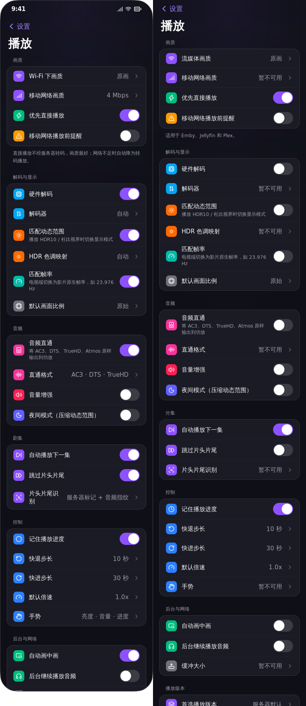

# Phone playback and subtitle settings

390 pt wide · Linux GTK at 1× scale · `zh-Hans` · Scenra `88548db091cd`. Each main image shows the design on the left and the app on the right. The light and dark language editor captures show the saved order after adding, removing and moving languages. [Playback design](../../design/settings-playback.scenra) · [Subtitle design](../../design/settings-subtitles.scenra)

## Playback

## Subtitles

## Findings

| Area | Result |
| --- | --- |
| Header and groups | Both app pages use the 44 pt back row, 30 pt title, 16 pt group margin, 28 pt badges and 51 × 31 pt switches. GTK lacks the design's mobile status bar and rounded device frame. App content starts about 44 pt higher. |
| Playback quality and version | The quality limit applies to Emby, Jellyfin and Plex. The app uses one network-wide preference and retains a separate playback version section below the designed groups. The reference frame clips the end of the background and network group. |
| Playback controls | Auto-next, speed, rewind and forward intervals, and picture mode save immediately. Direct play preference and progress reporting are fixed on. Cellular settings, decoder and HDR settings, passthrough, volume boost, night mode, intro detection, gestures, background audio, and buffer controls still need implementation. |
| Picture in Picture | Automatic entry is wired to the iOS video backend. The GTK capture shows the unavailable switch. iPhone and iPad behavior remains to be checked. |
| Subtitle languages and style | The first language with a matching text track wins. The app previews the chosen size, color, background and position, uses the system font and provides a custom color picker. The Scenra preview has an unresolved image and both captures show its placeholder. Font selection, outline customization, Simplified and Traditional conversion, bilingual display, ASS switches, online subtitle services and sidecar matching remain pending. Plain-text preferences apply to the app's caption overlay. |
| Integration | The settings test covers navigation, auto-next, speed and seek choices, preset and custom colors, and changing the subtitle language priority. The Docker test verifies Japanese audio and English subtitle fallback on Emby and Jellyfin, with the player obtaining a scaled rendered caption and the configured speed, aspect and seek intervals. Native GTK video decoding passed separately. |

The comparisons record layout and behavior in the GTK harness. Phone device screenshots and the unsupported design interactions remain pending. [Capture commands](README.md) · [Docker fixtures](../../integration/servers/TESTING.md)
