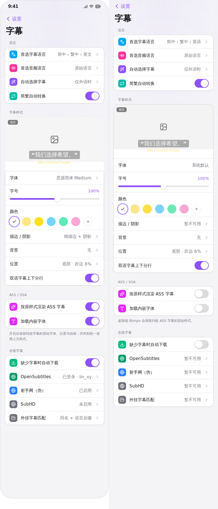
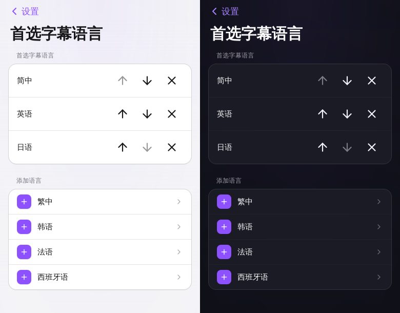

# Phone playback and subtitle settings

390 pt wide · Linux GTK at 1× scale · `zh-Hans` · Scenra `88548db091cd`. Each main image shows the design on the left and the app on the right. The light and dark language editor captures show the saved order after adding, removing and moving languages. [Playback design](../../design/settings-playback.scenra) · [Subtitle design](../../design/settings-subtitles.scenra)

## Playback

The quality group shows the Wi-Fi and mobile data values from separate preferences. The defaults are Original and 4 Mbps. Changing one value leaves the other at its saved value. When the mobile data warning is enabled, opening a title on cellular waits for Continue playing or Cancel before starting playback.

Prefer direct play defaults to on and shares its saved value with desktop settings. Turning it off asks Emby, Jellyfin and Plex to transcode from the start, including after a version or audio change. With it on, the selected bitrate, rendition and decoder capabilities can still require transcoding. Throughput measurement and switching playback methods midstream remain pending. [Docker playback evidence](../../integration/servers/TESTING.md#streaming-quality)

The Pixel 7 emulator check used Android 15. With Wi-Fi active the fixture requested the saved 1080p and 20 Mbps Wi-Fi profile. After switching the emulator's default network to cellular, the same test requested the saved 720p and 8 Mbps cellular profile. The screenshot records the warning before a stream opens. The test checks Continue and Cancel through the native screen. [Android test commands](../../build/android/PACKAGING.md)

## Subtitles

## Findings

| Area | Result |
| --- | --- |
| Header and groups | Both app pages use the 44 pt back row, 30 pt title, 16 pt group margin, 28 pt badges and 51 × 31 pt switches. GTK lacks the design's mobile status bar and rounded device frame. App content starts about 44 pt higher. |
| Playback quality and version | The player picks the network profile when opening a streamed title. Its presets cap the resolution and bitrate on Emby, Jellyfin and Plex. The app retains a playback version section below the designed groups. The reference frame clips the end of the background and network group. |
| Playback controls | The two network quality values, direct play preference, cellular warning, auto-next, skipping intros and credits, speed, rewind and forward intervals, and picture mode save immediately. Progress reporting is fixed on. Decoder and HDR settings, passthrough, volume boost, night mode, gestures, background audio, and buffer controls still need implementation. |
| Intro and credit detection | The episode group has the violet badge and the 51 × 31 pt switch shown in both appearances. The detection row displays the design’s server-marker and audio-fingerprint label. The player uses typed markers and named chapters first. A missing range can be inferred from recurring audio in two other episodes from the same season. [Playback evidence](phone-player.md#intro-and-credit-skips) |
| Picture in Picture | Automatic entry is wired to the iOS video backend. The GTK capture shows the unavailable switch. iPhone and iPad behavior remains to be checked. |
| Subtitle languages and style | The first language with a matching text track wins. The app previews the chosen size, color, background and position, uses the system font and provides a custom color picker. The Scenra preview has an unresolved image and both captures show its placeholder. Font selection, outline customization, Simplified and Traditional conversion, bilingual display, ASS switches, online subtitle services and sidecar matching remain pending. Plain-text preferences apply to the app's caption overlay. |
| Integration | The settings test covers navigation, auto-next, disabling intro and credit skips, speed and seek choices, preset and custom colors, and changing the subtitle language priority. The Docker test verifies Japanese audio and English subtitle fallback on Emby and Jellyfin, with the player obtaining a scaled rendered caption and the configured speed, aspect and seek intervals. Native GTK video decoding passed separately. |

Android's launcher asks ConnectivityManager for its active network. iOS uses a Network framework path monitor. HarmonyOS uses the connection type reported by ArkWeb when available. An unavailable transport uses the Wi-Fi/default profile. The application-level test changes the reported transport, checks its requested bitrate and height, and verifies that cancelling the warning sends no playback request. [Android network state](https://developer.android.com/reference/android/net/ConnectivityManager) · [Apple Network framework](https://developer.apple.com/documentation/network/network-functions) · [Network Information API](https://wicg.github.io/netinfo/)

The settings comparisons use the GTK harness. Device captures for the full settings pages and runtime verification of Apple and HarmonyOS transport reporting remain pending. [Capture commands](README.md) · [Docker fixtures](../../integration/servers/TESTING.md)
