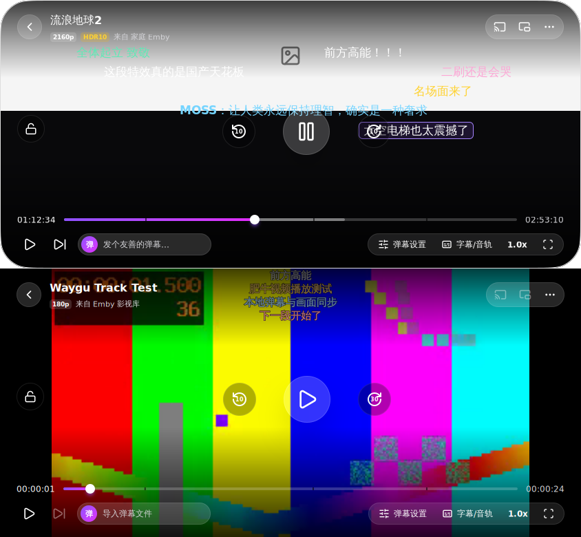
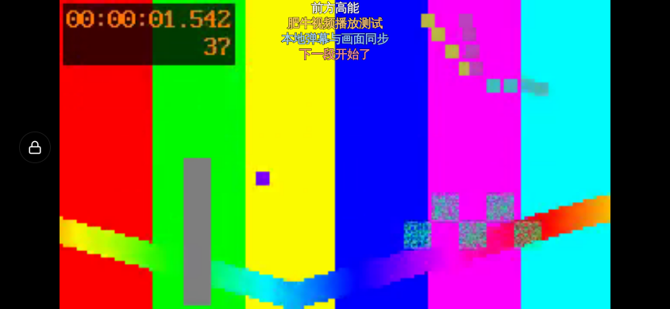
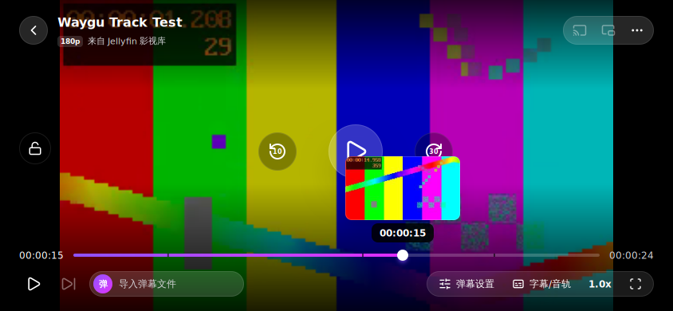
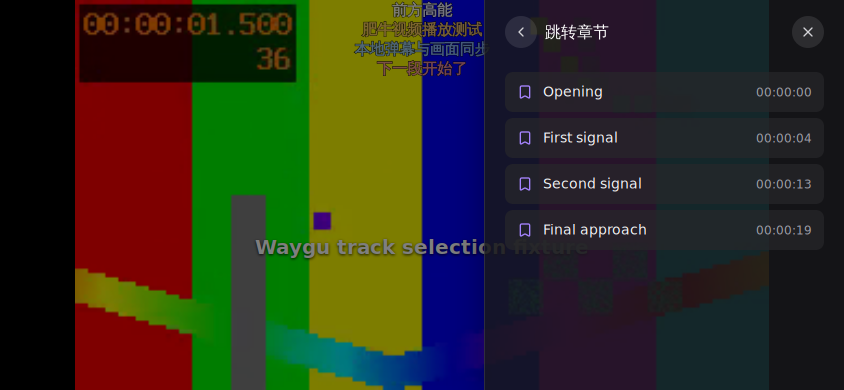
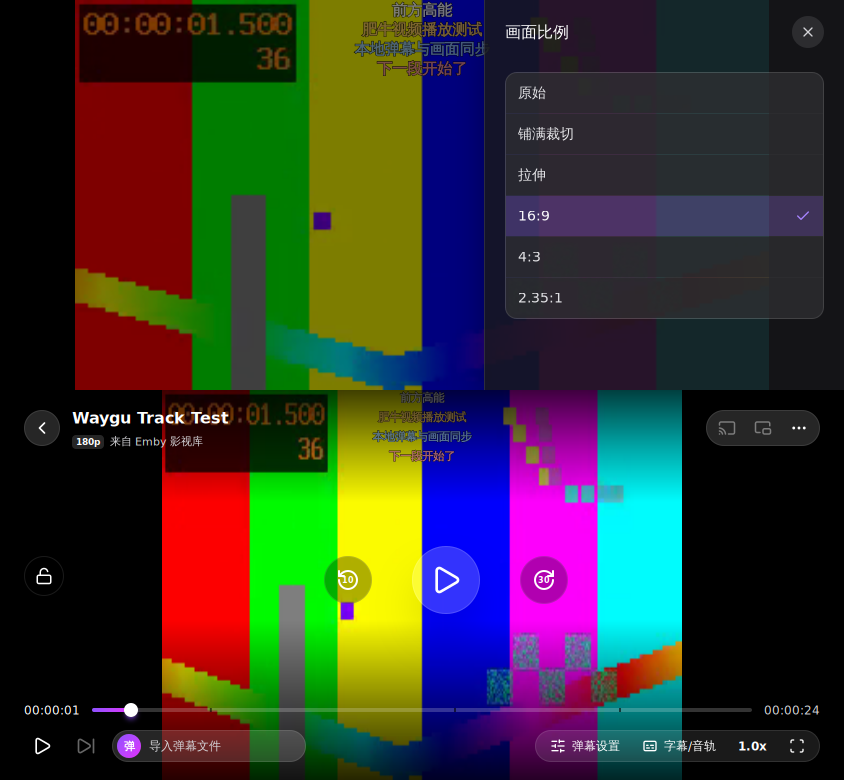
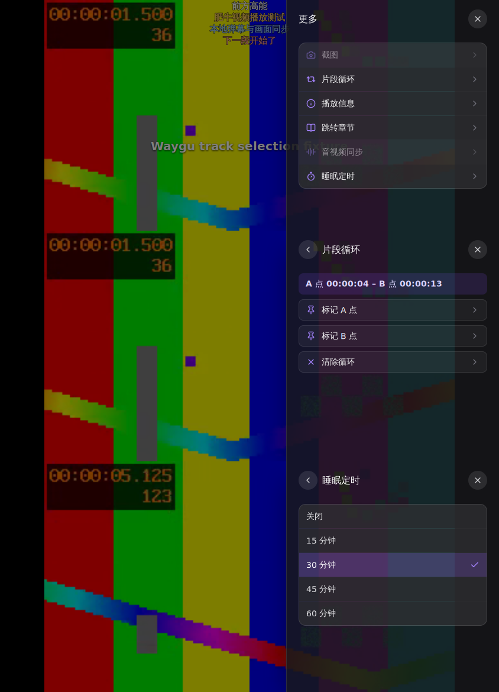

# Phone landscape player

844 × 390 pt · Linux GTK at 1× scale · `zh-Hans` · Scenra `88548db091cd`. Each main comparison shows the design above the running app. The app plays the Emby track test clip. Its 16:9 source video has side margins in the wider player, and the reference uses placeholder footage. The test uses a dark player palette inside a light app session. The main GTK capture freezes a decoded frame with playback paused, so its transport shows the play glyph. [Player design](../../design/player.scenra) · [Tracks design](../../design/player-tracks.scenra) · [Danmaku design](../../design/player-danmaku.scenra)

## Player

The main comparison shows the chapter ticks at 18%, 55%, and 80% of the timeline in both the design and the app. The app draws these from the three divisions between four chapters in the fixture video. The design specifies the gestures, preview and chapter action in notes. The captures below record those states in the running app.

## Picture ratio and playback actions

The scan and ellipsis icons retain their position in the main comparison. Their Scenra notes specify the ratio options and actions. The open menus use the 360 pt panel and the row styles from the tracks design, since those two open states have no standalone Scenra frame. The captures show the six choices and the actual 4:3 output, followed by the action menu, the active A/B segment, and a selected 30-minute timer.

## Subtitles and audio

## Danmaku

## Findings

| Area | Result |
| --- | --- |
| Player chrome | Top and bottom gradients, 68 pt central play control, seek buttons, timed progress and shortcut groups are positioned from the landscape frame. The lock leaves the unlock control available and disables the playback surface. The player uses actual resolution and source data. The cast button is disabled, and the next button is available when a subsequent episode exists. |
| Playback gestures | A single tap toggles the controls and a double tap plays or pauses. A horizontal drag previews and seeks on release. Left and right vertical drags adjust picture dimming and playback volume within the app. Holding while a supported stream plays temporarily switches to 2× and restores the previous rate on release or cancellation. Lock disables the gestures. Native rate verification uses GstPlay and scaletempo. |
| Timeline | The slider draws divisions from Emby, Jellyfin and Plex and opens a chapter at its exact start. On sources with a seek index, the progress slider and horizontal gesture show a real preview. The timestamp is available on the text-only preview. Native buffered ranges and casting remain pending. |
| Picture ratio | Original, Fill and crop, and Stretch use the native video modes. The three fixed ratios fit a centered frame for the video, captions and danmaku. The geometry checks cover all six options and confirm that changing ratio retains the mounted video. |
| Playback actions | Playback information and chapters open inside More. The A/B action records the current position for each mark, shows the interval on the timeline and repeats at B. Seeking out of the interval clears it. The 15, 30, 45 and 60 minute sleep timer keeps its deadline across automatic episode changes and pauses at expiry. Leaving the player clears it. Screenshot export and audio/video sync remain unavailable with the current native playback API. |
| Tracks | Each tab uses the 360 pt right-side panel. The subtitle list uses actual server and decoder tracks. Delay and style changes apply in the current session, and the local subtitle picker occupies the action row. Online subtitle search, audio delay, audio dynamic range controls and complete channel metadata remain pending. |
| Danmaku display | The sliders and choices update saved rendering preferences. The overlay reads the playback clock and the picture fit mode. The capture has four generated comments from a local DandanPlay response. The headless test imports XML and exercises the same rendering and source controls. |
| Danmaku sources and filters | The panel exposes the supported DandanPlay and local sources and their counts, with per-session switches. Keyword and regular expression rules use removable chips and the shared settings editor. Deduplication and colored-comment filtering are available. Other online providers, sender blocking, comment sending and a quality-level filter remain pending. |
| Platform | GTK verifies rendering and input at the landscape design size. iOS and Android receive a landscape request scoped to the player. Rotation, native Picture in Picture, safe areas and gesture input still need verification on phone hardware. |

The native review exercises all six ratios, an A/B repeat on the decoded Emby file, expiry using the accelerated test clock, the unlock path, track selection and the seven tabs. The headless checks cover a stale decoder report after a loop seek, timer continuity across automatic episode changes, cancellation of a preview, and restoration of speed. [Capture commands](README.md) · [Docker media fixtures](../../integration/servers/TESTING.md)
