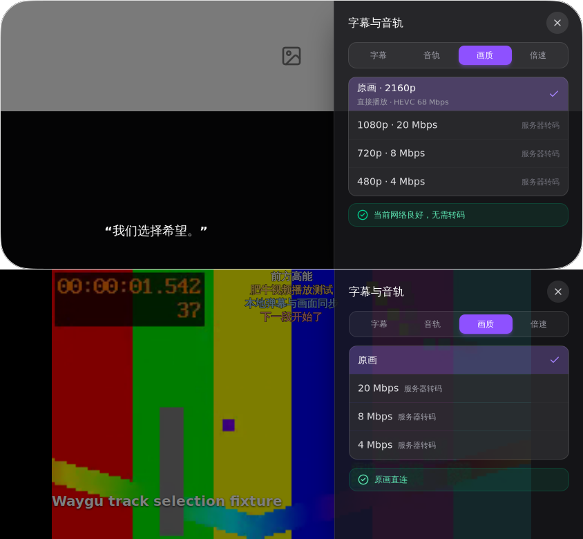
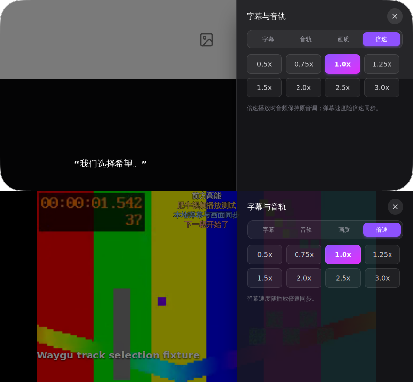
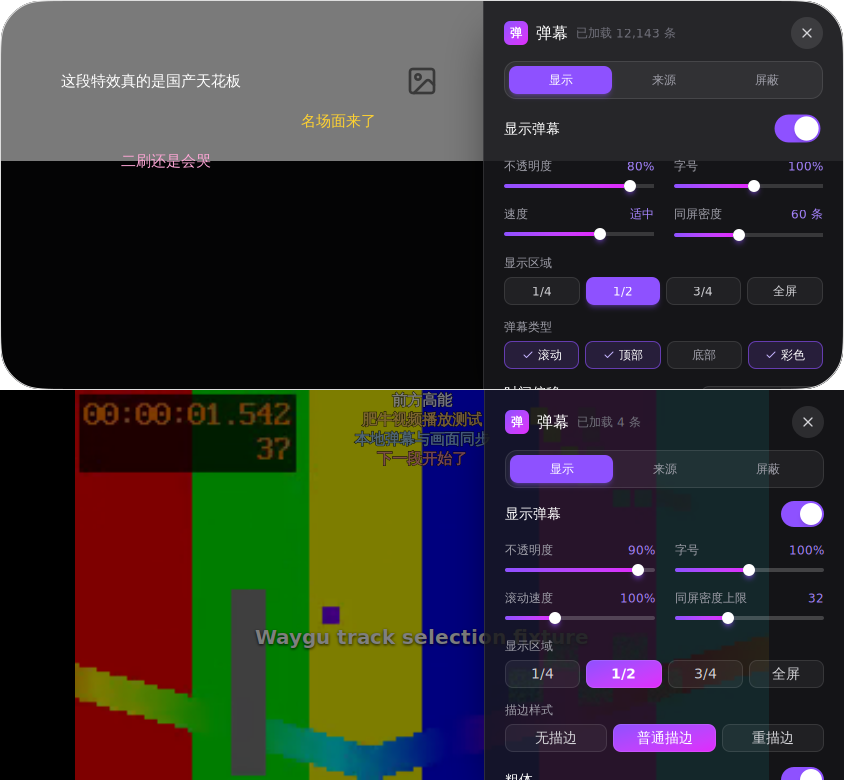
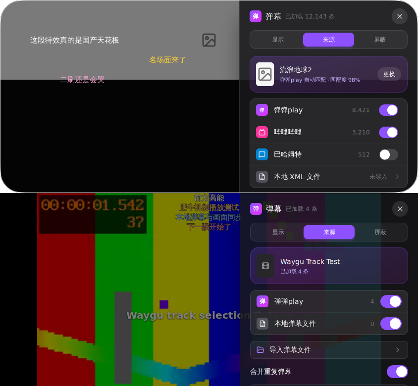

# Phone landscape player

844 × 390 pt · Linux GTK at 1× scale · `zh-Hans` · Scenra `88548db091cd`. Each main comparison shows the design above the running app. The app plays the Emby track test clip. Its 16:9 source video has side margins in the wider player, and the reference uses placeholder footage. The test uses a dark player palette inside a light app session. The main GTK capture freezes a decoded frame with playback paused, so its transport shows the play glyph. [Player design](../../design/player.scenra) · [Tracks design](../../design/player-tracks.scenra) · [Danmaku design](../../design/player-danmaku.scenra)

## Player

## Subtitles and audio

## Danmaku

## Findings

| Area | Result |
| --- | --- |
| Player chrome | Top and bottom gradients, 68 pt central play control, seek buttons, timed progress and shortcut groups are positioned from the landscape frame. The lock leaves the unlock control available and disables the playback surface. The player uses actual resolution and source data. The cast button is disabled, and the next button is available when a subsequent episode exists. |
| Playback actions | The progress slider and horizontal seeking use the active timeline. Speed can be cycled or opened as a list, and picture mode cycles original fit, crop, and stretch. The current bitrate and source capabilities determine the quality choices. Mobile brightness and volume gestures, press-and-hold speed, thumbnail previews, chapter ticks, additional ratios and the full playback actions menu remain pending. The native video rate check requires GstPlay and scaletempo. |
| Tracks | Each tab uses the 360 pt right-side panel. The subtitle list uses actual server and decoder tracks. Delay and style changes apply in the current session, and the local subtitle picker occupies the action row. Online subtitle search, audio delay, audio dynamic range controls and complete channel metadata remain pending. |
| Danmaku display | The sliders and choices update saved rendering preferences. The overlay reads the playback clock and the picture fit mode. The capture has four generated comments from a local DandanPlay response. The headless test imports XML and exercises the same rendering and source controls. |
| Danmaku sources and filters | The panel exposes the supported DandanPlay and local sources and their counts, with per-session switches. Keyword and regular expression rules use removable chips and the shared settings editor. Deduplication and colored-comment filtering are available. Other online providers, sender blocking, comment sending and a quality-level filter remain pending. |
| Platform | GTK verifies rendering and input in a phone-sized client area. iOS and Android receive a landscape orientation request scoped to the player. Physical-device rotation, native Picture in Picture, safe areas and mobile gesture behavior remain pending. |

The native review also exercises the unlock path, changing picture fit, selecting a subtitle, opening the current style editor, switching all seven tabs, checking a source switch, adding and removing a filter, and closing the session. [Capture commands](README.md) · [Docker media fixtures](../../integration/servers/TESTING.md)
