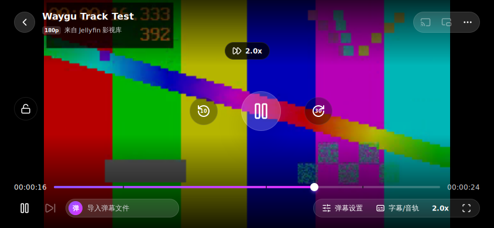
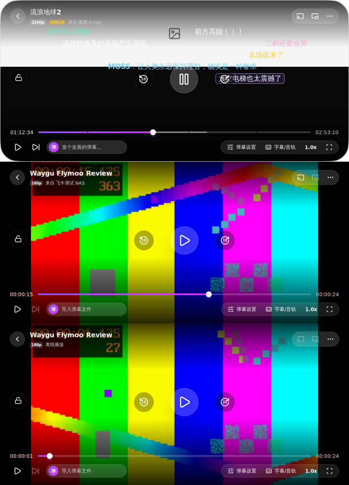
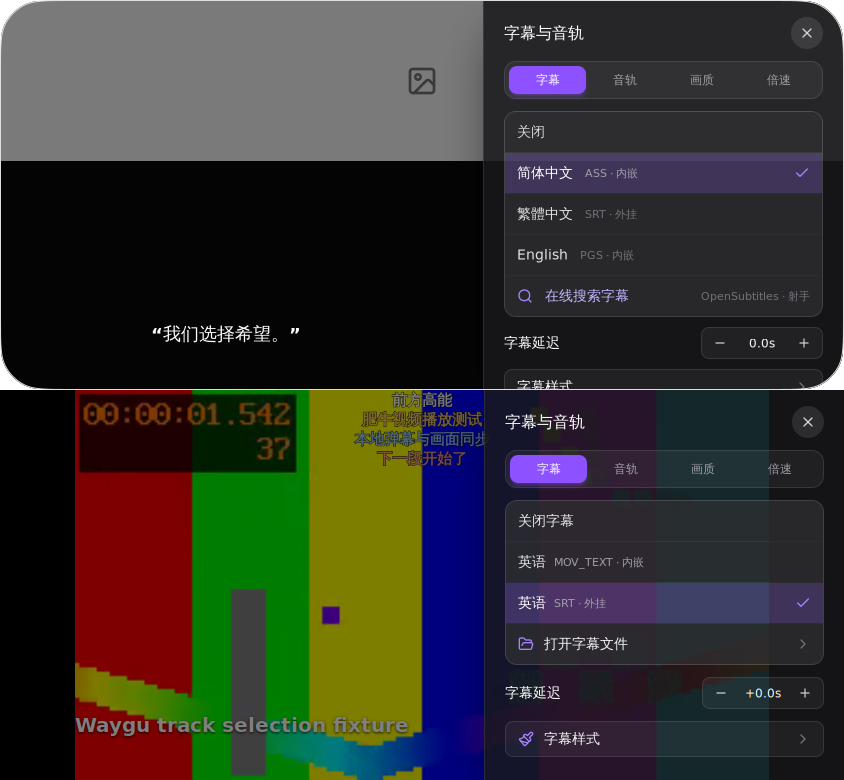
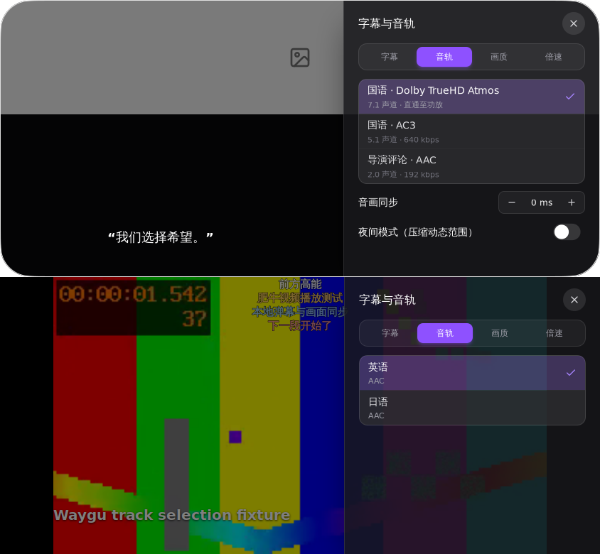
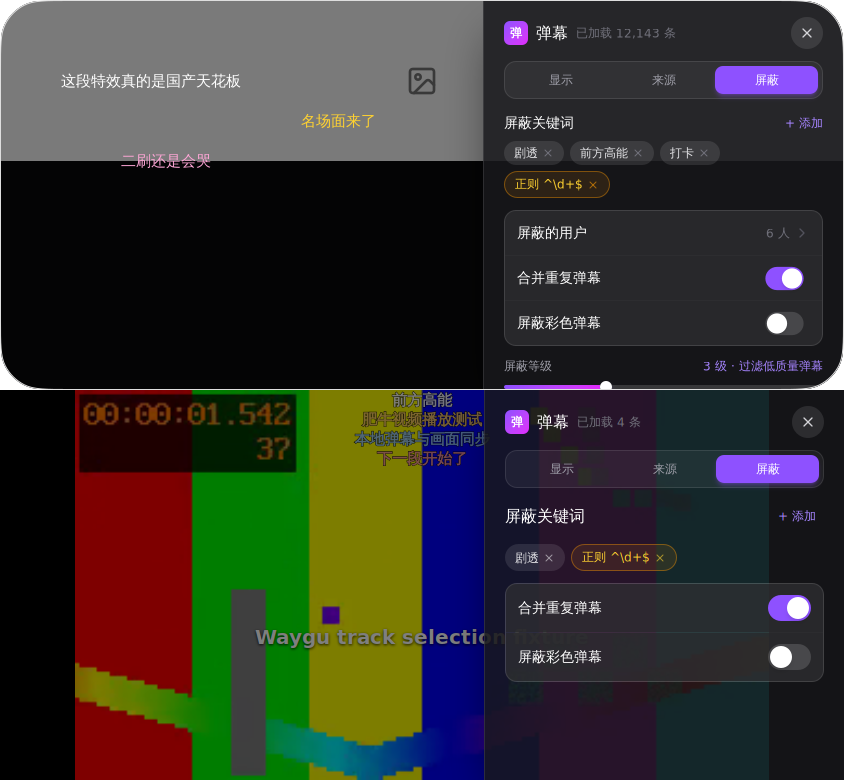
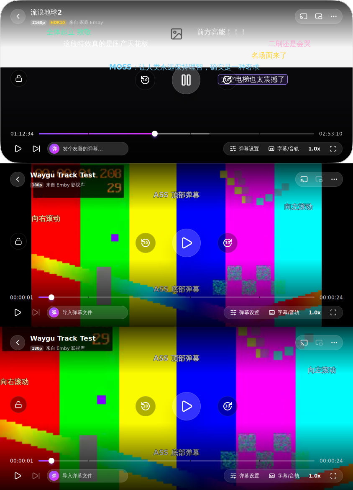
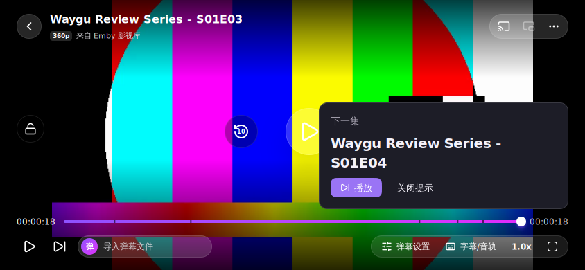
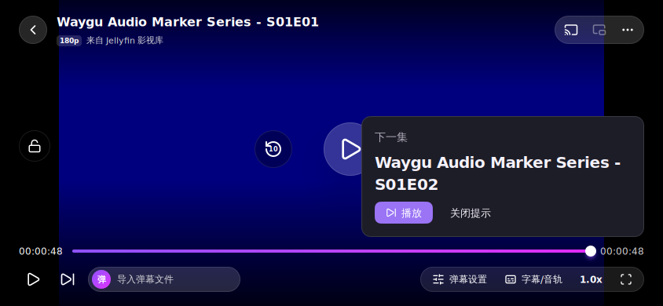

# Phone landscape player

844 × 390 pt · Linux GTK at 1× scale · `zh-Hans` · Scenra `88548db091cd`. Each main comparison shows the design above the running app. The app plays the Emby track test clip. Its 16:9 source video has side margins in the wider player, and the reference uses placeholder footage. The test uses a dark player palette inside a light app session. The main GTK capture freezes a decoded frame with playback paused, so its transport shows the play glyph. [Player design](../../design/player.scenra) · [Tracks design](../../design/player-tracks.scenra) · [Danmaku design](../../design/player-danmaku.scenra)

## Player

The main comparison shows the chapter ticks at 18%, 55%, and 80% of the timeline in both the design and the app. The app draws these from the three divisions between four chapters in the fixture video. The design specifies the gestures, preview and chapter action in notes. The captures below record those states in the running app.

### Flymoo online and offline playback

The first panel shows Scenra’s main player. The next two show the actual Flymoo fixture after dragging the timeline and after opening the downloaded clip with the server disconnected. The play button, seek buttons, timeline and control groups use the shared phone layout. The Flymoo fixture has no chapter metadata or comments, the two native captures are paused, and the offline status dims casting. GTK renders black margins around the 16:9 clip, where the design draws a rounded phone frame around its placeholder. Both app appearances ran the same signed playback and offline checks. [Flymoo media fixture](../../integration/servers/TESTING.md#flymoo-media-gateway)

## Picture ratio and playback actions

The scan and ellipsis icons retain their position in the main comparison. Their Scenra notes specify the ratio options and actions. The open menus use the 360 pt panel and the row styles from the tracks design, since those two open states have no standalone Scenra frame. The captures show the six choices and the actual 4:3 output, followed by the action menu, the active A/B segment, and a selected 30-minute timer.

## Subtitles and audio

The quality panel pairs the 48 pt original row with three 40 pt preset rows. The original row shows the selected file's resolution, codec and bitrate when the server supplies them. The presets show 1080p at 20 Mbps, 720p at 8 Mbps and 480p at 4 Mbps. The status card reports the stream's current playback method. The Emby, Jellyfin and Plex players pass the preset's height and bitrate limits to the server and resume from the same position after switching. Flymoo shows the versions and qualities its server advertises. [Emby HLS parameters](https://dev.emby.media/doc/restapi/Http-Live-Streaming.html) · [Plex Universal Transcoder](https://developer.plex.tv/pms/)

## Danmaku

### ASS file import

The source strip shows the Scenra panel, the local row before import and the same row after importing an ASS file with four comments. Manual match and Import use the design's two centered 36 pt buttons. The local row opens the picker when empty, then shows the imported format, comment count and a switch. Scenra's Bilibili and Bahamut rows push the actions below the fold in its four-source example. The fixture's two source rows leave both actions visible.

The first frame is Scenra. The two native frames show the paused Emby fixture in Original and Fill and crop. In both, the first comment lane starts 64 pt from the top at the design size. Default rows are about 28 pt apart there. The layout adds a system top inset when present and uses the visible video area to schedule the remaining lanes. The test checks the original and cropped views, the 2.35:1 frame, and a simulated 12 pt top system inset. The pill opens file import. Public comment sending, which Scenra assigns to that pill, remains open. The Docker test covers import with Emby, Jellyfin and Plex, and the libmpv test checks the imported overlay against decoded frame pixels. [Fixture and capture commands](../../integration/servers/TESTING.md#ass-danmaku-import)

## Findings

| Area | Result |
| --- | --- |
| Player chrome | Top and bottom gradients, 68 pt central play control, seek buttons, timed progress and shortcut groups are positioned from the landscape frame. The lock leaves the unlock control available and disables the playback surface. The player uses actual resolution and source data. The cast button opens the DLNA picker, and the next button is available when a subsequent episode exists. [Casting comparison](casting.md) |
| Playback gestures | A single tap toggles the controls and a double tap plays or pauses. A horizontal drag previews and seeks on release. Left and right vertical drags adjust picture dimming and playback volume within the app. Each swipe can be enabled in Playback settings. Holding while a supported stream plays temporarily switches to 2× and restores the previous rate on release or cancellation. Lock disables the gestures. Native rate verification uses GstPlay and scaletempo. [Gesture settings](phone-player-settings.md#playback-gestures) |
| Timeline | The slider draws divisions from Emby, Jellyfin and Plex and opens a chapter at its exact start. On sources with a seek index, the progress slider and horizontal gesture show a real preview. The timestamp is available on the text-only preview. Native buffered ranges remain pending. |
| Picture ratio | Original, Fill and crop, and Stretch use the native video modes. The three fixed ratios fit a centered frame for the video, captions and danmaku. The geometry checks cover all six options and confirm that changing ratio retains the mounted video. |
| Playback actions | Playback information and chapters open inside More. The A/B action records the current position for each mark, shows the interval on the timeline and repeats at B. Seeking out of the interval clears it. The 15, 30, 45 and 60 minute sleep timer keeps its deadline across automatic episode changes and pauses at expiry. Leaving the player clears it. Screenshot export and audio/video sync remain unavailable with the current native playback API. |
| Tracks | Each tab uses the 360 pt right-side panel. The subtitle list uses actual server and decoder tracks. Delay and style changes apply in the current session, and the local subtitle picker occupies the action row. Online subtitle search, audio delay, audio dynamic range controls and complete channel metadata remain pending. |
| Danmaku display | The sliders and choices update saved rendering preferences. The overlay reads the playback clock and the picture fit mode. The display and filter captures use four generated comments from a local DandanPlay response. Local XML and ASS use the same timeline and display controls. |
| Danmaku sources and filters | The panel exposes the supported DandanPlay and local sources and their counts, with per-session switches. The import action accepts XML, JSON and ASS. Keyword and regular expression rules use removable chips and the shared settings editor. Deduplication and colored-comment filtering are available. Other online providers, sender blocking controls, comment sending and a quality-level filter remain open. |
| Platform | GTK verifies rendering and input at the landscape design size. The Android 15 Pixel 7 emulator rotated to landscape, played the embedded clip and verified that the saved brightness and horizontal swipe restrictions leave the right-hand volume gesture and timeline slider usable. Rotation, native Picture in Picture, safe areas and gesture input still need verification on physical phones. [Reproduction commands](README.md) |

The native review exercises all six ratios, an A/B repeat on the decoded Emby file, expiry using the accelerated test clock, the unlock path, track selection and the seven tabs. The headless checks cover a stale decoder report after a loop seek, timer continuity across automatic episode changes, cancellation of a preview, and restoration of speed. [Capture commands](README.md) · [Docker media fixtures](../../integration/servers/TESTING.md)

## Intro and credit skips

The playback setting uses the shared player on phone, tablet, TV and desktop. The Emby fixture plays a cold open, skips 2–5 seconds, skips credits at 14–15.5 seconds and plays the intervening scene. Reaching the final credits at 16.5 seconds completes the 18-second clip and makes the next episode available. The capture uses GTK with autoplay switched off so the next-episode card stays visible. The headless case also verifies the watched report to Emby and the 10-second autoplay transition. [Scenra playback flow](../../design/flows/playback.scenra) · [Settings comparison](phone-player-settings.md) · [Fixture and capture commands](../../integration/servers/TESTING.md#intro-and-credit-markers)

### Same-season audio

The second fixture has three different cuts with no server markers. Their opening starts at 4, 6 and 2 seconds. The credits start at 39, 43 and 47 seconds. The playback test on GTK uses Jellyfin, checks that the first episode jumps from the opening to about 13 seconds, and verifies the final skip at 48 seconds. Emby and Jellyfin provide bounded PCM samples through their authenticated audio routes. The Plex fixture uses the original file through the desktop FFmpeg path. The opening scan is limited to the first third or three minutes. The credit scan is limited to the final quarter or 90 seconds. [Scenra playback settings](../../design/settings-playback.scenra) · [Fixture verification](../../integration/servers/TESTING.md#same-season-audio)

