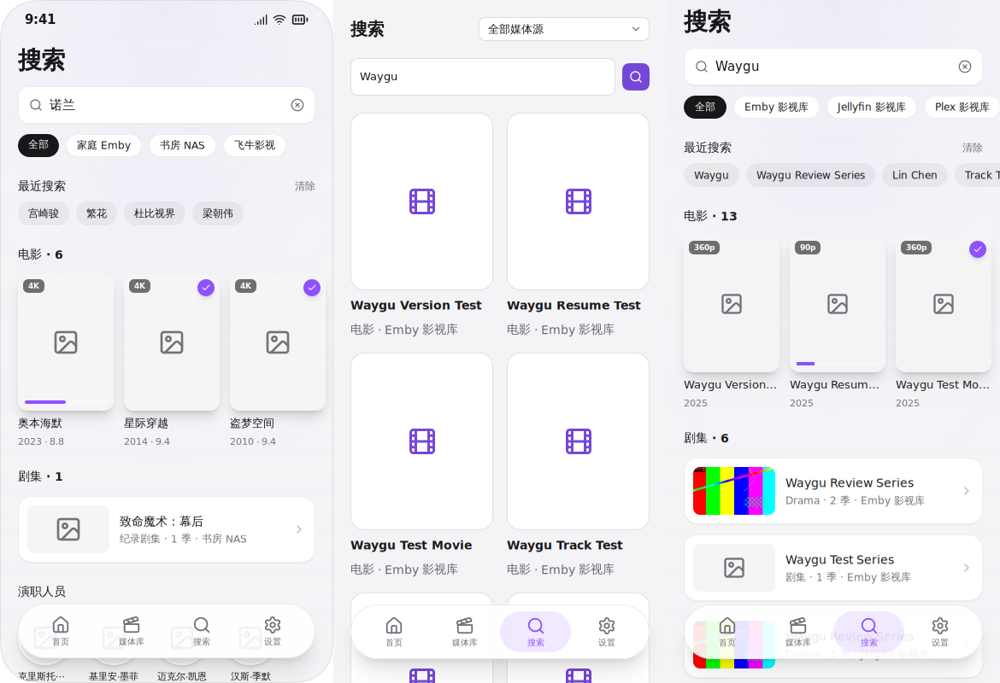
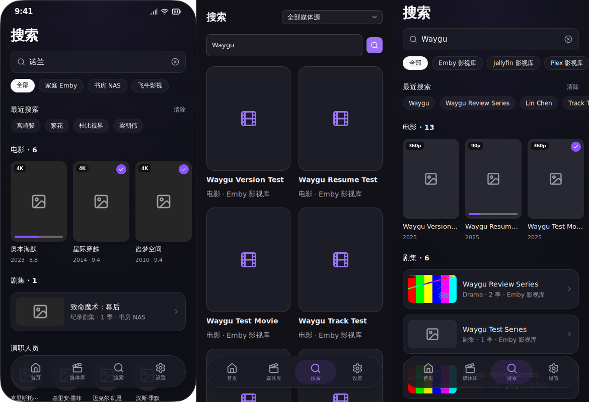
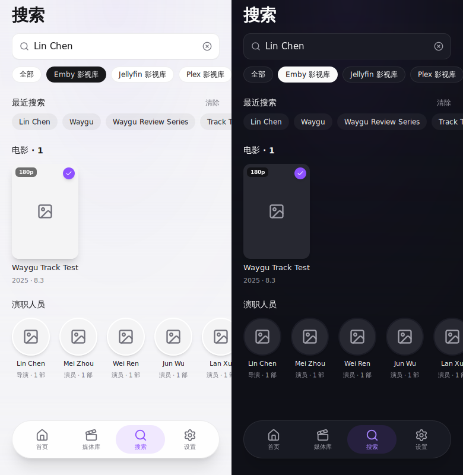
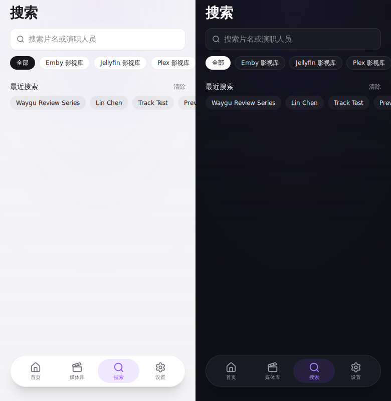
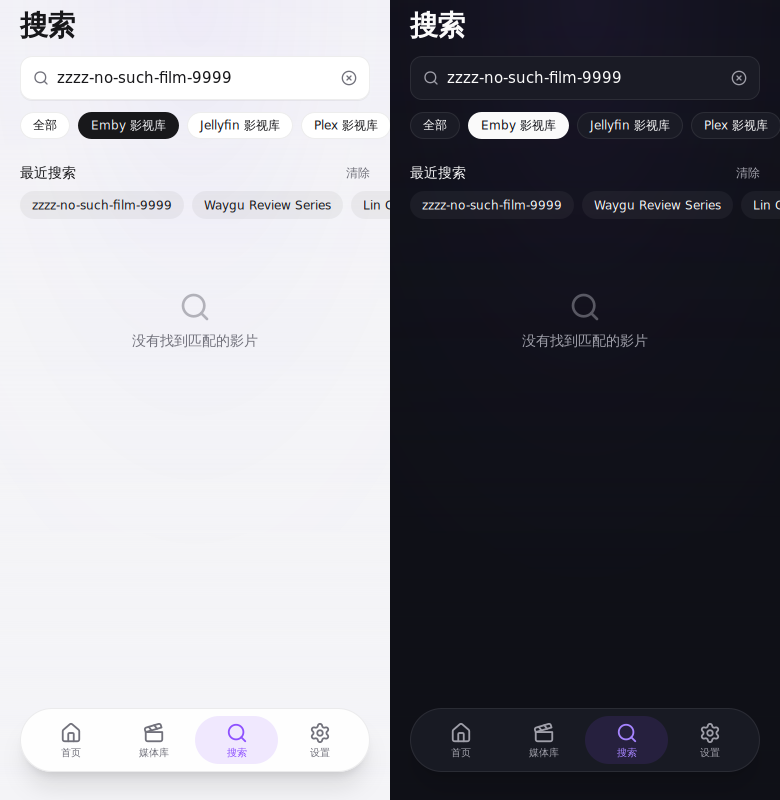
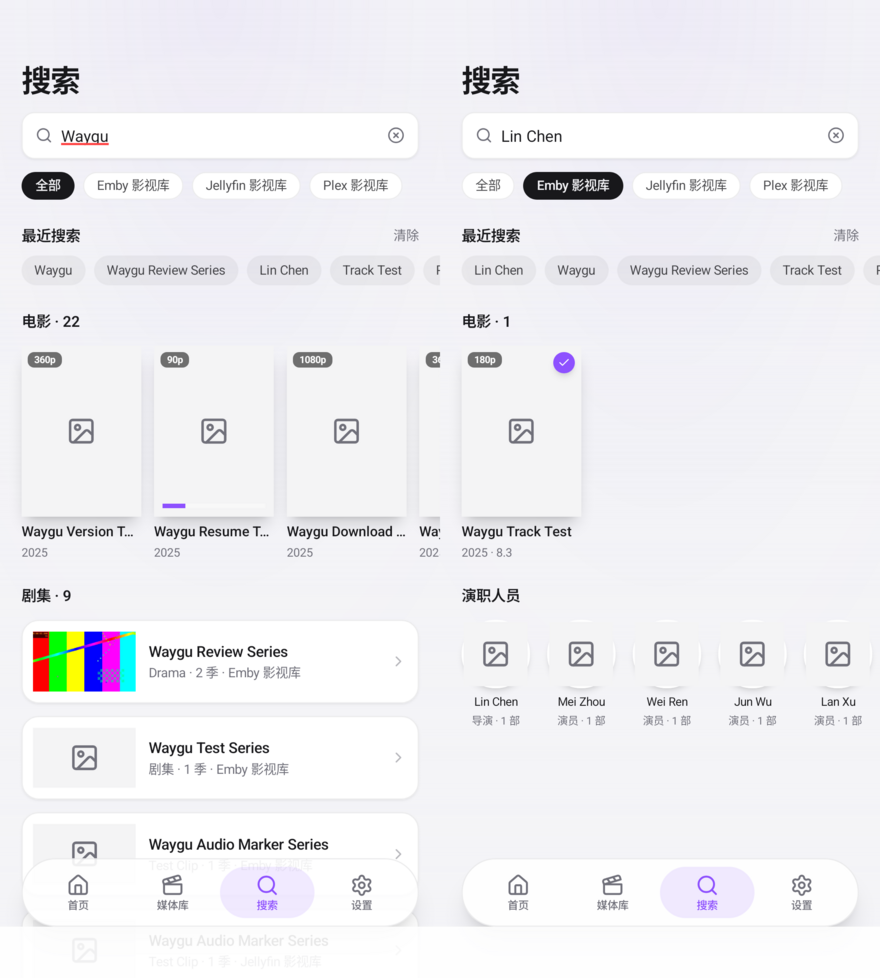

# Phone search review

390 × 800 pt · Linux GTK at 1× scale · `zh-Hans` · Scenra `88548db091cd`. The main strips show the design, the previous app, and the current app. The other strips show the app's light and dark states. [Scenra design](../../design/search.scenra)

## Title search

## Scoped credit search

## Idle and empty states

## Findings

| Area | Result |
| --- | --- |
| Field and source chips | The 44 pt search field, clear button and horizontal source chips follow the design. New searches start with all configured sources. Typing starts a search after a short delay. Submit and history clicks run immediately. GTK has no 44 pt mobile status bar and the app highlights Search in the bottom bar. |
| Recent queries | The seeded local history demonstrates the design chips. Submitting or opening a result moves the query to the front, and clearing history removes the saved entry. Opening and closing a detail preserves the search and its scope. |
| Results | Movies use the poster rail and series use the 96 × 56 pt thumbnail rows. The title fixture has more series than the reference, so its lower sections extend below the first scroll position. The scoped director capture exposes the portrait row at the same viewport. |
| Credit counts | Person captions count the matching titles in the returned set. Emby and Jellyfin supply positive cast results from real test media. Plex hub parsing and visibility checks have a separate wire-format test. The unclaimed Plex fixture returns an empty credit result. |

`TestDockerPhoneSearchReview` verifies typing, submit, source scope, history recall and clearing, and navigation to movie and series details. `TestDockerCreditSearchScopesLibraries` checks director searches against the real libraries. Positive Plex credit matches on a populated server remain pending. [Capture commands](README.md) · [Fixture setup](../../integration/servers/TESTING.md)

## Android phone

The Android emulator passed the light search flow with the Docker fixtures. At 420 dpi the native field measures 43.81 pt after rounding to whole pixels. The fixture accepts up to a half-point difference from the 44 pt design. The captures show title results and the Emby-scoped director result.
