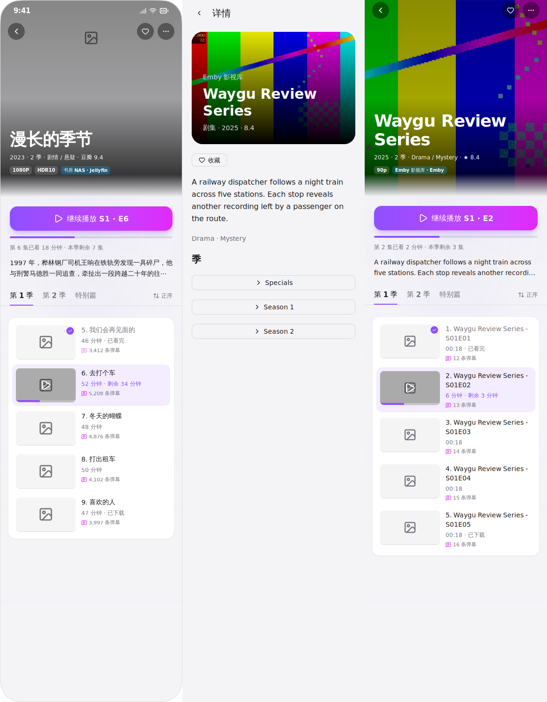
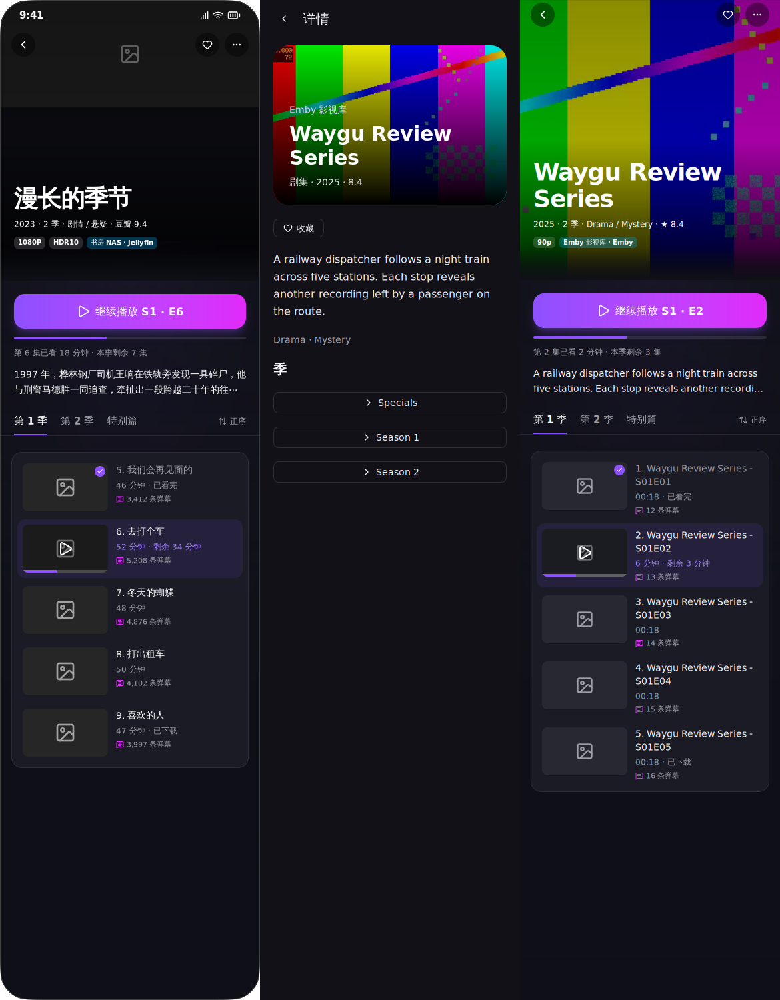
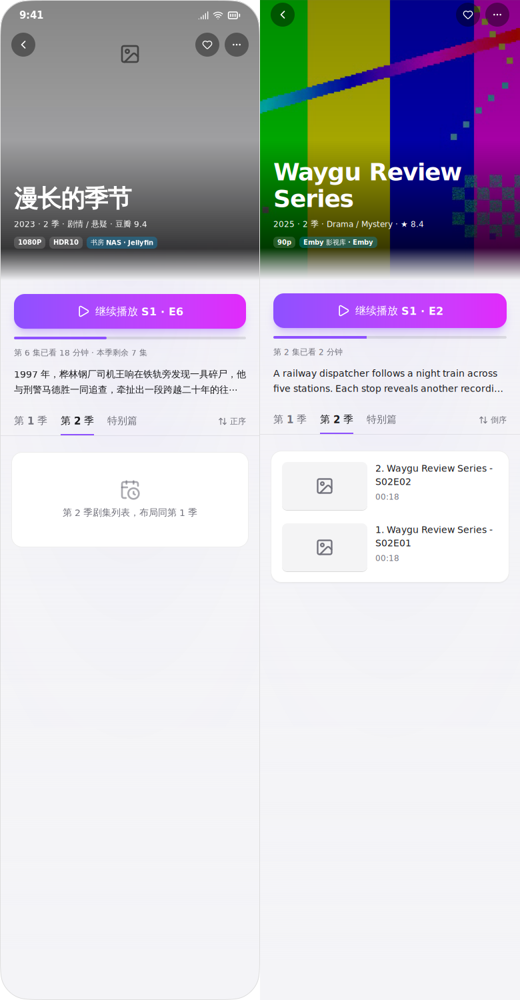
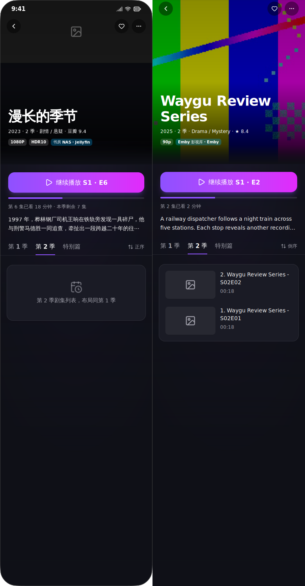
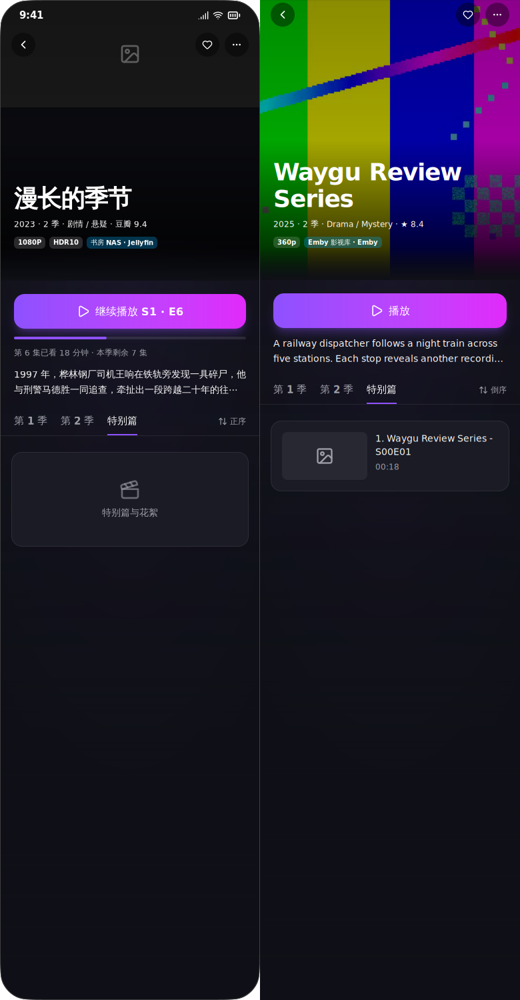

# Phone series detail review

[Scenra design](../../design/series-detail.scenra) · 390 × 1500 pt · Linux GTK at 1× scale · `zh-Hans` · Scenra `88548db091cd`. The first-season strips show the design, the previous app, and the current app. The other strips show the matching design panel and the current app.

## First season

## Second season

## Specials

## Findings

| Area | Result |
| --- | --- |
| Hero | The 420 pt edge-to-edge art, lower scrim, source badge, favorite and overflow controls follow the design. The active episode's file supplies resolution and HDR badges when available. GTK uses its own window chrome and has no 44 pt mobile status bar. The source's aggregate score appears with a star. |
| Resume | The 52 pt action starts the series bookmark. The body shows watched time and the remaining episode count from the active season. Long-press offers restart and episode details. The Emby fixture resumes at 2:24 with three later episodes remaining. |
| Season bar | The violet underline follows the selected tab. The sort menu changes order and can hide watched episodes. Returning from the player retains the season, sort and filter. The More menu opens the DLNA picker for the selected episode. [Casting comparison](casting.md) |
| Episode rows | The fixture exercises the 128 × 72 pt thumbnail, watched check, active scene-progress overlay, cached danmaku count and actual download state. The count snapshots for the reference capture are synthetic. Real bindings record their count after the player loads comments. |
| Second season and specials | Scenra uses a placeholder box for each panel. The app uses the first season's row treatment for populated seasons and specials. Empty panels use the design's icon and text treatment. Art and episode names come from each server. |

The native review plays the second-season file and checks that the clock advances. The test opens a downloaded episode from its season row and checks that it loads a local file. Headless coverage verifies the first-season seek and all three media adapters' season indexing. Phone device comparisons remain pending. [Fixture setup](../../integration/servers/TESTING.md) · [Capture commands](README.md)
