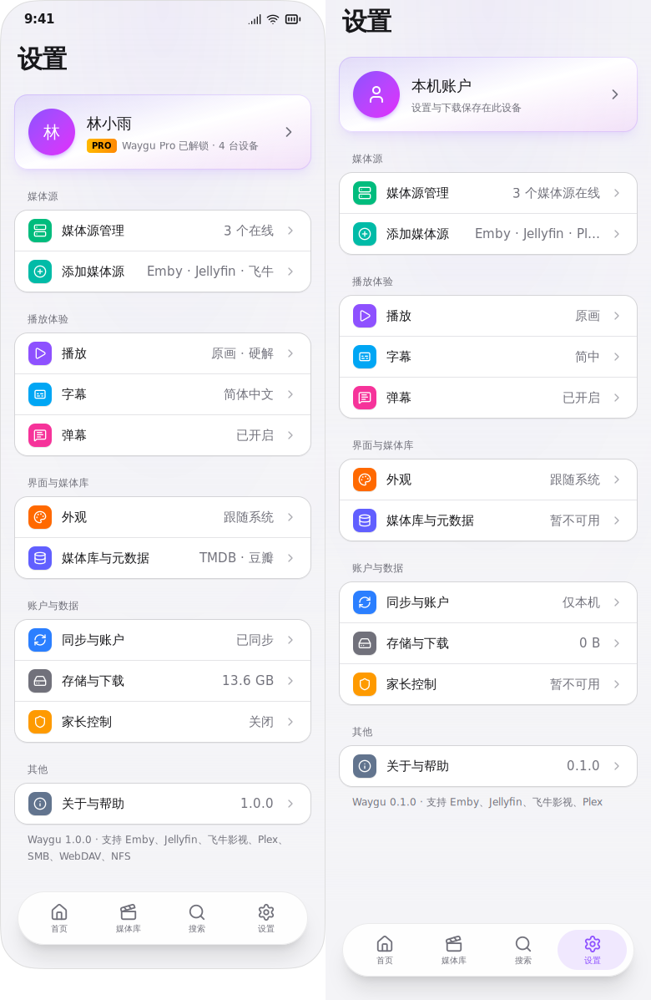
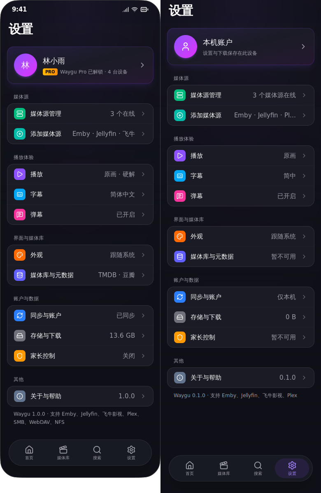
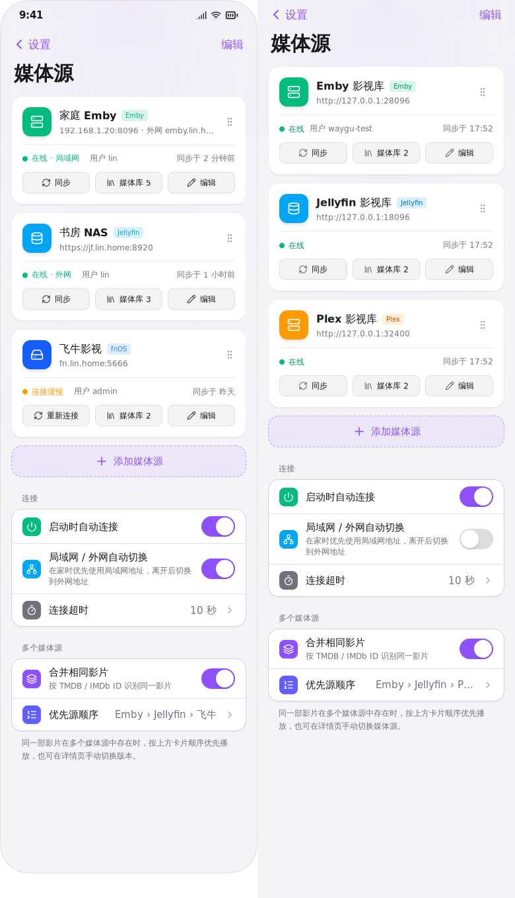
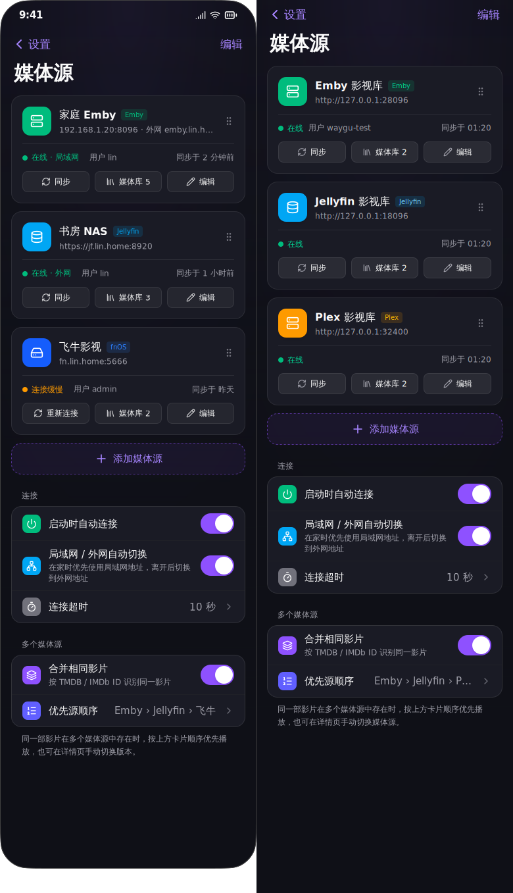
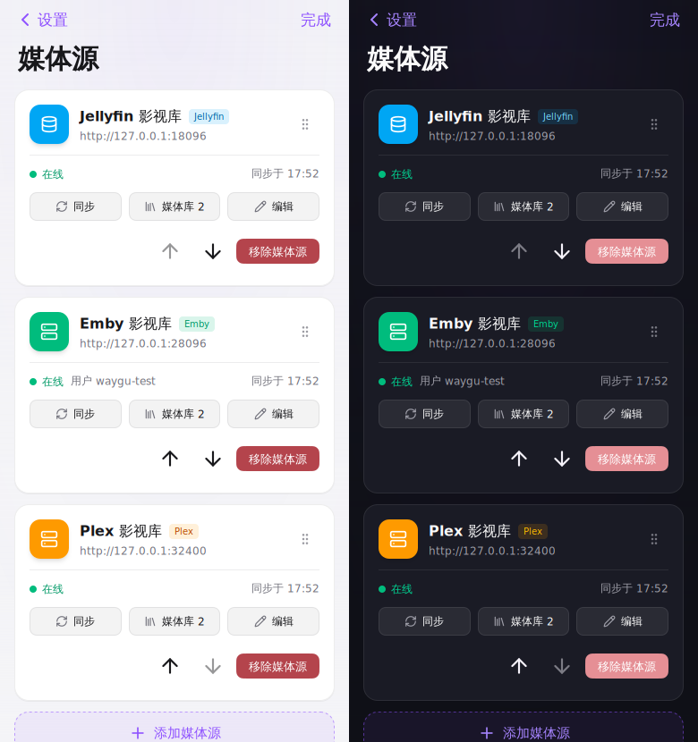
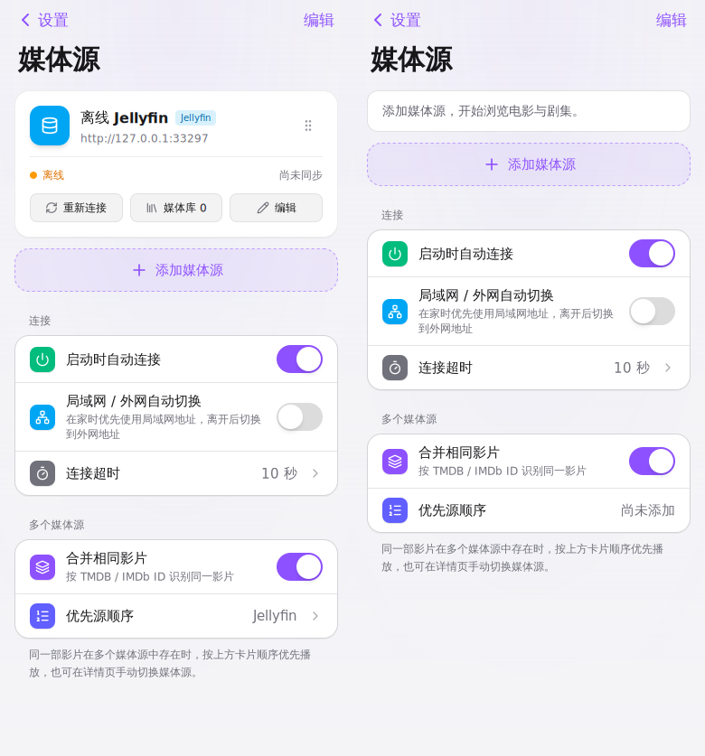
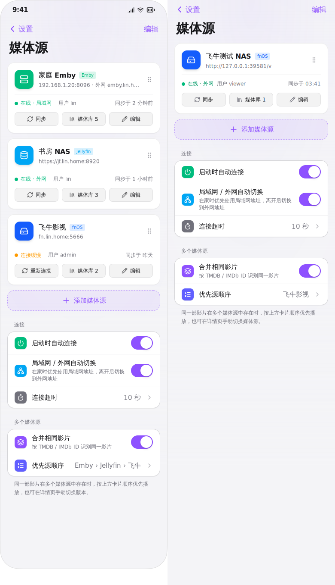
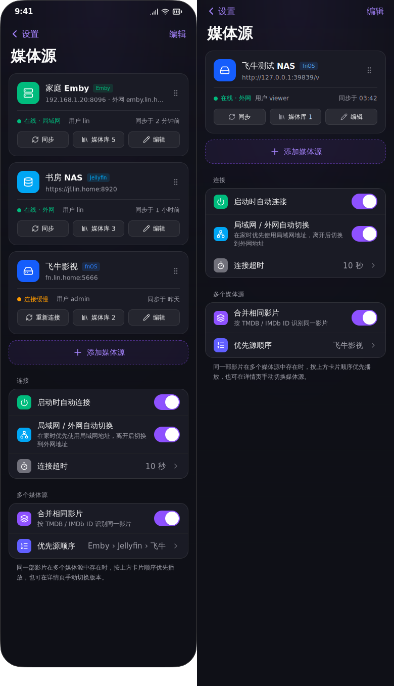

# Phone settings and media sources

390 pt wide · Linux GTK at 1× scale · `zh-Hans` · Scenra `88548db091cd`. The paired captures show the design on the left and the running app on the right. The source cards use the Docker fixtures for Emby, Jellyfin and Plex. [Settings design](../../design/settings.scenra) · [Media source design](../../design/settings-sources.scenra)

## Settings home

## Media sources

## Findings

| Area | Result |
| --- | --- |
| Settings home | The title, profile card, grouped rows and footer follow the design. The card shows the local profile. It has no paid badge or connected device count. Row summaries show live online counts, playback quality, subtitle preference, danmaku state, used download bytes and the app version. The home page links to source management, adding a source, playback, subtitles, [danmaku](phone-danmaku-settings.md), downloads, [appearance](phone-appearance.md), [library and metadata](phone-library-metadata.md), [parental controls](phone-parental.md), [Sync and accounts](phone-sync-accounts.md) and [About and help](phone-about.md). |
| Navigation and layout | The media source page uses the shared back row with the Edit action. GTK lacks the phone status bar and device frame. The shell highlights Settings on its floating bottom bar. The setting rows and source card actions can receive pointer and keyboard input. |
| Connection and refresh | Each card shows the latest authenticated connection check and its last library refresh. Connection health and refresh were tested with all three servers. New libraries stay hidden after a refresh until enabled. The timeout applies to saved-source checks, library refresh, and direct sign-in. The shared routing switch now saves and applies the automatic LAN and WAN preference. A source with a backup address shows the route used for the last successful check. |
| Source priority and removal | The cards support dragging the grip, edit-mode up and down buttons, and swipe-to-reveal removal with confirmation. Priority changes persist and feed the matched catalog. Reconnecting keeps the source in its existing position. Phone touch verification remains pending. |
| Differences still under review | Cards display both configured addresses when a backup exists. The online state identifies the local or remote route. Offline and sign-in-required states also appear. The edit actions appear in an extra row, and the app has a confirmation dialog for removal. The reference bottom bar uses demo tab values. The app retains an accurate selected Settings tab. |

`TestDockerPhoneSourceSettingsReview` drives source sync, the library manager, the edit entry point, timeout selection, matching, drag and swipe on GTK. `TestPhoneSourceSettingsOfflineAndEmpty` verifies the offline and add paths. Real phone captures and the open design differences remain pending. [Capture commands](README.md) · [Media server fixtures](../../integration/servers/TESTING.md)

The failover review adds an Emby backup address, checks the remote-online state after the local gateway is unavailable, then restores the local gateway and confirms that a new request uses it. [Connection review](source-login.md#backup-address) · [Router checks](../../integration/servers/TESTING.md#media-source-routes)

### FN Connect route recovery

The left panel is the Scenra media sources page. The right is the 390 × 1357 pt GTK capture after the saved Flymoo route stopped serving video, the player opened the replacement route and the source card was refreshed. The card shows the replacement address and the existing green online indicator with `在线 · 外网`. Its sync, library and edit buttons stay in the design's action row.

The fixture has one saved source, so the Add button and connection settings sit higher than in the three-source design. GTK omits the phone status bar and frame, which moves the navigation row and title up. The design uses a fixed demo clock and relative sync time. The app shows the fixture's latest sync time. The native pass covers signed video playback and the settings refresh in both appearances. The headless pass also checks that an interruption at 7 seconds resumes there. A physical phone and NAS still need verification. [Fixture and capture commands](../../integration/servers/TESTING.md#saved-fn-id-route-recovery)
