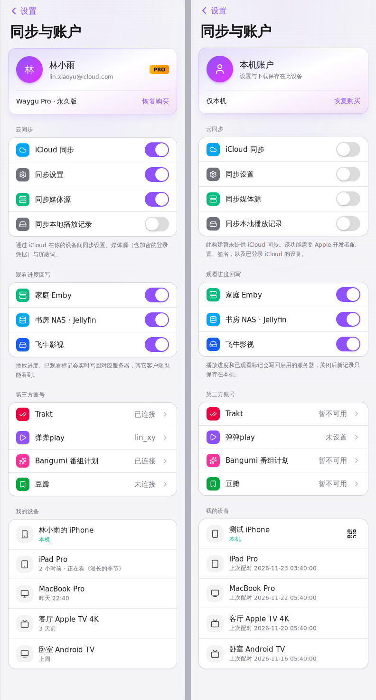
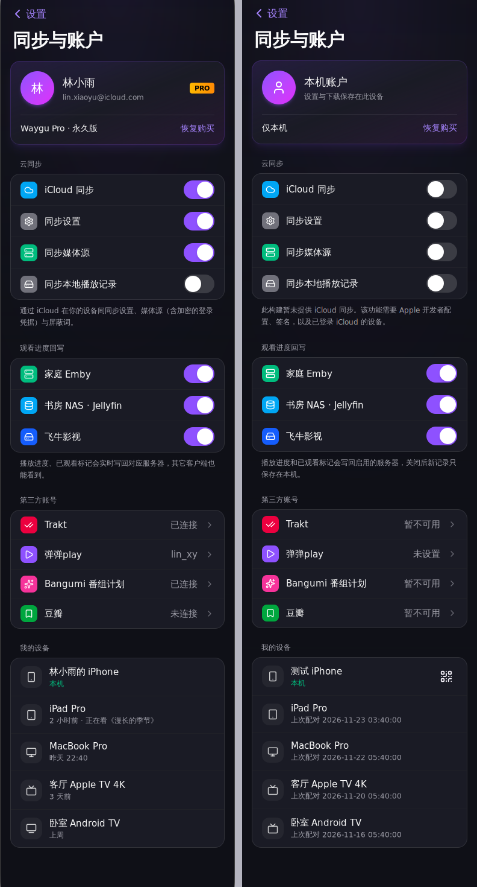

# Phone Sync and accounts

The Scenra reference is on the left and the running Linux GTK app is on the right at 390 pt, 1× scale and `zh-Hans`. The comparison starts below the reference’s 44 pt status bar. The app uses a local profile, test media sources and recorded device fixtures. [Scenra design](../../design/settings-sync.scenra)

| Area | Comparison and verification |
| --- | --- |
| Profile | The app uses the reference gradient, avatar size, divider, and restore action placement. It shows a local account and a generic avatar. A signed Apple build and a configured StoreKit product are required to verify purchase restoration. [NSGo purchases](https://nsgo.dev/docs/services/#in-app-purchases) |
| Cloud sync | The four switches stay disabled in this build. iCloud integration and testing require an assigned Apple entitlement, signing configuration, and an authenticated iCloud device. [Apple iCloud configuration](https://developer.apple.com/documentation/xcode/configuring-icloud-services) |
| Server progress | Each saved media source has a persisted switch. The master progress setting can pause all sources. With one source disabled, new checkpoints and explicit watched changes are stored locally and remain local when it is re-enabled. Already queued server updates may resume once the source is enabled. Local state is applied in Details, the library and watch history. The Docker test confirms that the same action leaves Emby unchanged while reaching Jellyfin. |
| Third-party accounts | DandanPlay opens its existing developer credentials form and shows the configured state from the platform credential store. Trakt, Bangumi and Douban connections remain pending. The public DandanPlay user account and posting flow are also pending. |
| Devices | The page shows the device’s own name when the platform provides it. Other rows reflect successful QR setups, with the last pairing time. The QR action is on the current-device row. The pinned HTTPS exchange transmits the device identity along with setup. The history keeps IDs, names, device types and times, with no address, link, token or password. Live device presence is pending. [NSGo device name and model](https://nsgo.dev/docs/services/#device-name-and-model) |
| Platforms | Captures and form interaction were checked with the compact GTK layout. Desktop and TV settings can open the same page. Physical phone and TV captures remain pending. |

`TestPhoneSyncAccountsReview` compares both appearances and verifies isolated switch preferences, DandanPlay credential configuration, and navigation to QR pairing. `TestPhoneSendsTVSetup` verifies the real local TLS exchange and its saved device record. `TestSourceSyncReplayKeepsLocalCheckpoints` checks the replay queue before and after re-enabling a source. `TestDockerSyncSourceWatchedIsolation` checks server and device watched state in the same app session. [Reproduction commands](README.md)
