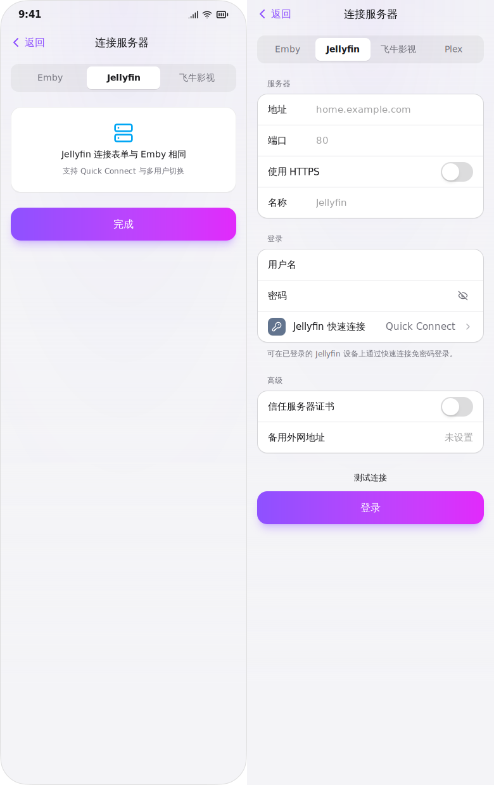
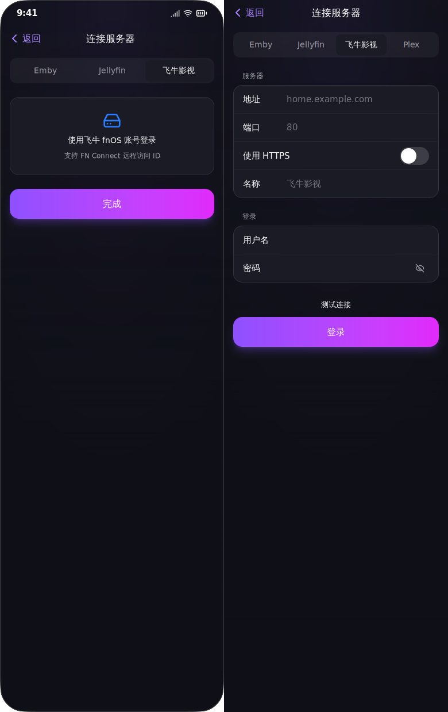
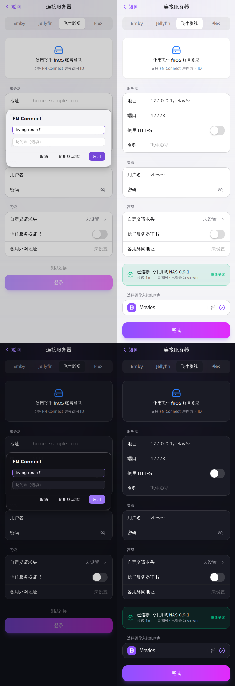
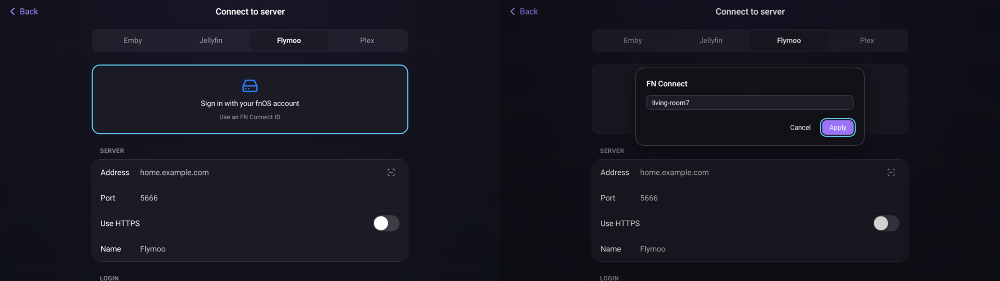
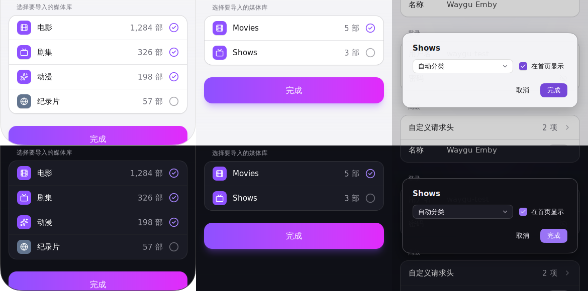
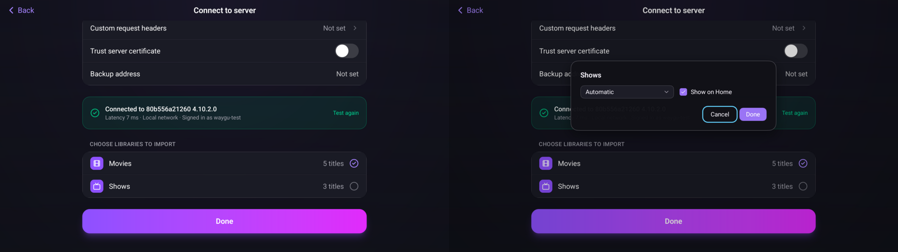
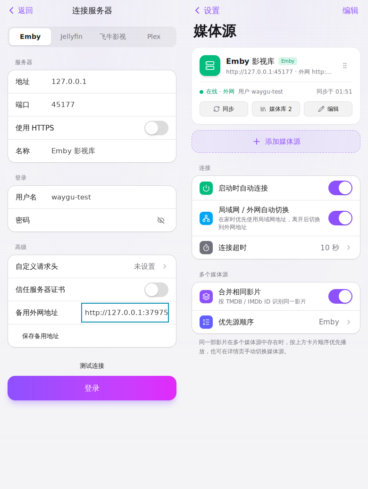
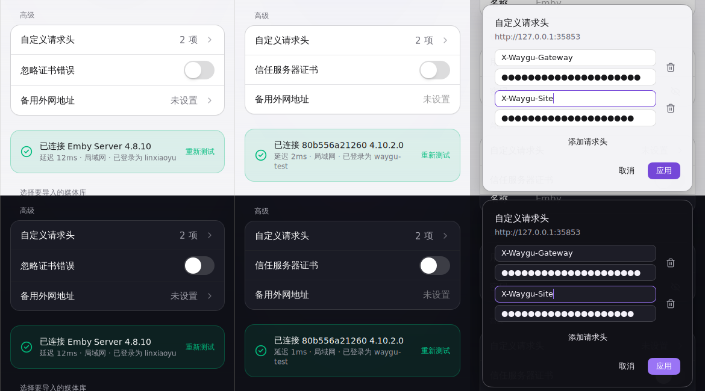
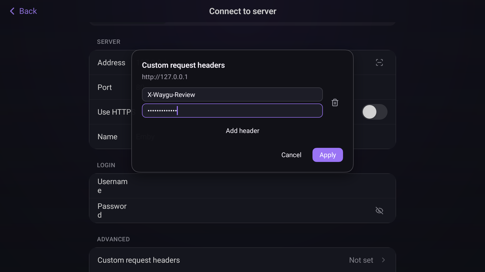
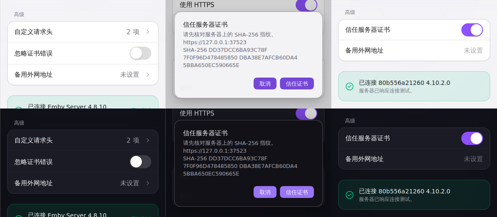

# Connect to server review

[Scenra design](../../design/source-login.scenra) · 390 × 1240 px per image · Linux GTK at 1× scale · `zh-Hans` · Scenra `88548db091cd`. The baseline app is `0c494bb`.

## Emby

Each strip shows the original empty form on the left, the design's authenticated example in the center, and the revised form after signing into the Emby Docker fixture on the right.

| Area | Baseline | Revised capture and remaining work |
| --- | --- | --- |
| Header and provider tabs | Generic header with a form for a provider selected on the prior screen. | The header is centered and the tabs use the reference's rounded selection. Plex adds a fourth segment. The reference includes a phone bezel and system bar. Verify safe-area placement and camera presentation on phones. |
| Server and login | Labels above boxed fields. | Address, port, HTTPS, name, and login use the reference's grouped 48 pt rows. The app clears the password after successful authentication. The QR control appears when the target reports scanner support. |
| Connection result and import | Testing and login were compact buttons. Successful login replaced the form with an import card. | The emerald status panel shows measured latency and the inline retest. Each import row uses the reference’s badge, title, right-aligned count and selection circle. The fixture has two libraries. The leading badge opens category and home visibility options. |
| Advanced and alternate sign-in | Only local password login for Emby. | The Advanced group has a header count, certificate switch, and editable backup address. Emby Connect PIN remains pending. Jellyfin Quick Connect and Plex authorization are reachable from their corresponding tabs. |

## Jellyfin and Flymoo

Each pair shows the Scenra tab on the left and the native app on the right. Jellyfin shows a working sign-in form below the provider tabs, where Scenra shows an introduction. The Flymoo introduction uses Scenra’s icon, text, card spacing and colors. The GTK form continues below that card with sign-in fields. The capture has four provider tabs and omits the phone’s bezel and status bar. Those layout differences are visible in the comparison. The introduction opens an FN ID dialog. Applying the ID fills the HTTPS media gateway address, and the user can test it and sign in with their fnOS account.

Each row below shows the FN ID dialog and the authenticated connection result with a local protocol fixture. Scenra specifies the FN Connect entry and the library import flow. The ID dialog uses the app's existing dialog styling. The test verifies the generated HTTPS address locally and sends the credentials to the synthetic gateway only after its public configuration responds. The connection result uses the actual gateway path and shows one available title. The imported library loads signed artwork, and the title plays after a same-origin media redirect. Physical NAS verification, FN Connect portal route selection and access codes remain pending. [Source connection flow](../../design/flows/source-connect.scenra) · [Connection fixture](../../integration/servers/TESTING.md#flymoo-media-gateway) · [Flymoo playback comparison](phone-player.md#flymoo-online-and-offline-playback)

On the Android TV x86-64 emulator, Select opens the dialog and focuses the FN ID field. Back first dismisses the system keyboard, then closes the dialog and restores focus to the introduction card. After entering an ID, the D-pad moves to Cancel and then Apply. The left capture shows restored focus after Back. The right capture shows Apply focused before the app fills the gateway address. Run the installed-APK check from the welcome screen with `python3 build/android/tv-smoke.py --with-flymoo-connect`.

## Plex

Light and dark native captures of the token form and the account linkage action. The design does not include a Plex panel for comparison.

## Interaction checks

`TestSourceReview` selects each provider tab in both appearances, toggles HTTPS, and checks the return to the source chooser. `TestServerAddressFields` verifies URL input, separate ports, HTTPS, reverse-proxy paths, and IPv6 addresses. `TestServerQRCodeAndPasswordVisibility` supplies a QR scan through the NSGo test host and verifies the populated fields and password visibility.

`TestDockerSourceReview` opens the discovered Emby server, verifies the connection, signs in, imports the fixture libraries, and reaches the home screen. The existing Docker media suite exercises the Emby, Jellyfin, and Plex authentication APIs and Jellyfin Quick Connect. Flymoo is checked against its protocol fixtures. Scanning with a physical camera, phone system chrome, and TV remote navigation on hardware remain pending.

The installed Android TV x86-64 APK opened the Emby form from Settings, showed the port and HTTPS controls, switched to Jellyfin, and returned to the chooser. A separate remote-only run opened the Emby form directly from welcome and returned using Back. See the [Android TV focus comparison](welcome.md#android-tv-remote-focus).

### Choose libraries

Each row below shows the Scenra library group, the GTK app with one library deselected, and the category and home visibility dialog. The selected and unselected circles share the reference’s 48 pt row and grouped dividers. The fixture has five movies and three series. Counts use the authenticated server’s library total and arrive after sign-in. An empty library shows zero and a library whose count is unavailable remains selectable.

Select a library with its title or trailing circle. Open its options with the leading badge. Applying changes keeps them in the import draft until completion. Cancel discards the dialog edits. The header’s Back action returns to sign-in and the footer contains the completion button. The options dialog provides the connection flow’s category and home visibility settings. [Source connection flow](../../design/flows/source-connect.scenra) · [Count verification](../../integration/servers/TESTING.md#library-import-counts)

An Android TV x86-64 emulator signed in to the same Docker fixture using an independently installed review APK. It displayed both counts. D-pad Left moved from the Shows selection to its options badge. Select opened the dialog, Back restored the badge focus, and a second Back returned to the sign-in form.

### Backup address

The editable backup address row uses the same 48 pt form group as the login fields. Existing connections have an action to save the backup without re-entering the password. Both addresses must report the identity of the same media server. The app checks a proposed address using the public identity endpoint before it sends the stored account. The Docker review rejects a different server and confirms it received no account token. The left panel shows the edit form and the right panel shows the source after switching. [Source connection flow](../../design/flows/source-connect.scenra) · [Router checks](../../integration/servers/TESTING.md#media-source-routes)

### Advanced connection

Each row shows the same Advanced and connection result areas in Scenra and GTK, followed by the native request header editor. The app uses the reference’s plain row and chevron with the configured count. The editor opens a dialog for the current scheme, host and port. It masks values and supports adding, replacing and removing headers. Existing sources can save a change with their current media account. The form and playback use values from the platform’s secure store. Each header applies only to the configured scheme, host, and port.

The inline result measures the public connection probe and labels private or loopback addresses as local. Retesting preserves the signed-in account and selected libraries. An unsuccessful retest pauses import until the source responds successfully again. In the GTK capture the fixture username wraps because the result also includes the live latency and local-network label. The request header editor is shown as an app-specific dialog. The Web and HarmonyOS WebView currently require server or reverse-proxy authentication that works without app-managed request headers. [Local verification](../../integration/servers/TESTING.md#custom-request-headers)

The Android TV x86-64 emulator rechecked the editor at 1920 × 1080. The APK used a separate test application ID to preserve the existing installation. D-pad navigation opens the editor, moves from the header name to its masked value, and restores focus to the Advanced row on Back. The two English login labels still wrap at this scale.

### Server certificate

The first panel in each row crops the Scenra Advanced group. The middle panel shows the certificate confirmation from the Emby Docker fixture. The last panel shows the switch after approval in the native app. The switch keeps the grouped row and light and dark styling. The label describes the stored certificate. The confirmation includes the exact HTTPS origin and the full SHA-256 fingerprint. Saving an existing connection can update or clear its approved certificates without entering a password again. The standard system or browser trust store applies on Web and the HarmonyOS WebView.

`TestDockerPhoneTrustsCertificateForLoginAndPlayback` verifies the confirmation before the gateway receives an HTTP request. It then signs in, imports the libraries, and reaches the native player. GTK decodes the fixture while reading the artwork and video over the approved connection. The certificate gateway tests reject a changed certificate on the same host and port. [HTTPS certificate checks](../../integration/servers/TESTING.md#https-server-certificates) · [Connection flow](../../design/flows/source-connect.scenra)
