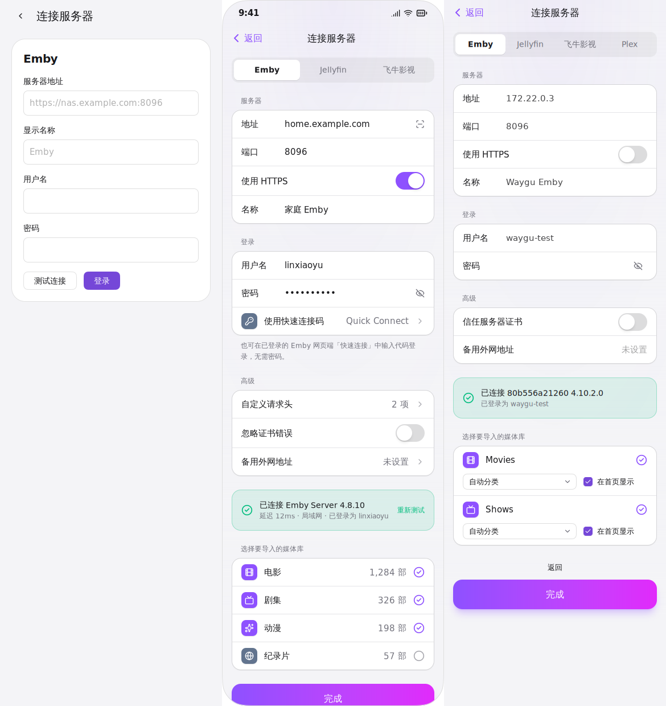
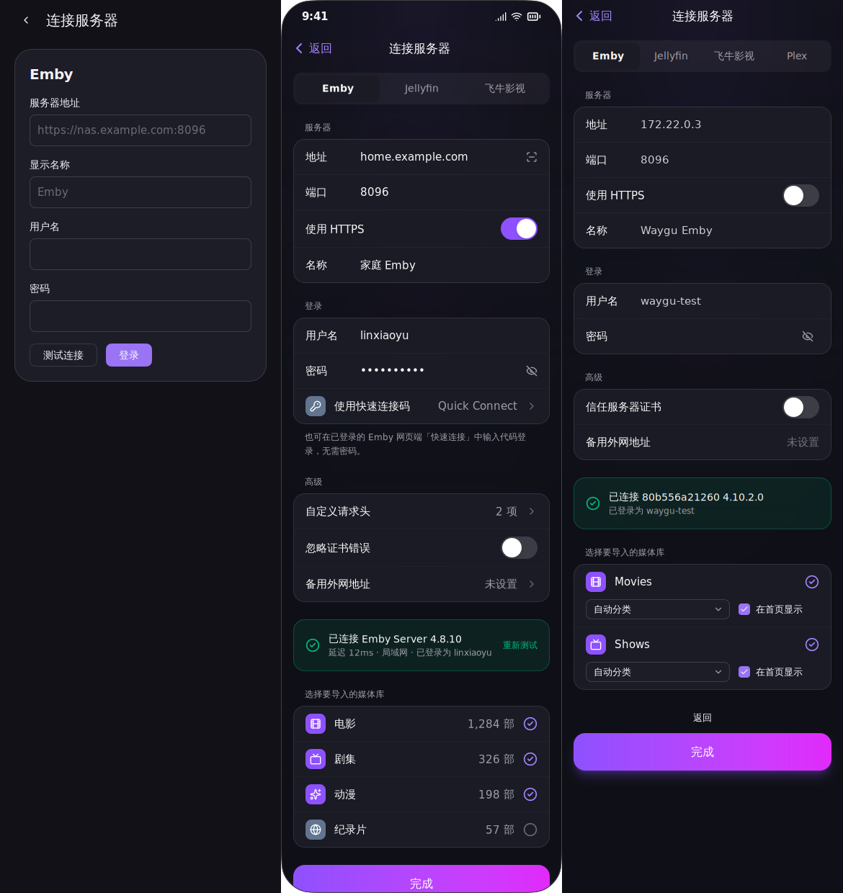
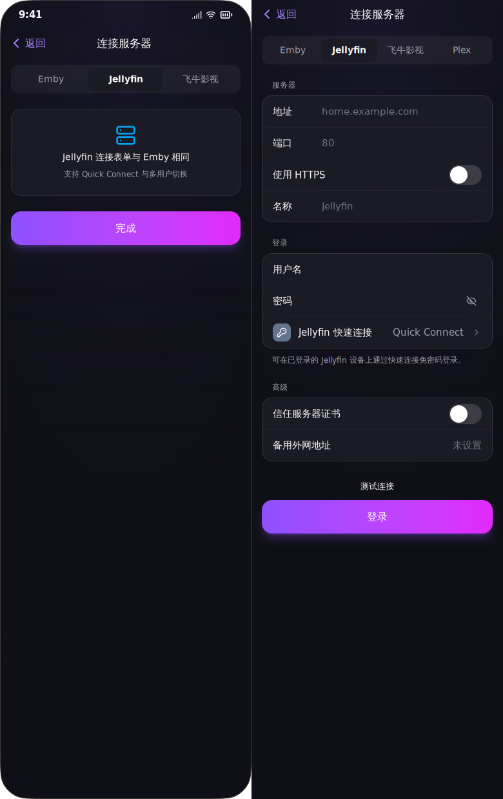
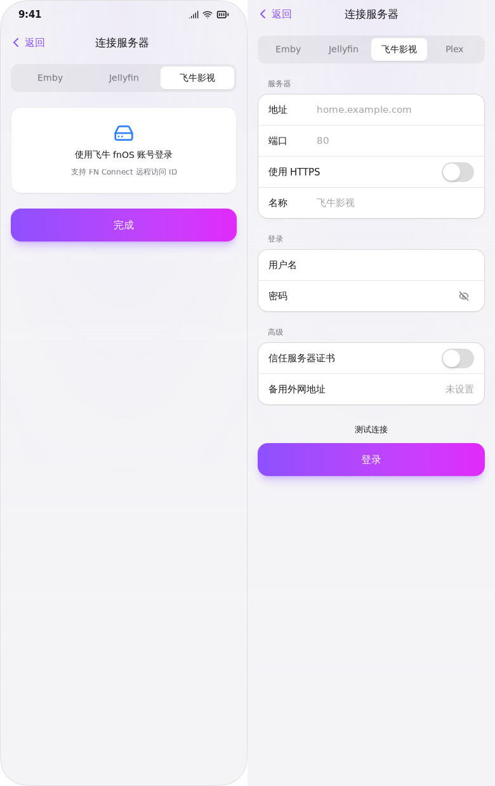
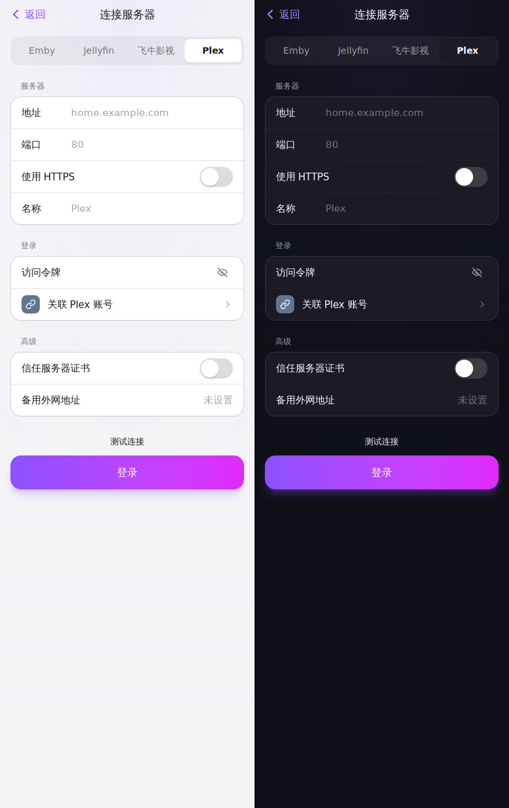

# Connect to server review

[Scenra design](../../design/source-login.scenra) · 390 × 1240 px per image · Linux GTK at 1× scale · `zh-Hans` · Scenra `88548db091cd`. The baseline app is `0c494bb`.

## Emby

Each strip shows the original empty form on the left, the design's authenticated example in the center, and the revised form after signing into the Emby Docker fixture on the right.

| Area | Baseline | Revised capture and remaining work |
| --- | --- | --- |
| Header and provider tabs | Generic header with a form for a provider selected on the prior screen. | The header is centered and the tabs use the reference's rounded selection. Plex adds a fourth segment. The reference includes a phone bezel and system bar. Verify safe-area placement and camera presentation on phones. |
| Server and login | Labels above boxed fields. | Address, port, HTTPS, name, and login use the reference's grouped 48 pt rows. The app clears the password after successful authentication. The QR control appears when the target reports scanner support. |
| Connection result and import | Testing and login were compact buttons. Successful login replaced the form with an import card. | The successful result is shown inline with an emerald status panel. Library rows use badges and visible selection circles. The fixture has two libraries, and the app keeps category and home visibility editing with each selected library. Counts, inline re-testing, and the latency indicator remain pending. |
| Advanced and alternate sign-in | Only local password login for Emby. | The Advanced group has the certificate switch and backup address. Emby Connect PIN and custom headers remain pending. Jellyfin Quick Connect and Plex authorization are reachable from their corresponding tabs. |

## Jellyfin and Flymoo

Each pair shows the Scenra tab on the left and the native app on the right. The design draws a short introduction for each tab. The app provides a working form in the same grouped style. These panels retain a layout difference under the reference as written. Flymoo FN Connect remote access remains pending.

## Plex

Light and dark native captures of the token form and the account linkage action. The design does not include a Plex panel for comparison.

## Interaction checks

`TestSourceReview` selects each provider tab in both appearances, toggles HTTPS, and checks the return to the source chooser. `TestServerAddressFields` verifies URL input, separate ports, HTTPS, reverse-proxy paths, and IPv6 addresses. `TestServerQRCodeAndPasswordVisibility` supplies a QR scan through the NSGo test host and verifies the populated fields and password visibility.

`TestDockerSourceReview` opens the discovered Emby server, verifies the connection, signs in, imports the fixture libraries, and reaches the home screen. The existing Docker media suite exercises the Emby, Jellyfin, and Plex authentication APIs and Jellyfin Quick Connect. Flymoo is checked against its protocol fixtures. Scanning with a physical camera, phone system chrome, and TV remote navigation on hardware remain pending.

The installed Android TV x86-64 APK opened the Emby form from Settings, showed the port and HTTPS controls, switched to Jellyfin, and returned to the chooser. A separate remote-only run opened the Emby form directly from welcome and returned using Back. See the [Android TV focus comparison](welcome.md#android-tv-remote-focus).

### Backup address

The editable backup address row uses the same 48 pt form group as the login fields. Existing connections have an action to save the backup without re-entering the password. Both addresses must report the identity of the same media server. The app checks a proposed address using the public identity endpoint before it sends the stored account. The Docker review rejects a different server and confirms it received no account token. The left panel shows the edit form and the right panel shows the source after switching. [Source connection flow](../../design/flows/source-connect.scenra) · [Router checks](../../integration/servers/TESTING.md#media-source-routes)

### Server certificate

The first panel in each row crops the Scenra Advanced group. The middle panel shows the certificate confirmation from the Emby Docker fixture. The last panel shows the switch after approval in the native app. The switch keeps the grouped row and light and dark styling. The label describes the stored certificate. The confirmation includes the exact HTTPS origin and the full SHA-256 fingerprint. Saving an existing connection can update or clear its approved certificates without entering a password again. The standard system or browser trust store applies on Web and the HarmonyOS WebView.

`TestDockerPhoneTrustsCertificateForLoginAndPlayback` verifies the confirmation before the gateway receives an HTTP request. It then signs in, imports the libraries, and reaches the native player. GTK decodes the fixture while reading the artwork and video over the approved connection. The certificate gateway tests reject a changed certificate on the same host and port. [HTTPS certificate checks](../../integration/servers/TESTING.md#https-server-certificates) · [Connection flow](../../design/flows/source-connect.scenra)
