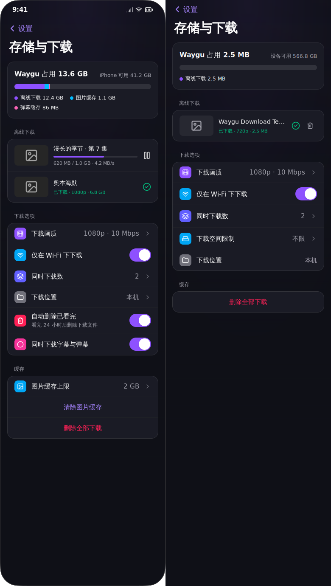
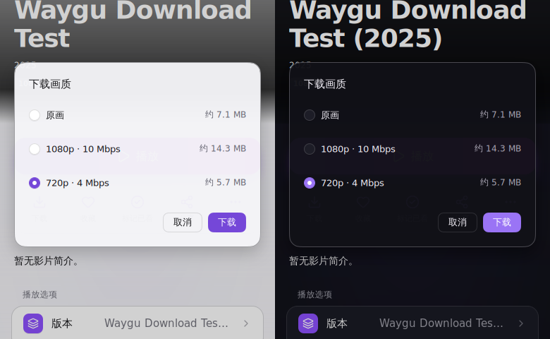
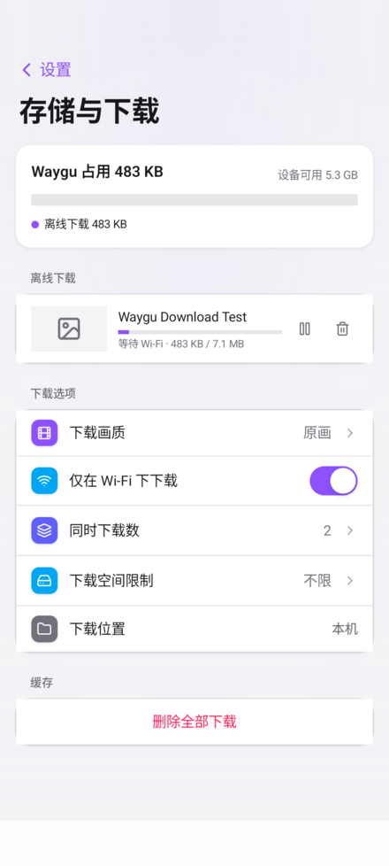
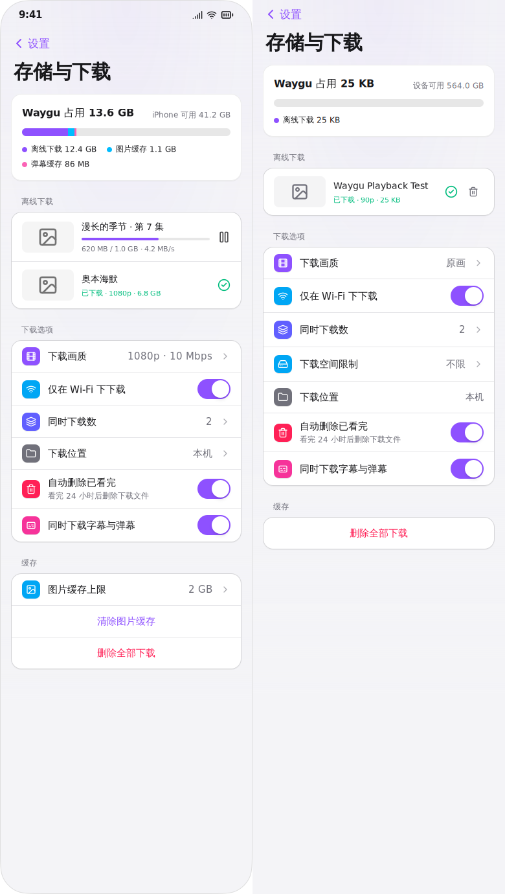
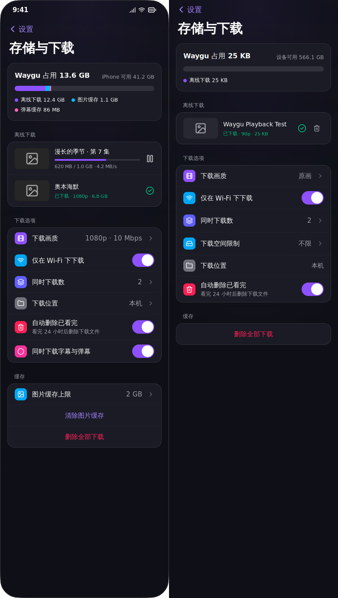
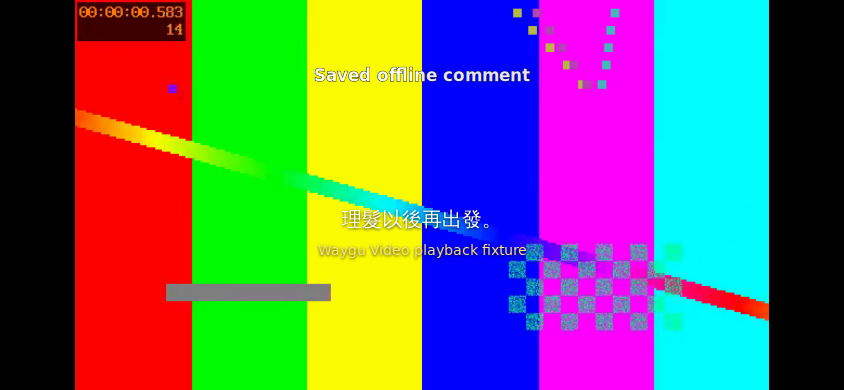
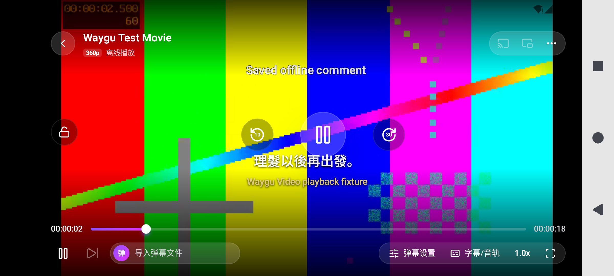
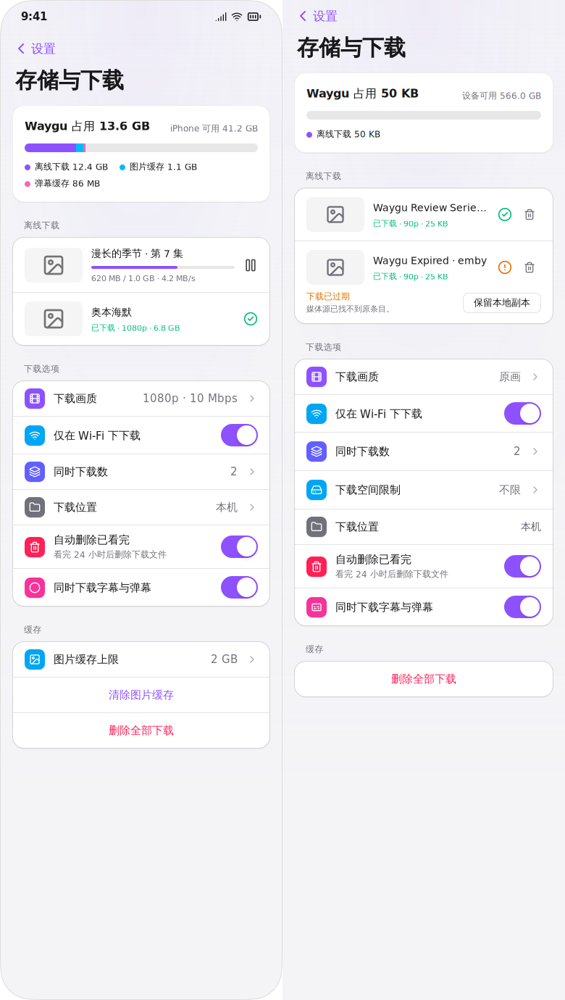
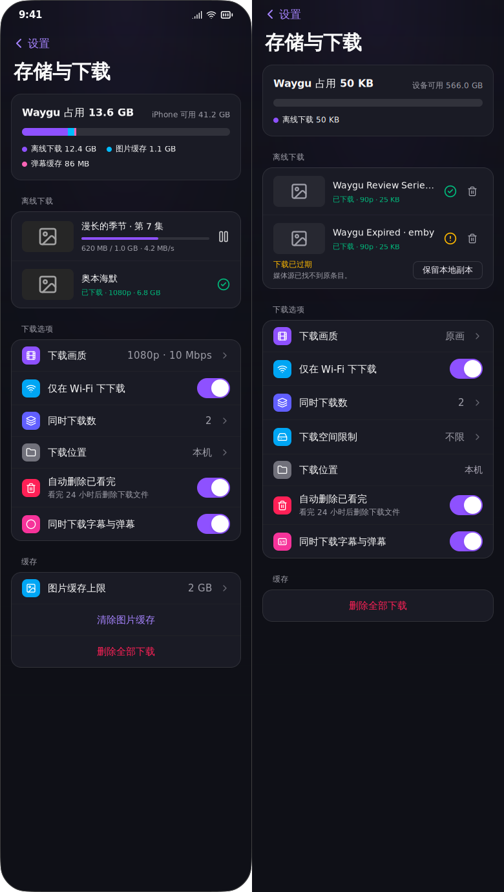
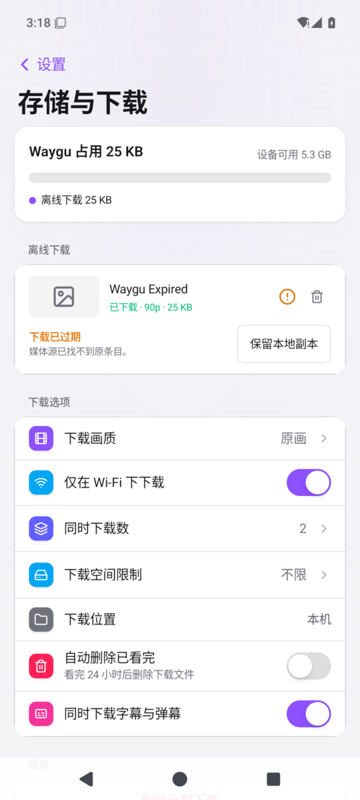

# Storage and downloads review

[Scenra design](../../design/settings-storage.scenra) · [Download workflow](../../design/flows/offline-download.scenra) · 390 × 1380 pt · Linux GTK at 1× scale · `zh-Hans`. Each strip shows the Scenra reference on the left and the native settings page on the right. The reference is rendered with Scenra `88548db091cd`. The first captures document the queue during a transfer. The latest settings captures show both new switches. [Settings captures](#automatically-delete-watched-downloads)

## Light

## Dark

## Findings

| Area | Implemented and remaining differences |
| --- | --- |
| Navigation | The Settings back link and leading title follow the reference. The iOS status bar in the design takes 44 pt at the top. The Linux capture has no mobile status bar. |
| Storage card | The native card shows local download usage, available disk space when the OS reports it, and the violet usage segment. The single legend line makes the card shorter than the reference. Separate image and danmaku cache measurements and cleanup remain pending. |
| Queue | The completed and transferring rows use the designed thumbnail, status and progress treatments. The test slows one real transfer to capture both states. The queue offers pause, resume, retry, play and confirmed deletion. Transfer size and speed come from the actual response. Completed rows have a separate delete action. Thumbnails use the artwork placeholder because the offline manifest omits signed media URLs. |
| Options | The app saves download quality, Wi-Fi policy, concurrency from one to three, the disk quota, watched-file cleanup and whether to include subtitles and danmaku. Download location is local to the device. |
| Detail and library | The detail action saves the active version of a movie or individual episode. The series picker queues selected episodes from one season. The tablet sidebar opens the same storage screen. Completed copies display a download badge and remain in the library while an included source is unreachable. Storage flags expired copies for review while they remain playable. [Season download review](phone-series.md#season-downloads) |
| Recovery and verification | Queue metadata survives restart. An original-file transfer reuses a partial range when the server supplies a matching validator. A transcoded transfer starts a new encode when resumed. The store checks response sizes when known, verifies supplied MD5 checksums, and records a SHA-256 of each completed file. OS-managed background work during sleep or app suspension remains pending. |

## Download quality

The GTK captures use the same 390 × 1380 pt client size as Scenra. Download quality is the first options row and uses the reference's icon and trailing value. The actual queue contains one 720p copy. The design shows a second row transferring and compares several types of cache usage. The outstanding settings rows and iOS system status bar account for the remaining vertical differences.

The download flow specifies Original, 1080p and 720p with size estimates. The app uses a shared confirmation dialog for this step. The global setting supplies the initial choice, and the detail page can override it for a movie or individual episode. The picker uses the selected version's original size and checks the estimate against free space and the remaining download quota. When space is insufficient, it shows both figures and opens this settings page. The completed row shows the encoded resolution and measured size. [Download workflow](../../design/flows/offline-download.scenra) · [Picker captures](desktop-movie.md#download-picker)

Emby and Jellyfin return progressive H.264/AAC MP4. Plex supplies one finite fragmented MP4 playlist. The app writes a full-movie index for fragmented copies and shifts audio and video timestamps together when the stream starts with an offset. The app checks the output resolution and timeline and reserves space as it receives bytes. The test converts the real 1080p fixture to 720p, checks picture, audio and duration, decodes near the end, and reopens it with all requests to its server rejected. Each GTK run also confirms that the local video playhead advances. [Fixture and test commands](../../integration/servers/TESTING.md#transcoded-downloads)

The Android 15 x86_64 emulator system screenshot shows the Plex copy after seeking across fragments with the media server disconnected. The same test checks the 720p label, 12-second duration and continued playback after seeking for Emby, Jellyfin and Plex. [Android test command](../../integration/servers/TESTING.md#transcoded-downloads)

## Wi-Fi downloads

The settings use the reference's sky-blue Wi-Fi icon and violet switch directly below Download quality. Wi-Fi only defaults to on. A wired connection also allows downloads. When the app loses the network or the default connection changes to cellular, active restricted tasks return to the queue. Wi-Fi restores automatic transfers. A task paused by the user waits for Resume.

Turning off Wi-Fi only lets the download picker queue a copy for Wi-Fi or start it over mobile data. A copy queued for Wi-Fi can be released individually from Storage. The queue resumes a validated original file from its saved byte range. A paused transcode starts a new encode.

On the Android 15 x86_64 emulator, an actual Emby transfer pauses on cellular, keeps a manual pause through reconnection, then pauses and resumes again across complete network loss. The Android capture shows squared group corners where Scenra and GTK clip the rows to rounded corners. Apple platforms use the system's Network framework and still need a device replay. Linux and Windows leave the switch unavailable. The HarmonyOS web host follows the setting when its embedded browser reports the transport type. [Design](../../design/settings-storage.scenra) · [Download flow](../../design/flows/offline-download.scenra) · [Verification commands](../../integration/servers/TESTING.md#download-network-transitions)

## Automatically delete watched downloads

Both comparisons show Scenra on the left and the 390 × 1380 pt GTK app on the right. The cleanup row follows Download location and uses the rose trash badge, two-line Chinese label, and 51 × 31 pt violet switch. The badge and switch sample to the same colors in both captures (`#ff2056` and `#8e51ff`). The queue and disk figures show fixture data. The app includes a download quota row, and the image-cache controls and iOS status bar are absent from the GTK capture. [Scenra source](../../design/settings-storage.scenra)

Cleanup defaults to off. While enabled and recording playback progress, reaching the end in the app starts a 24-hour timer for the completed download of that title on that account. Finishing it again restarts the timer. Marking it unwatched clears the timer. Turning cleanup off cancels pending deletions, including after re-enabling it. The app rechecks deadlines when it returns from the background or restarts and waits for an open offline player to close. Removal preserves watch history and affects only the device's downloaded copy.

The headless test checks the exact 24-hour boundary from saved state, protection for older entries without a completion timestamp, and cancellation when the option is turned off and on again. The GTK and Android 15 phone emulator tests decode a local MP4 through the player, receive the native end event, then advance the app clock while the player remains open. Both tests confirm that closing the player removes the completed file and retains the other account's download and the local progress checkpoint. [Verification commands](README.md#capture-a-comparison)

## Download subtitles and danmaku

The last Download options row uses the pink captions badge and violet switch in both themes, as shown in the comparisons above. The badge and switch sample to the same colors in the design and app (`#f6339a` and `#8e51ff`). Scenra uses the Lucide `captions` icon name for the subtitle symbol. The switch defaults to on and applies to new downloads. [Storage design](../../design/settings-storage.scenra)

The download keeps readable text subtitles from the selected version, including supported embedded and external tracks. It also keeps an existing online subtitle selection or an exact match when automatic missing-subtitle download is enabled. Danmaku follows the DandanPlay and Logvar settings and uses saved bindings or automatic matches. Saved timing offsets carry over to offline playback. The download limit includes the saved tracks. The video remains usable when optional tracks are unavailable or exceed the limit. If the video has been verified when the task pauses, resuming reuses the saved video and fetches the remaining tracks. Deleting the download also removes its saved tracks. [Offline workflow](../../design/flows/offline-download.scenra)

The tests download original and server-transcoded videos from local Emby, Jellyfin and Plex. They deny all media gateway requests, start a new app without media or DandanPlay credentials, and verify Chinese and English captions and a saved comment. The DandanPlay responses are local fixtures. GTK decodes the same video the app downloaded. The headless tests also confirm the switch prevents optional requests and that an over-quota subtitle does not invalidate a completed video. Image-based subtitles and native selection of original audio tracks remain platform-dependent. [Test commands](../../integration/servers/TESTING.md#offline-subtitles-and-danmaku)

The Android emulator opens the Emby original after disconnecting the gateway. Its screenshot is from the device display and includes the native video surface. The test checks the 360p badge against the fixture's original pixel height. [Android test command](../../integration/servers/TESTING.md#offline-subtitles-and-danmaku)

## Expired downloads

The saved row retains the thumbnail, quality, size and playback action. The status icon turns amber and the row shows a reason and **保留本地副本**. The flow specifies the expiration state and its actions. The standard storage frame supplies the row layout. The fixture includes a healthy completed row to show the difference from an expired copy. [Storage frame](../../design/settings-storage.scenra) · [Offline workflow](../../design/flows/offline-download.scenra)

Library sync checks the original item using the saved account. A confirmed missing item expires immediately. A failed connection starts a persistent clock, and another failed check at or after 30 days marks the copy expired. After reconnecting, the app checks that the original item is available before clearing the status. Expiration leaves the file available for playback and review. **保留本地副本** retains the copy even if automatic watched-file cleanup is enabled. The existing confirmed delete action can remove it.

The Docker cases use actual missing-item responses from Emby, Jellyfin and Plex and retain an adjacent valid episode. The GTK tests advance playback of an expired local copy. The clock fixture verifies the 30-day boundary, reconnecting while the item is still missing, and recovery after the item returns. [Fixture tests](../../integration/servers/TESTING.md#expired-downloads)

The Android phone emulator opens a saved expired row, keeps the file, and advances its local playback. The screenshot comes from the emulator display and shows the rounded outlines of both groups. The test framework's software bitmap capture omits that clipping. [Android test command](../../integration/servers/TESTING.md#expired-downloads)

## Interaction checks

`TestDockerOfflineDownloadReview` downloads original Emby, Jellyfin, and Plex movies and opens them after restarting with the fixture gateway disconnected. `ffprobe` checks the downloaded video and GTK verifies that native playback advances without server requests. The headless run reconnects to verify the saved progress reaches the media server. The GTK app test also pauses and resumes a live transfer. The [verification commands](README.md) reproduce the captures.

Physical device playback, lock-screen behavior, and the Flymoo original-file download path still need hardware verification.
