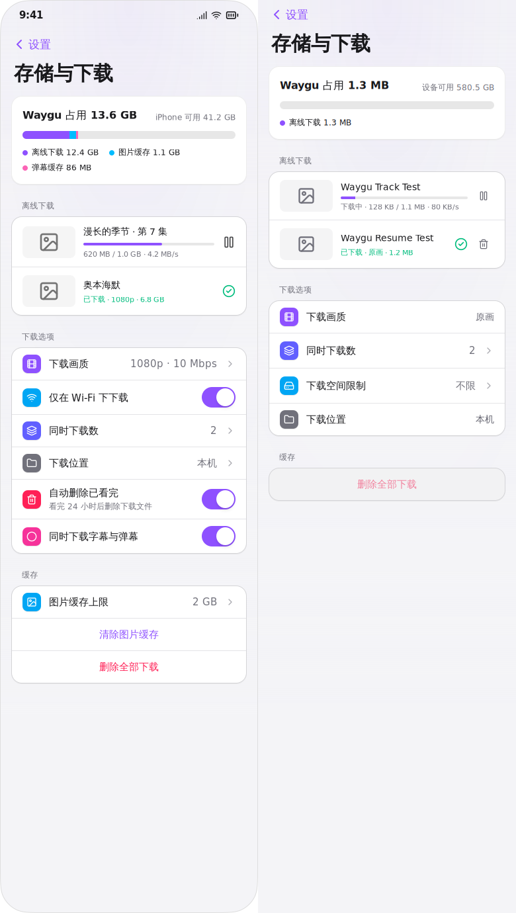
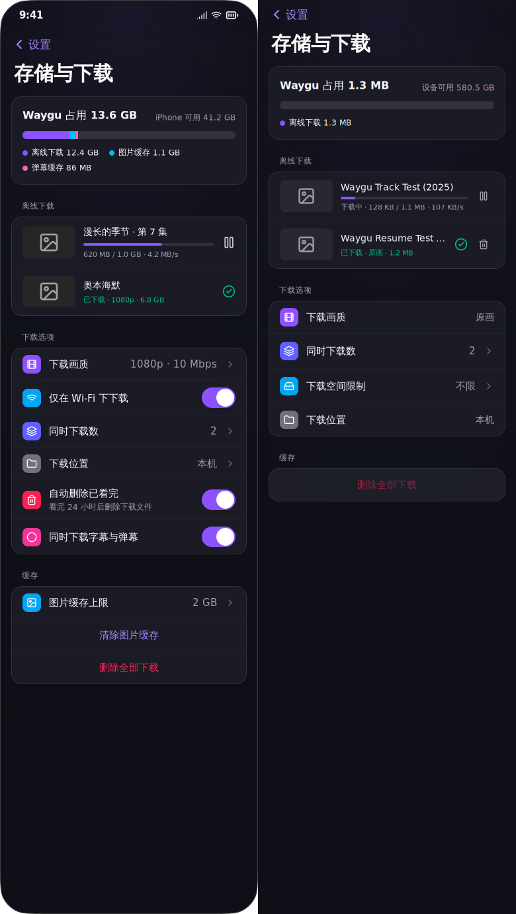

# Storage and downloads review

[Scenra design](../../design/settings-storage.scenra) · [Download workflow](../../design/flows/offline-download.scenra) · 390 × 1380 pt · Linux GTK at 1× scale · `zh-Hans`. Each strip shows the Scenra reference on the left and the native settings page on the right. The reference is rendered with Scenra `88548db091cd`. The previous app had no storage page.

## Light

## Dark

## Findings

| Area | Implemented and remaining differences |
| --- | --- |
| Navigation | The Settings back link and leading title follow the reference. The iOS status bar in the design takes 44 pt at the top. The Linux capture has no mobile status bar. |
| Storage card | The native card shows local download usage, available disk space when the OS reports it, and the violet usage segment. The single legend line makes the card shorter than the reference. Separate image and danmaku cache measurements and cleanup remain pending. |
| Queue | The completed and transferring rows use the designed thumbnail, status and progress treatments. The test slows one real transfer to capture both states. The queue offers pause, resume, retry, play and confirmed deletion. Transfer size and speed come from the actual response. Completed rows have a separate delete action. Thumbnails use the artwork placeholder because the offline manifest omits signed media URLs. |
| Options | The app saves concurrency from one to three simultaneous tasks and a disk quota, with trailing values and chevrons. Download location is local to the device. Original files are available. Transcoded quality options, Wi-Fi scheduling, automatic watched-file deletion, and automatic subtitle and danmaku downloads remain pending. |
| Detail and library | The detail action saves the active version of a movie or individual episode. The tablet sidebar opens the same storage screen. Completed copies display a download badge and remain in the library while an included source is unreachable. Season-wide selection and offline expiration handling remain pending. |
| Recovery and verification | Queue metadata survives restart. A partially saved range is reused when the server supplies a matching validator. The store checks the response size and supplied response MD5 and records a SHA-256 of the completed file. OS-managed background work during sleep or app suspension and per-segment checksums for transcoded playlists remain pending. |

## Interaction checks

`TestDockerOfflineDownloadReview` downloads original Emby, Jellyfin, and Plex movies and opens them after restarting with the fixture gateway disconnected. `ffprobe` checks the downloaded video and GTK verifies that native playback advances without server requests. The headless run reconnects to verify the saved progress reaches the media server. The GTK app test also pauses and resumes a live transfer. The [verification commands](README.md) reproduce the captures.

Platform device playback, lock-screen behavior, and the Flymoo download path still need hardware verification.
