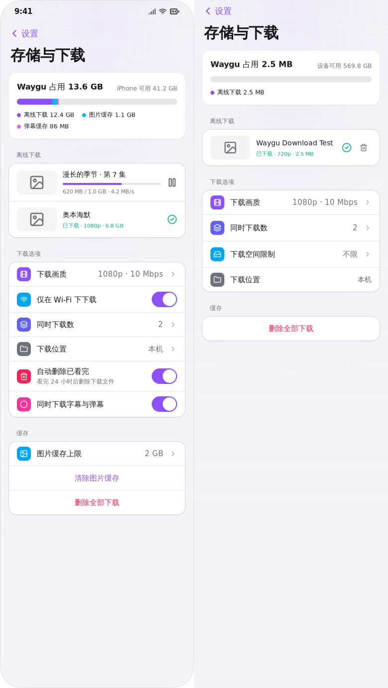
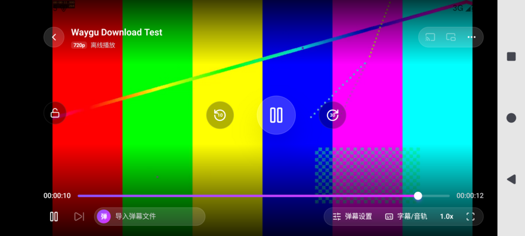

# Storage and downloads review

[Scenra design](../../design/settings-storage.scenra) · [Download workflow](../../design/flows/offline-download.scenra) · 390 × 1380 pt · Linux GTK at 1× scale · `zh-Hans`. Each strip shows the Scenra reference on the left and the native settings page on the right. The reference is rendered with Scenra `88548db091cd`. The previous app had no storage page.

## Light

## Dark

## Findings

| Area | Implemented and remaining differences |
| --- | --- |
| Navigation | The Settings back link and leading title follow the reference. The iOS status bar in the design takes 44 pt at the top. The Linux capture has no mobile status bar. |
| Storage card | The native card shows local download usage, available disk space when the OS reports it, and the violet usage segment. The single legend line makes the card shorter than the reference. Separate image and danmaku cache measurements and cleanup remain pending. |
| Queue | The completed and transferring rows use the designed thumbnail, status and progress treatments. The test slows one real transfer to capture both states. The queue offers pause, resume, retry, play and confirmed deletion. Transfer size and speed come from the actual response. Completed rows have a separate delete action. Thumbnails use the artwork placeholder because the offline manifest omits signed media URLs. |
| Options | The app saves download quality, concurrency from one to three, and the disk quota. The quality row uses the violet film icon, trailing preset and chevron from the design. Download location is local to the device. Wi-Fi scheduling, automatic watched-file deletion, and automatic subtitle and danmaku downloads remain pending. |
| Detail and library | The detail action saves the active version of a movie or individual episode. The tablet sidebar opens the same storage screen. Completed copies display a download badge and remain in the library while an included source is unreachable. Season-wide selection and offline expiration handling remain pending. |
| Recovery and verification | Queue metadata survives restart. An original-file transfer reuses a partial range when the server supplies a matching validator. A transcoded transfer starts a new encode when resumed. The store checks response sizes when known, verifies supplied MD5 checksums, and records a SHA-256 of each completed file. OS-managed background work during sleep or app suspension remains pending. |

## Download quality

The GTK captures use the same 390 × 1380 pt client size as Scenra. Download quality is the first options row and uses the reference's icon and trailing value. The actual queue contains one 720p copy. The design shows a second row transferring and compares several types of cache usage. The outstanding settings rows and iOS system status bar account for the remaining vertical differences.

The download flow specifies Original, 1080p and 720p with size estimates. Scenra does not draw a separate picker frame. The app uses the shared confirmation dialog with the chosen preset and size estimate. The global setting supplies the initial choice, and the detail page can override it for a movie or individual episode. The completed row shows the encoded resolution and measured size. [Download workflow](../../design/flows/offline-download.scenra) · [Movie detail action](../../design/movie-detail.scenra)

Emby and Jellyfin return progressive H.264/AAC MP4. Plex supplies one finite fragmented MP4 playlist. The app writes a full-movie index for fragmented copies and shifts audio and video timestamps together when the stream starts with an offset. The app checks the output resolution and timeline and reserves space as it receives bytes. The test converts the real 1080p fixture to 720p, checks picture, audio and duration, decodes near the end, and reopens it with all requests to its server rejected. Each GTK run also confirms that the local video playhead advances. [Fixture and test commands](../../integration/servers/TESTING.md#transcoded-downloads)

The Android 15 x86_64 emulator system screenshot shows the Plex copy after seeking across fragments with the media server disconnected. The same test checks the 720p label, 12-second duration and continued playback after seeking for Emby, Jellyfin and Plex. [Android test command](../../integration/servers/TESTING.md#transcoded-downloads)

## Interaction checks

`TestDockerOfflineDownloadReview` downloads original Emby, Jellyfin, and Plex movies and opens them after restarting with the fixture gateway disconnected. `ffprobe` checks the downloaded video and GTK verifies that native playback advances without server requests. The headless run reconnects to verify the saved progress reaches the media server. The GTK app test also pauses and resumes a live transfer. The [verification commands](README.md) reproduce the captures.

Physical device playback, lock-screen behavior, and the Flymoo original-file download path still need hardware verification.
