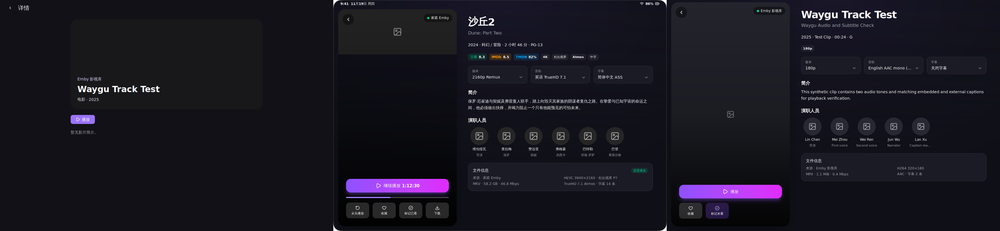
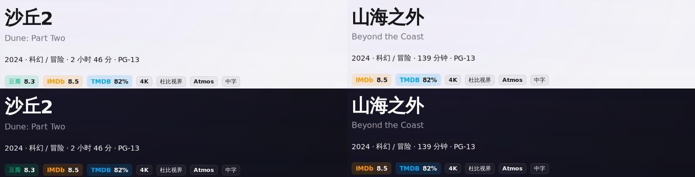
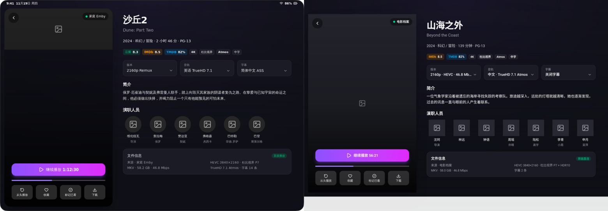

# Tablet movie detail review

[Scenra design](../../design/tablet-detail.scenra) · 1180 × 820 px per image · Linux GTK at 1× scale · `zh-Hans`. From left to right each strip shows the generic detail screen at `b1a3cae`, the Scenra reference from `88548db091cd`, and the tablet layout. The GTK lab selects the tablet layout explicitly. The new capture uses Emby's indexed Waygu Track Test file, its NFO metadata, audio streams and subtitle tracks.

## Light

## Dark

## Saved progress

The separate fixture has a saved position and displays the resume bar and poster actions.

## Findings

| Area | Revised capture and remaining differences |
| --- | --- |
| Shell | A 420 pt poster panel and a scrollable metadata column replace the centered detail column. The Scenra mock status row uses 24 pt. The app reads platform safe-area insets and GTK has no matching system row inside the client. Tablet devices still need safe-area and rotation checks. |
| Poster and actions | The rounded poster panel has an image scrim, a 40 pt back button, a source capsule, and a 48 pt gradient playback action. Saved progress adds the violet track and a separate play-from-beginning action. The fixture supplies no poster. Favorite and mark as watched read and update the active source account. Download adds the active source version to the local queue and opens the file once the download is complete. [Personal library checks](personal-library.md) · [Offline download checks](storage-downloads.md) |
| Title and metadata | The original title, year, genre, duration and certification come from the server. The rating row shows IMDb and TMDB when attributed or uses the server's generic score. The format badges follow the selected file. [Rating and format comparison](#ratings-and-formats) |
| Versions and tracks | The three equal-width controls use the selected file's metadata. The version choice persists. Chosen audio is negotiated by the media server and the selected supported text subtitle loads in the player. The test clip has AAC and text subtitles. Decoder-only subtitle formats still use the player track controls. |
| Synopsis and cast | The overview and horizontal cast strip use the fixture's indexed NFO fields. The placeholder portraits reflect the supplied data. Emby, Jellyfin, and Plex can supply credits. Flymoo credits still need a provider mapping. |
| File information | The two columns show the source, container, size, bitrate, video dimensions, Dolby Vision profile and compatible range, audio codec, and subtitle count when provided. Emby and Jellyfin determine the play method while negotiating playback, so their preview has no direct-play badge. |

## Ratings and formats

Scenra is on the left and GTK is on the right, with light above dark. The fixture supplies IMDb 8.5, TMDB 82%, a 4K Dolby Vision file, an Atmos audio track and Chinese subtitles. `TestDetailBadges/tablet` confirms those badges, the P7 and HDR10 file information, and the update to 1080p when selecting the SDR version. It also checks that the TMDB rating stays visible. The Emby Docker movie exercises the generic 8.3 score. The Douban badge still needs a rating source. [Rating sources](desktop-movie.md#rating-badges)

The Android 15 emulator ran the landscape tablet layout at 1180 × 820 dp. The test selected both versions and checked the Dolby Vision file information and the rating row. The Android content starts lower because the device supplies its own safe area. The poster panel and cast placeholders have square corners on this Android capture. Scenra rounds the panel and uses circular portraits.

## Interaction checks

`TestDockerTabletDetailReview` opens the fixture movies from the tablet movie library, checks the landscape panel and control sizes, selects Japanese audio and an external subtitle, verifies the selections in the player, reopens a multi-version movie to verify persistence, starts a previously played movie from the beginning, and switches the poster source for a matched copy. It also closes the track dialog over playing video. On GTK the closed dialog is removed immediately so a stalled exit transition cannot intercept playback controls. The Docker media suite verifies the version and track payloads and decodes the selected audio against Emby, Jellyfin, and Plex. Native playback uses GStreamer with HLS, transport-stream and H.264/AAC plugins.

See the [screen inventory](screens.md) for the other detail and player layouts.
