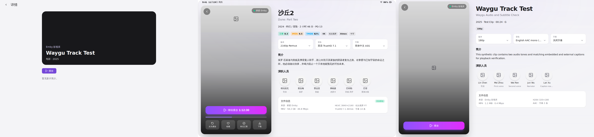
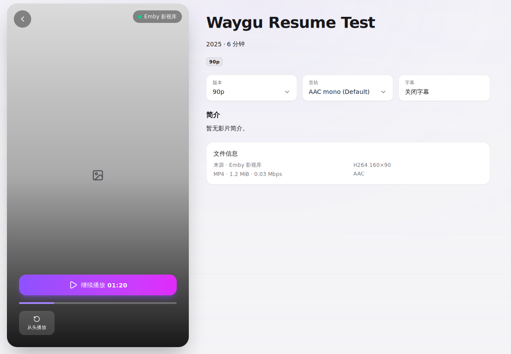

# Tablet movie detail review

[Scenra design](../../design/tablet-detail.scenra) · 1180 × 820 px per image · Linux GTK at 1× scale · `zh-Hans`. From left to right each strip shows the generic detail screen at `b1a3cae`, the Scenra reference from `88548db091cd`, and the tablet layout. The GTK lab selects the tablet layout explicitly. The new capture uses Emby's indexed Waygu Track Test file, its NFO metadata, audio streams and subtitle tracks.

## Light

## Dark

## Saved progress

The separate fixture has a saved position and displays the remaining part of the playback controls.

## Findings

| Area | Revised capture and remaining differences |
| --- | --- |
| Shell | A 420 pt poster panel and a scrollable metadata column replace the centered detail column. The Scenra mock status row uses 24 pt. The app reads platform safe-area insets and GTK has no matching system row inside the client. Tablet devices still need safe-area and rotation checks. |
| Poster and actions | The rounded poster panel has an image scrim, a 40 pt back button, a source capsule, and a 48 pt gradient playback action. Saved progress adds the violet track and a separate play-from-beginning action. The fixture supplies no poster. Favorite, mark as watched, and download actions remain pending. |
| Title and metadata | The original title, year, genre, duration, certification, and resolution come from the server. The app shows provider-neutral scoring when the server supplies a score. The design's named rating sources and additional audio and subtitle badges remain pending. |
| Versions and tracks | The three equal-width controls use the selected file's metadata. The version choice persists. Chosen audio is negotiated by the media server and the selected supported text subtitle loads in the player. The test clip has AAC and text subtitles. Decoder-only subtitle formats still use the player track controls. |
| Synopsis and cast | The overview and horizontal cast strip use the fixture's indexed NFO fields. The placeholder portraits reflect the supplied data. Emby, Jellyfin, and Plex can supply credits. Flymoo credits still need a provider mapping. |
| File information | The two columns show the source, container, byte size, bitrate, video dimensions, audio codec, and subtitle count when provided. Emby and Jellyfin determine the play method while negotiating playback, so the preview has no direct-play badge. |

## Interaction checks

`TestDockerTabletDetailReview` opens the movie from the tablet home, checks the landscape panel and control sizes, selects Japanese audio and an external subtitle, verifies the selections in the player, reopens a multi-version movie to verify persistence, starts a previously played movie from the beginning, and switches the poster source for a matched copy. It also closes the track dialog over playing video. On GTK the closed dialog is removed immediately so a stalled exit transition cannot intercept playback controls. The Docker media suite verifies the version and track payloads and decodes the selected audio against Emby, Jellyfin, and Plex. Native playback uses GStreamer with HLS, transport-stream and H.264/AAC plugins.

See the [screen inventory](screens.md) for the other detail and player layouts.
