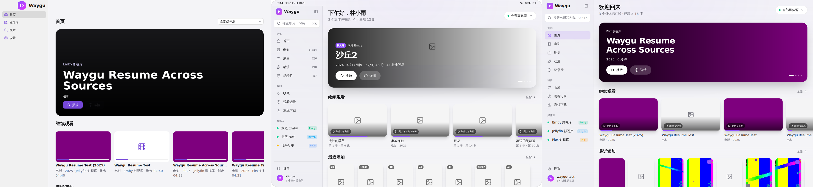
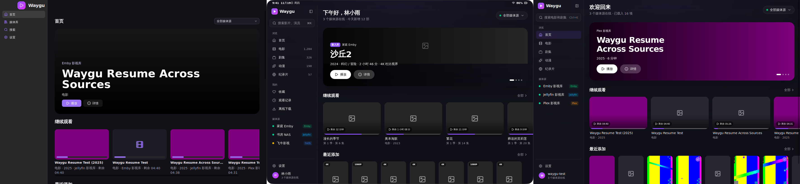
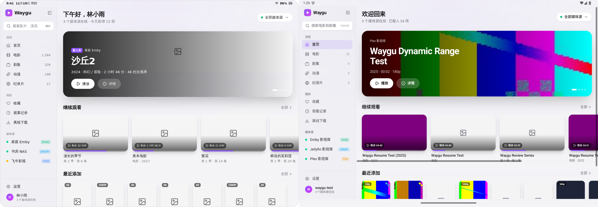
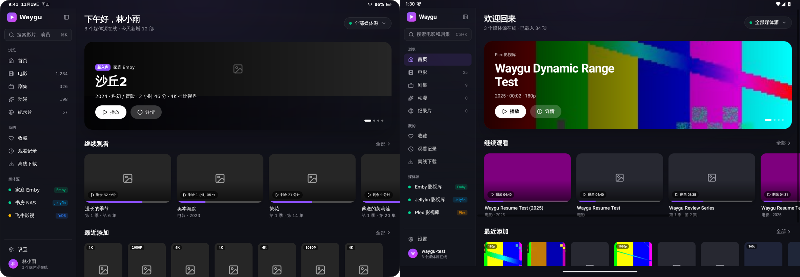
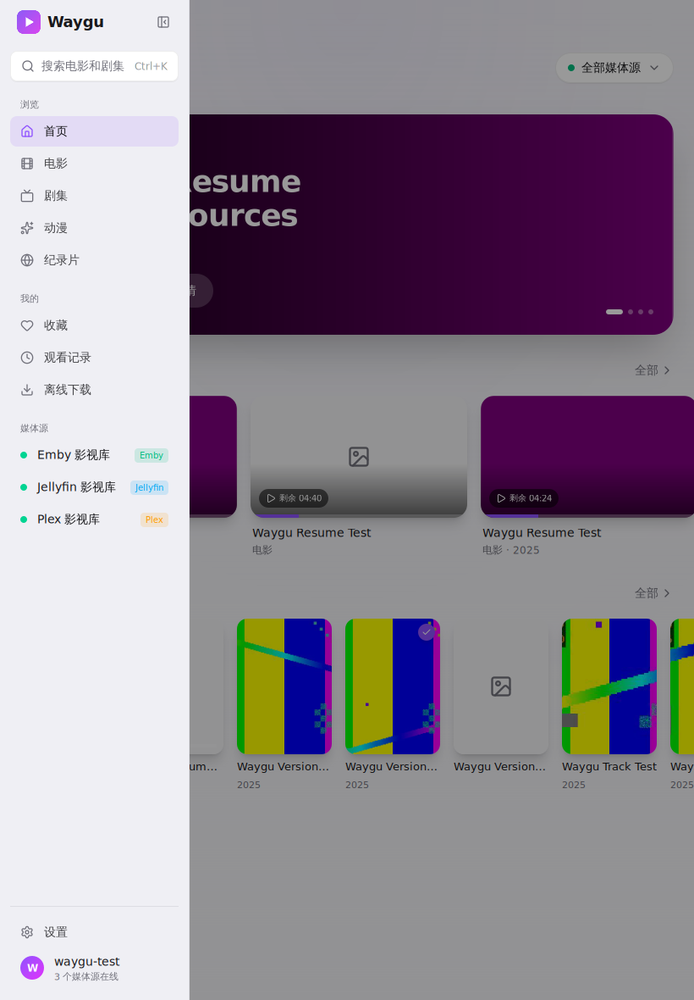
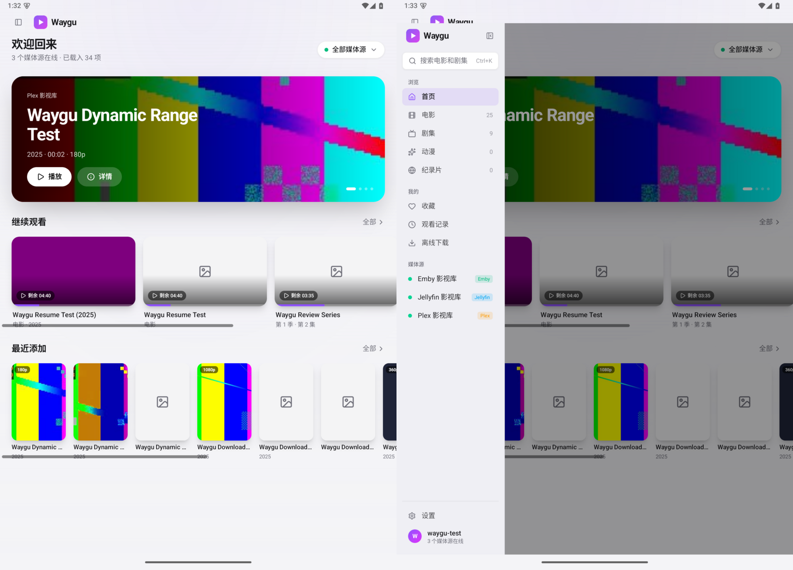

# Tablet home review

[Scenra design](../../design/tablet-home.scenra) · 1180 × 820 px per landscape image · Linux GTK at 1× scale · `zh-Hans`. The app reads the Emby, Jellyfin, and Plex Docker libraries and uses their fixture art and resume progress.

The strips show the pre-tablet layout at `e19c0a1`, the Scenra reference, and the revised tablet layout. The baseline comes from the shared desktop and tablet shell at that revision. The GTK harness selects the new tablet shell explicitly. Scenra `88548db091cd` renders both references with the sidebar components. The component files use the supported clock icon for watch history.

## Light



## Dark



## Android 15

Each landscape pair shows Scenra on the left and the Android display on the right. The x86-64 Android 15 tablet emulator ran NSGo 0.3.0 at 2360 × 1640 px and 320 dpi. The Android images include the system status and gesture navigation bars and are scaled to 1180 × 820 px.





## Portrait drawer

The 820 × 1180 px native capture shows the drawer open over the portrait home. The design describes the drawer interaction in a note and supplies landscape drawings for both appearances.



The Android pair shows the home and the drawer after a system-level swipe, scaled from 1640 × 2360 px to 820 × 1180 px per view.



## Findings

| Area | Revised capture and remaining differences |
| --- | --- |
| Landscape shell | The sidebar is 224 pt wide and the content starts 24 pt beyond it. The design draws a 24 pt iPad status bar and rounded screen frame. The app uses platform safe-area insets, so the GTK client starts above the equivalent content in the design. |
| Sidebar | The brand, search field, browse shortcuts, source badges, settings, and account footer use the shared sidebar design. The shortcut follows the platform's key labels. Source names, account, and provider badges reflect fixture data. Favorites and Watch history occupy the My library group and link to their sections. The Downloads row links to the local queue. The four Android category totals match the loaded libraries and are announced in the links’ accessibility hints. [Personal library checks](personal-library.md) |
| Header and source filter | The greeting, live catalog summary, and 36 pt source pill follow the header layout. The archived Android photos show the loaded-item summary. The current summary reports today’s additions in the same row. Android draws its own system indicators and rail scrollbars. The status bar foreground follows the tablet app appearance. |
| Featured title | The 260 pt wide-format carousel uses a left-to-right scrim, 40 pt pill actions, and bottom-right indicators. Title wrapping, source, art, runtime, resolution, and HDR or Dolby Vision labels depend on the selected item. The Android captures feature the Plex 180p test pattern. The fixture with a 4K Dolby Vision profile checks the full metadata row. |
| Continue watching | The rail uses 256 × 144 pt artwork, 16 pt gaps, remaining-time pills, and bottom progress tracks. Resume rows reflect saved fixture positions and the current source selection. |
| Recently added | The rail uses 112 × 160 pt poster covers and 16 pt gaps. Playback progress follows the catalog. The poster shows the reported resolution in the upper-left corner when enabled. The title subtitle uses the year and first genre when supplied. A separate Series Updates shelf in a customized layout uses the latest indexed episode’s number and format. [Episode checks](home.md#interaction-checks) |
| Portrait navigation | The drawer spans the client height with a scrim and the same navigation links. It opens from a leading-edge swipe or the panel button. It closes from a leftward swipe, the panel button, the scrim, or a destination. On Android, a central 12 × 192 dp region on the left edge opens the drawer. Android retains the system Back gesture on the rest of the edge. Physical Android and iPadOS tablet checks remain pending. |

## Interaction checks

`TestDockerTabletHomeReview` verifies horizontal swipes and manual carousel selection, expansion and collapse of the recent rail, source selection and restoration of the aggregate catalog, movie and series shortcuts, search and its keyboard shortcut, the featured detail and playback routes, side-panel toggling in landscape, and portrait drawer gestures and navigation.

The Android portrait run injects a system-level edge swipe and Back, then rotates to landscape with the drawer open and checks that the selected settings page survives. The runner uses a temporary debuggable test runtime for the portrait run so Android can deliver system touch input to NSGo. Set `ANDROID_SERIAL` to the tablet emulator serial and enable gesture navigation for portrait. Start the Docker fixtures and forward their ports to the emulator. [Docker fixtures](../../integration/servers/TESTING.md) · [Android SDK and JDK setup](../../build/android/PACKAGING.md) The runner saves full-display and window captures under `.nsgo/tablet-home-android/`.

```sh
adb -s "$ANDROID_SERIAL" reverse tcp:18096 tcp:18096
adb -s "$ANDROID_SERIAL" reverse tcp:28096 tcp:28096
adb -s "$ANDROID_SERIAL" reverse tcp:32400 tcp:32400
python3 build/android/test-tablet-home.py "$ANDROID_SERIAL" light
python3 build/android/test-tablet-home.py "$ANDROID_SERIAL" dark
python3 build/android/test-tablet-home.py "$ANDROID_SERIAL" portrait
```

The GTK lab uses Cairo and preloads its installed libsoup 3 to load the Docker artwork. The [tablet detail review](tablet-detail.md) covers the movie destination. The [screen inventory](screens.md) tracks the remaining device layouts.
