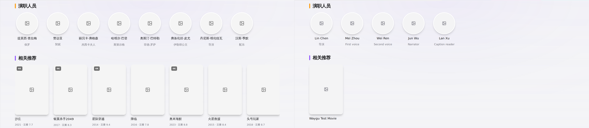
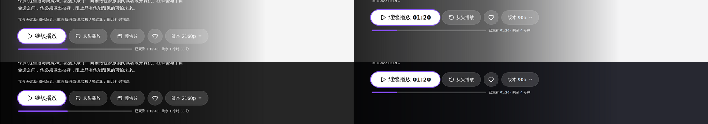

# TV detail review

The left frames are Scenra and the right frames are the app on Linux GTK, both using the Simplified Chinese layout at 1920 × 1640 pt. The app displays two movies from the Emby Docker fixture. Scenra shows its title graphic and image placeholders. The app uses a test clip as the backdrop and displays a text title when the server has no logo tag. [Scenra design](../../design/tv-detail.scenra)

## Light

## Dark

## Cast and recommendations

The source frame clips the recommendation metadata near its lower edge. The shelf comparison extends the reference to 1920 pt in height and aligns the cast marker with the scrolled app capture. The app shows the five credits and one recommendation supplied by the fixture.

## Resume

The reference and app crops show the playback row and its progress in light and dark appearance. The resume fixture has a saved position of 1:20 and a six-minute run time. That fixture has no trailer or cast metadata.

| Area | Comparison |
| --- | --- |
| Hero and back row | The hero is 980 pt high. The left overlay spans 1440 pt, and the top and bottom gradients span 192 and 80 pt. Back, its remote hint and the clock share the 96 pt insets. The 480 × 112 pt logo slot takes a tagged Emby or Jellyfin title image and falls back to text. The Docker capture shows that fallback. |
| Metadata | The title block begins 170 pt below the top. The app shows the server rating, year, genres, duration and content rating, actual version format and source badge. The reference shows individual Douban, IMDb and TMDB scores. Those separately attributed ratings remain pending. |
| Actions and progress | The 80 pt pill row uses a white primary control with a violet focus ring. A bookmark adds Resume, From beginning and a 620 × 8 pt progress track. The Trailer button opens a playable clip tagged as a trailer. Favorites reflect the current provider's capabilities. Version opens separate choices for media sources and the selected server's playable files. |
| Cast and recommendation shelves | Cast cells use 144 pt avatars, 160 pt cells and a 40 pt gap. The recommendation rail reuses the 220 × 330 pt TV posters and 32 pt spacing. A credit opens its full name and role. A poster opens that title's details. |
| Device coverage | GTK captures use the design-sized viewport. Android TV uses the 1920 × 1080 operating viewport. Physical TV and tvOS validation remain pending. |

`TestDockerTVDetailReview` verifies the geometry, credit dialog, related-title route, trailer playback route, saved resume position, version selection and reopening the same version. Its headless case switches a shared title from Emby to Jellyfin. `TestDockerMovieFeatures` exercises the extras and recommendation endpoints on all three Docker servers. `TestDetailUsesTaggedLogo` verifies the Emby and Jellyfin image routes with a tagged data fixture.

## Android TV

The installed Leanback APK was checked on a 1920 × 1080 Android TV emulator against Emby. The captured focus stops show Play, the version dialog, the first credit and the first related poster. Down scrolls the short viewport to bring each shelf into view. Back closes the picker and restores focus to its trigger. Selecting a related poster opens a new detail route.

With a featured movie that has credits, recommendations and playable versions, launch Waygu and run `python3 build/android/tv-smoke.py --with-detail` on the host with the device's `ANDROID_SERIAL`.

The [screen inventory](screens.md) tracks the other TV views.
