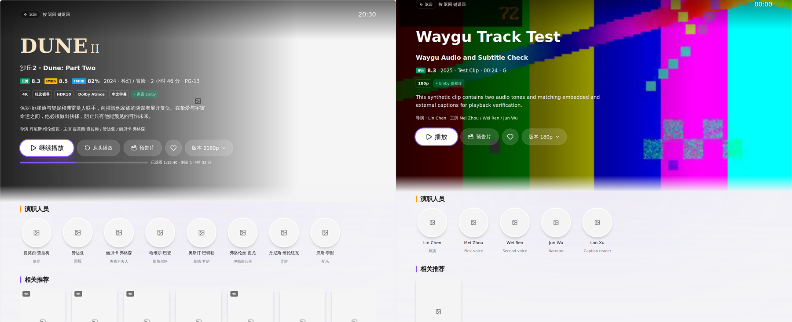
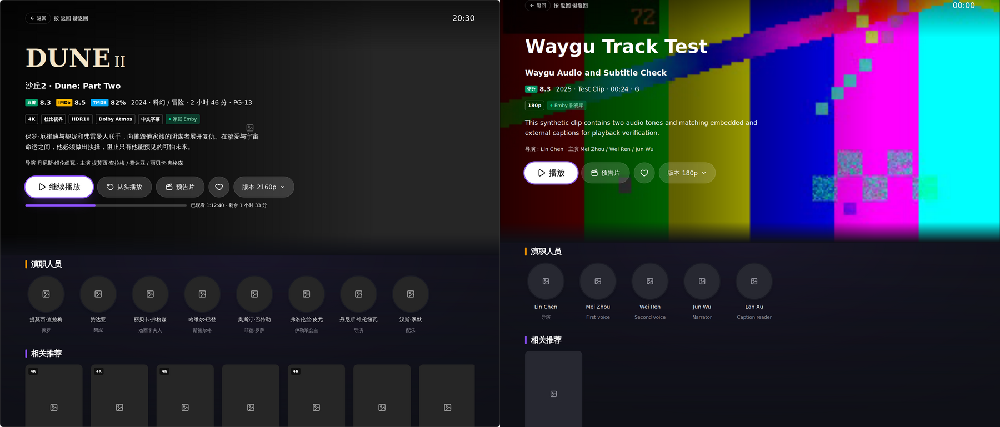
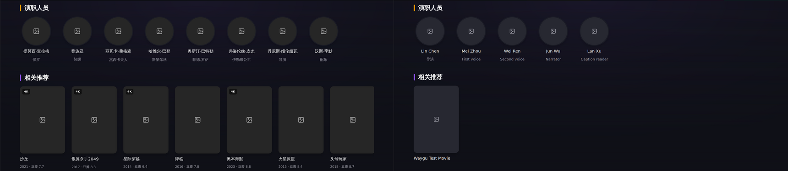
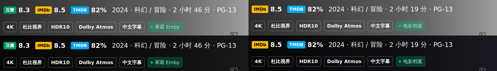
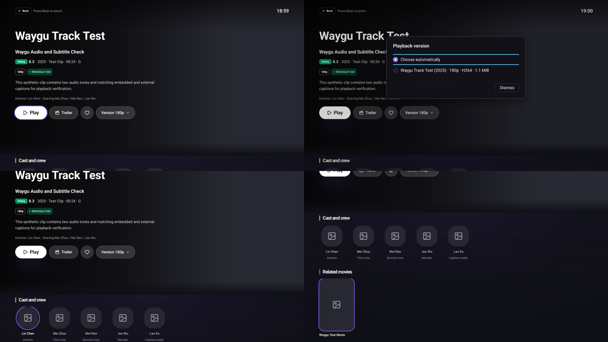
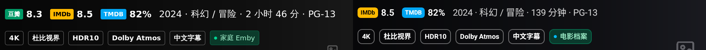
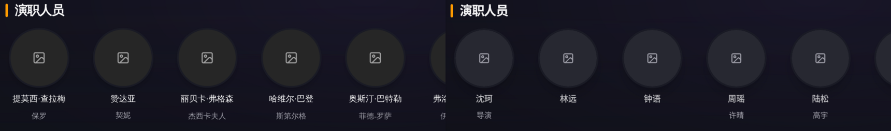
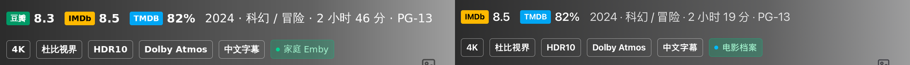

# TV detail review

The left frames are Scenra and the right frames are the app on Linux GTK. Both use the 1920 × 1640 pt Simplified Chinese layout and show the top 1563 pt in the main comparison. The app displays two movies from the Emby Docker fixture. Scenra shows its title graphic and image placeholders. The app uses a test clip as the backdrop and displays a text title when the server has no logo tag. [Scenra design](../../design/tv-detail.scenra)

## Light

## Dark

## Cast and recommendations

The source frame clips the recommendation metadata near its lower edge. The shelf comparison extends the reference to 1920 pt in height and aligns the cast marker with the scrolled app capture. The app shows the five credits and one recommendation supplied by the fixture.

## Resume

The reference and app crops show the playback row and its progress in light and dark appearance. The resume fixture has a saved position of 1:20 and a six-minute run time. That fixture has no trailer or cast metadata.

| Area | Comparison |
| --- | --- |
| Hero and back row | The hero is 980 pt high. The left overlay spans 1440 pt, and the top and bottom gradients span 192 and 80 pt. Back, its remote hint and the clock share the 96 pt insets. The 480 × 112 pt logo slot takes a tagged Emby or Jellyfin title image and falls back to text. The Docker capture shows that fallback. |
| Metadata | The title block begins 170 pt below the top. The app shows attributed IMDb and TMDB scores or a generic server rating, year, genres, duration, certification, selected version formats and source. Durations over an hour use hours and minutes. The badge corners and borders scale with the viewport alongside the text. [Rating and format comparison](#ratings-and-formats) |
| Actions and progress | The 80 pt pill row uses a white primary control with a violet focus ring. The outlined controls use a 1 pt border at the design size. A bookmark adds Resume, From beginning and a 620 × 8 pt progress track. The Trailer button opens a playable clip tagged as a trailer. Favorites reflect the current provider's capabilities. Version opens separate choices for media sources and the selected server's playable files. |
| Cast and recommendation shelves | Cast cells use 144 pt avatars, 160 pt cells and a 40 pt gap. The portrait fits inside its 4 pt border at the design size. The recommendation rail reuses the 220 × 330 pt TV posters and 32 pt spacing. A credit opens its full name and role. A poster opens that title's details. |
| Device coverage | GTK captures use the design-sized viewport. The Android TV emulator and Apple TV simulator use a 1920 × 1080 viewport. Physical TV validation remains pending. |

`TestDockerTVDetailReview` verifies the geometry, credit dialog, related-title route, trailer playback route, saved resume position, version selection and reopening the same version. Its headless case switches a shared title from Emby to Jellyfin. `TestDockerMovieFeatures` exercises the extras and recommendation endpoints on all three Docker servers. `TestDetailUsesTaggedLogo` verifies the Emby and Jellyfin image routes with a tagged data fixture.

## Ratings and formats

Scenra is on the left and GTK is on the right, with light above dark. Both use NSGo 0.3.0. The ratings appear in the same row as the year and runtime. The selected 4K version has separate Dolby Vision and HDR10 badges, followed by Dolby Atmos and Chinese subtitles. `TestDetailBadges/tv` checks these values and the badge update after choosing the SDR version. The Emby Docker movie exercises the generic 8.3 score. The Douban badge still needs a rating source. [Rating sources](desktop-movie.md#rating-badges) · [Dynamic range mapping](desktop-movie.md#video-range)

## Android TV

The installed Leanback APK was checked on a 1920 × 1080 Android TV emulator against Emby. The captured focus stops show Play, the version dialog, the first credit and the first related poster. Down scrolls the short viewport to bring each shelf into view. Back closes the picker and restores focus to its trigger. Selecting a related poster opens a new detail route.

The dark crops show Scenra, the previous Android TV window and the updated window, from left to right. All use the same pixel scale. The top edge of the 4K badge measures one physical pixel after scaling, compared with two in the previous capture. The native test switches to the 1080p SDR version and checks that the 4K format badges disappear. The geometry assertions also run locally at 1920 and 960 logical points. [Android capture method](../../build/android/PACKAGING.md)

The cast comparison shows Scenra on the left and the scrolled Android TV window on the right. The portrait ring stays outside the artwork, and the empty portrait's image icon scales to 28 px in the 1920 px Android TV capture.

The installed NSGo 0.3.0 APK also passed Leanback launch, onboarding, server setup and Settings navigation with the D-pad. [Android packaging](../../build/android/PACKAGING.md)

With a featured movie that has credits, recommendations and playable versions, launch Waygu and run `python3 build/android/tv-smoke.py --with-detail` on the host with the device's `ANDROID_SERIAL`.

## Apple TV

Scenra is on the left and the Apple TV simulator is on the right. The simulator's 3840 × 2160 px capture is reduced to its 1920 × 1080 pt viewport before cropping. The fixture supplies IMDb and TMDB scores, a different runtime and a different source name. The Apple TV badge rows sit about 3 to 4 px higher in the crop, and the labels use the platform font metrics.

`TestDetailBadges` passed the badge geometry and the change from 4K HDR to 1080p SDR. The uploaded artifact contains the light capture. The same workflow checked the tvOS device and simulator targets and passed `TestTVNavigation` and `TestTVHomeNativeFixture`. [Apple TV simulator run](https://github.com/vicnoah/waygu-video/actions/runs/45210627506)

The [screen inventory](screens.md) tracks the other TV views.
