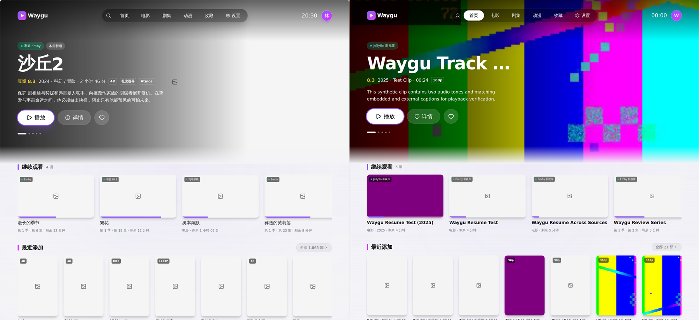
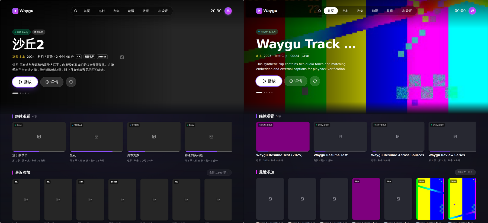
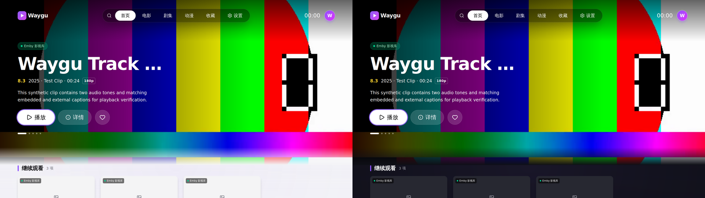
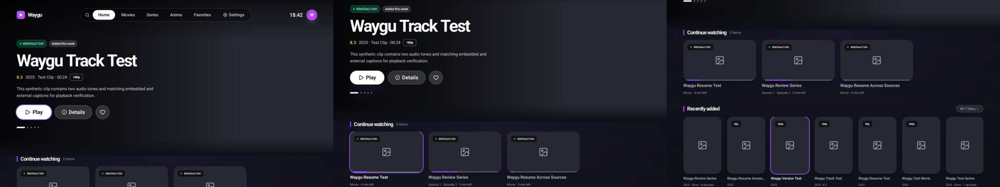
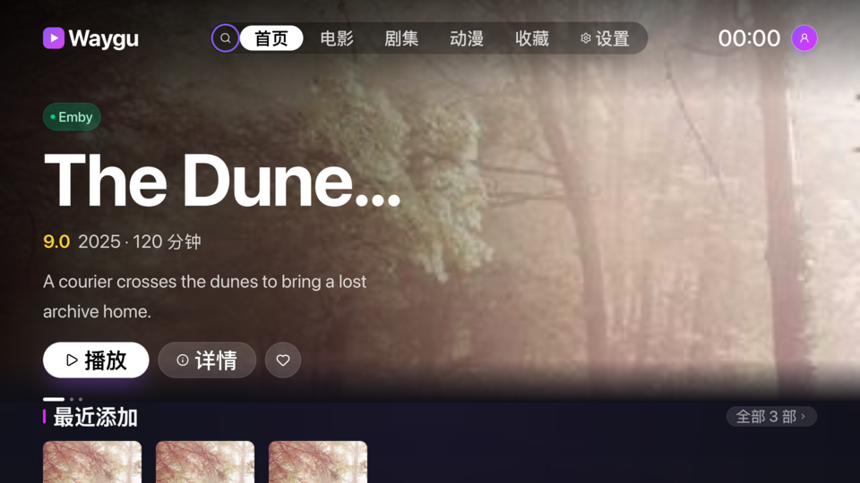
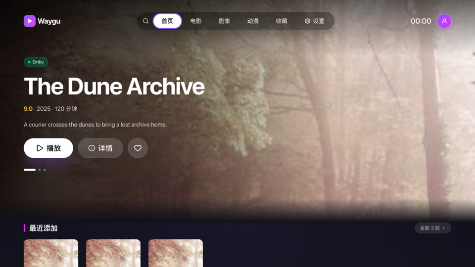
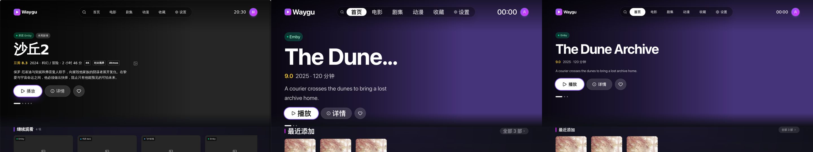

# TV home review

The left frames are Scenra and the right frames are the app on Linux GTK. Both use the Simplified Chinese layout at 1920 × 1760 pt. The app connects to the Emby, Jellyfin, and Plex Docker fixtures. The reference renderer substitutes image placeholders for the design's film stills and posters. [Scenra design](../../design/tv-home.scenra)

## Light



## Dark



## Source shelves

The design frame clips the first source shelf at 1760 pt. To compare this section, the reference export extends the frame to 2450 pt and crops the first source shelf. The app capture scrolls to its first shelf. The reference shows Flymoo and the fixture shows Emby.


## Findings

| Area | Comparison |
| --- | --- |
| Featured artwork | Both appearances use a 900 pt panel with a left scrim extending 1360 pt, a top scrim and a 96 pt fade into the page background. The high-contrast color bars in the app come from the synthetic movie. |
| Navigation | The wordmark, central pill, clock and profile sit in a row with 96 pt side insets. The app shows the active Home pill. The static Scenra export draws the unselected pills. The app uses the current time and the first source account initial. |
| Featured metadata and actions | Source and freshness pills, title, metadata, synopsis, actions and page indicators use the reference layout. The title and synopsis change line breaks with the catalog text. Ratings use the server's value, and quality badges depend on available stream metadata. The primary focus uses a violet ring and a small scale increase. |
| Continue watching | Cards use 420 × 236 pt artwork, a 32 pt gap, a source badge over the top-left corner and a 6 pt progress line. The fixture shows five saved bookmarks. The horizontal viewport clips the next card at the 96 pt right inset. |
| Recently added and source shelves | The shelves use 220 × 330 pt artwork, 32 pt gaps and section markers. The fixture's available source names, provider badges and media count determine the labels. Content cards link to their media copy. |
| Source shelf settings | **Settings → Appearance → Home layout** controls the visibility and order of each source row. The catalog and playback keep their original source priority. [Settings captures and checks](tv-settings.md#home-layout) |
| Background trailers | The focused featured panel can play a server trailer behind its metadata and actions. The image fills the 900 pt panel and uses the same scrims. [Playback checks](#silent-background-trailers) |

## Interaction checks

`TestDockerTVHomeReview` verifies the featured and card dimensions, all three Docker source shelves, details, Movies, Series, Anime, Favorites, Search and the complete catalog shortcut. Headless it checks the six-second focus-gated rotation and the long-press removal of a resume bookmark. Removing a bookmark from the TV shelf preserves the server's progress. New playback progress makes the title eligible for the shelf again.

After adjusting the Home layout, both appearances show Jellyfin above Emby and omit the Plex row. The covers and titles come from the fixture libraries. Items without artwork use the app's poster placeholder. [Home layout steps and settings captures](tv-settings.md#home-layout)


A separate Series Updates shelf in a customized layout uses the newest indexed episode for its ordering and caption. [Series update checks](home.md#interaction-checks)

The [screen inventory](screens.md) tracks the detail page and the other TV views.

## Silent background trailers

After 750 ms of focus in the featured actions, Waygu looks for a trailer attached to the title. It keeps the artwork until the native player advances, then puts the muted frame under the same title, scrims, indicator and focus ring. The next recommendation still appears after six seconds. Leaving the actions or the foreground restores the artwork and closes the stream. An unavailable trailer retains the artwork. Reduced motion, parental controls, and a reported cellular or offline connection keep the background static. [Scenra background and timing note](../../design/tv-home.scenra#L4)




The test footage uses a synthetic color chart, and the buttons and scrims occupy the same positions as in the artwork captures. GTK elides the fixture title sooner than Android because of native font metrics. The Android image comes from the emulator display. The native test host's software snapshot omits the video texture.

`TestDockerTVSilentTrailer` uses Emby and Jellyfin trailer fixtures and checks mute, fill mode, focus and artwork restoration. The GTK and Android TV runs decode the Emby trailer. The preview has its own encoding session and creates no viewing history. Plex supplies trailers when present in Extras. Its unclaimed Docker fixture has no trailer. Flymoo displays artwork because its adapter has no trailer endpoint. The Apple TV simulator decoded the authorized synthetic trailer and captured the active video layer. [Apple TV native evidence](#apple-tv-initial-focus)

```sh
go tool nsgo test -target linux -env WAYGU_TEST_SERVERS=1 \
  -run '^TestDockerTVSilentTrailer$' -screenshots .nsgo/ui-review/tv-trailer
```

Use `-env WAYGU_REVIEW_APPEARANCE=light` for the light capture. For Android TV, forward the fixture ports 18096, 28096 and 32400 with `adb reverse` and use `sh build/android/package.sh test -device <serial> -env WAYGU_TEST_SERVERS=1 -run '^TestDockerTVSilentTrailer$'`.

## Android TV

The 1920 × 1080 Android TV emulator ran the installed x86-64 Leanback APK against the same Emby fixture. These captures show the initial Play focus, the first resume bookmark after Down scrolled the page, and a recently added poster after moving Right and Down. The native accessibility tree reported each focused control. Select opened the featured details and Back returned to the home page.



With a connected test library and at least two saved bookmarks, start Waygu from Leanback and run `python3 build/android/tv-smoke.py --with-library` on the host. The script uses the connected emulator's Android serial. Physical TV checks and the equivalent Apple TV shelf and detail navigation remain pending.

## Apple TV initial focus

The Apple TV simulator ran the Simplified Chinese layout in a 1920 × 1080 pt viewport. The left frame shows UIKit initially focusing Search over the static cover. The right frame shows Play focused over the purple H.264 test frame. The app requests the primary action after UIKit reports its first focus inside the featured panel. Each frame is shown at 960 × 540 px and precedes the typography correction below. [Initial Apple TV run](https://github.com/vicnoah/waygu-video/actions/runs/45142961369) · [Native Apple TV capture](https://github.com/vicnoah/waygu-video/actions/runs/45145736372)



`TestTVHomeNativeFixture` verified the Play focus ring, the authorized trailer request and muted cover playback. The earlier run stayed in the featured actions on Up. The current run sends Up from Play to the Home tab, checks that the video closes and waits for the static artwork to return. The capture shows the resulting Home focus ring and cover with the corrected default text scale. GTK and Android TV also pass the fixture. [Apple TV simulator run](https://github.com/vicnoah/waygu-video/actions/runs/45150055162)



The same Apple TV run entered **Settings → Appearance → Home layout**, moved Jellyfin above Emby and hid Plex. Returning to Home showed the new order and preserved playback source priority. [Home layout capture](tv-settings.md#home-layout)

The Apple TV build uses `sh build/apple/package.sh build -target tvos`. The package applies a controller-level focus update with the requested view set as the preferred focus. [UIKit focus updates](https://developer.apple.com/documentation/uikit/uifocussystem/requestfocusupdate%28to%3A%29?language=objc)

## Apple TV typography

The strip shows the dark Scenra frame, the Apple TV simulator before the typography correction and the simulator after it. Each frame covers the same 1920 × 1080 pt viewport. The original title and labels widen the navigation pill and push the actions down. With the corrected scale, the full fixture title fits, the navigation pill is narrower, and the button row follows the fixture's shorter synopsis. The design shows placeholder artwork and Continue Watching. Both simulator frames show the same synthetic trailer and a library without resume points.



The Apple package calculates Dynamic Type scaling against the 29 pt default body size on tvOS. Using the iPhone's 17 pt base inflated the design's 96 pt title to about 164 pt. The updated TV fixture confirms a 96 pt title at the default simulator setting. Size changes selected in system settings still scale relative to the default. Native fonts retain small glyph and line-height differences. [Apple TV simulator run](https://github.com/vicnoah/waygu-video/actions/runs/45150055162) · [Apple typography specifications](https://developer.apple.com/design/human-interface-guidelines/typography)
