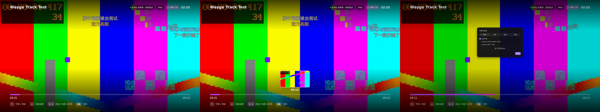
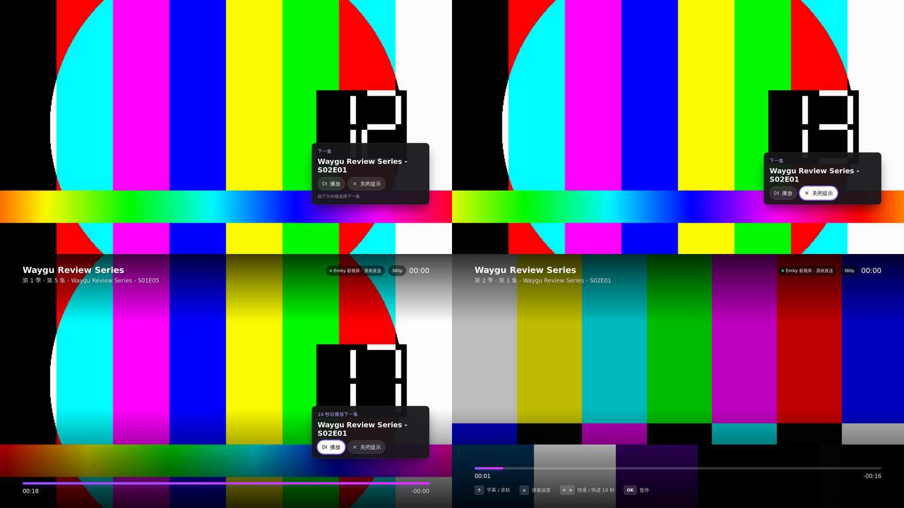
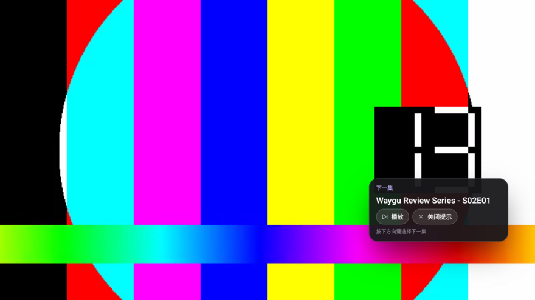
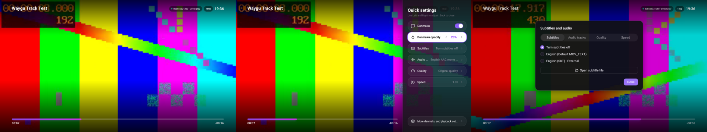

# TV player review

Scenra is on the left and the Linux GTK app is on the right at 1920 × 1080 pt in Simplified Chinese. The app runs in the light appearance with the player's dark treatment. The app frames use the Emby Docker clip, a test danmaku feed, and a seek thumbnail supplied by the test adapter. The movie title, tracks, time, frame and comments differ from the values shown in Scenra. [Scenra design](../../design/tv-player.scenra)

| Area | Comparison |
| --- | --- |
| Video and overlays | The video fills the client area. The top and bottom gradients are 288 and 420 pt high. The title begins 48 pt from the top and 96 pt from the left. The header shows the active provider, play method, format when available, danmaku count and clock. The Emby sample is a short SDR movie. |
| Timeline and seek preview | With quick settings open, the 10 pt timeline spans 1224 pt with 96 pt on the left and 600 pt on the right. The thumbnail is 284 × 160 pt with a white border and moves with the seek target. Left and Right seek in ten-second steps. The timeline shows the current playhead while the preview shows the target time, including when the server has no preview images. The grey buffered segment remains pending because the video backend exposes buffering state without buffered positions. |
| Remote hints | The four hints show tracks, quick settings, ten-second seeking and pause. The app displays them during the first three playback opens. During playback the on-screen display closes after three seconds without input. |
| Quick settings | The panel takes 560 pt. Rows are 80 pt tall with 12 pt gaps and 40 pt insets. The focused row turns white with a violet ring. Left and Right change opacity in 10% steps and save the setting. The remaining rows open the current track, quality and speed controls. The last row opens playback settings and Back returns to playback at the saved position. |
| Danmaku | The TV overlay begins below the header and is clipped before the sidebar while quick settings are open. Comment positions reflect the test feed and playback time. |
| Remaining review | The track picker uses the shared track dialog. The last settings row opens the dedicated [TV settings screen](tv-settings.md). Physical Android TV and the tvOS Siri Remote remain unverified. |

`TestDockerTVPlayerReview` checks overlay geometry, remote actions, saved opacity, seeking, playback speed, auto-hide, and the route back from settings. The `seek-preview` subtests in `TestDockerServers` retrieve and decode server-generated images at 0 and 12 seconds from all three providers. `TestSeekPreviewProviders` checks file selection and frame indexing with local HTTP fixtures. [Docker test setup](../../integration/servers/TESTING.md)

## Next episode

The playback flow specifies a card in the last 30 seconds and a ten-second countdown when an episode ends. The GTK captures show the card on the TV player, using the white action focus and violet ring from the player design. At 1920 × 1080 it is 500 pt wide with a 96 pt right inset and a 210 pt bottom inset. The card uses the playback flow's interaction notes and the player panel's styling. Short clips show the card in their last third. [Scenra playback flow](../../design/flows/playback.scenra) · [TV player design](../../design/tv-player.scenra)

The four frames show the 18-second Emby clip in the final episode of season one. The card stays visible after the playback controls fade. Down moves focus to Play, Right moves to Dismiss, and Select dismisses the card and returns focus to the playback surface. After reopening the episode, natural completion focuses Play and starts the countdown. The next media opens at season two, episode one. Select pauses the new episode and Back restores the original detail page. The headless test runs the same transition through Emby, Jellyfin and Plex. [Fixture and test commands](../../integration/servers/TESTING.md#tv-next-episode)

The system screenshot shows the decoded Emby clip after submitting a search on the Android TV API 36 x86_64 emulator at 1920 × 1080. The on-screen keyboard is closed. The native test verifies actual D-pad focus, dismissal, the countdown and playback in season two. The clips run at their recorded duration while the test advances the app's UI timers. [Android TV test command](../../integration/servers/TESTING.md#tv-next-episode)

## Android TV

The Android x64 Leanback APK played the Emby Docker clip on the 1920 × 1080 Android TV emulator. The remote smoke test verifies that Select changes the play state, Menu opens quick settings, the directional buttons adjust opacity and seek, Up opens tracks, and Back returns to the same detail screen.

With an Emby fixture that has a featured playable movie, launch the app on TV and run `python3 build/android/tv-smoke.py --with-player` with the emulator or device selected through `ANDROID_SERIAL`.
