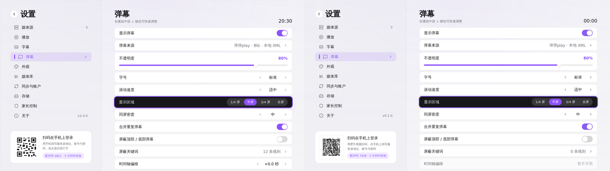
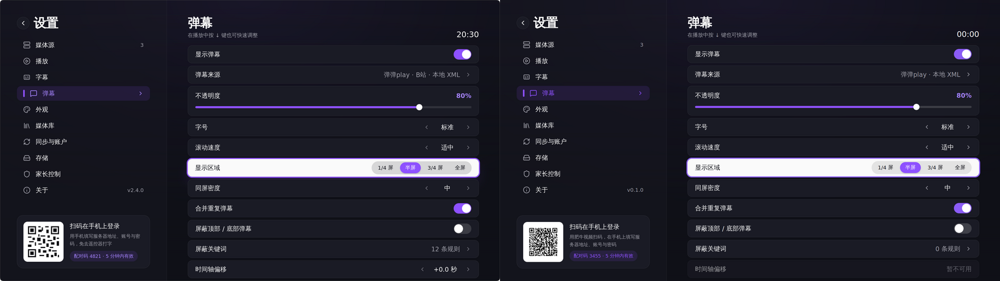
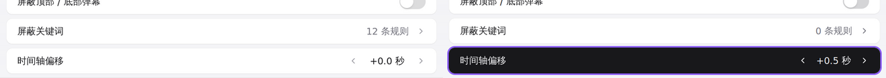
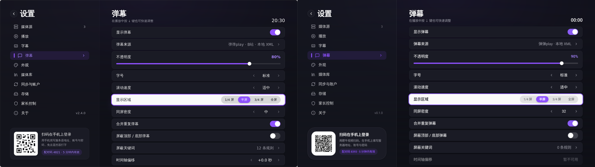
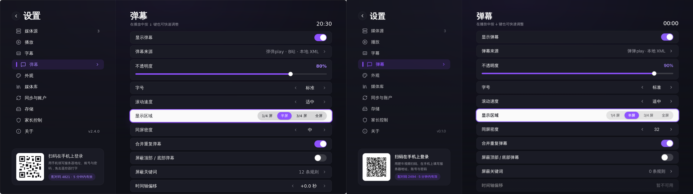
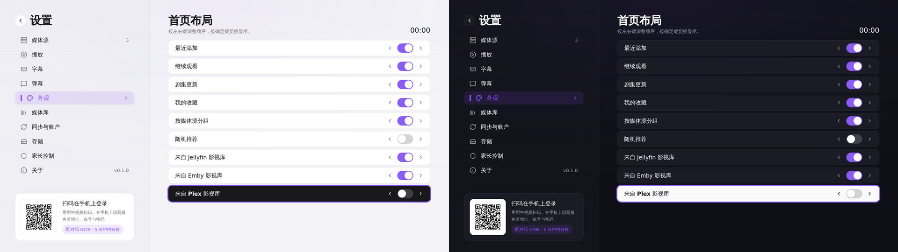
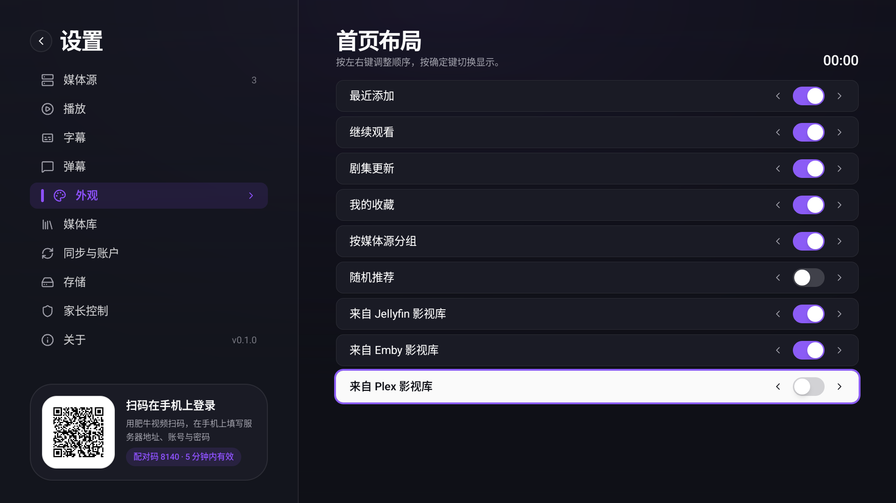
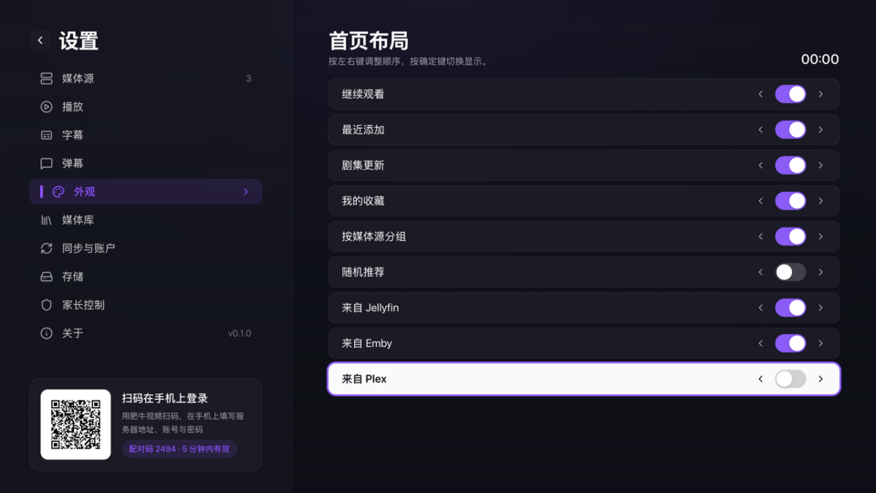

# TV settings review

Scenra is on the left and the Linux GTK app is on the right. Both use the Simplified Chinese TV layout at 1920 × 1080 pt. The app shows the Docker library count, its build version, a generated five-minute pairing code, and the current danmaku providers and filter count. [Scenra design](../../design/tv-settings.scenra)

## Light



## Dark



## Playback offset

The crop compares the timeline offset row in Scenra and in the settings opened from a playing title. The app shows the saved half-second adjustment with the focus ring.



| Area | Comparison and interaction |
| --- | --- |
| Sidebar | The sidebar takes 640 pt with 64 pt horizontal insets. The rows are 56 pt high. The active category keeps its violet marker while the option pane has focus. Up and Down change category and Right enters its options. |
| Danmaku controls | The content uses 80 pt horizontal insets and 68 pt standard rows. The opacity slider and four screen coverage choices match the Scenra layout. The focused option inverts with a violet outline. Left and Right change values and update the same preferences the player reads. |
| Timeline offset | Enter from the player to adjust the current movie or episode in half-second steps. The app displays the row as unavailable when opened from Home without a current title. Back resumes the previous playback position when opened from the player. |
| Pairing | The card renders a real code. In the Waygu phone app, open Settings and Sync and account, then scan the code or enter the pairing address. The phone sends the details directly to the TV over a connection pinned to the scanned certificate. The code expires after five minutes and a successful setup consumes it. The published captures use an isolated loopback endpoint. |
| Design coverage | Scenra supplies the Danmaku category in both appearances. The other categories use existing settings and media-source actions. Bilibili, account synchronization and parental controls remain pending. |

`TestDockerTVSettingsReview` checks focus transitions, the sidebar and options geometry, persisted danmaku changes, and receipt of both Emby media credentials and DandanPlay credentials. The Emby test signs in, reads its libraries and checks the saved session. `TestPhoneSendsTVSetup` runs the actual phone form against a local pairing endpoint. The transport test covers incorrect certificates, incorrect tokens, retry after a rejected request and reuse of a consumed code. `TestDockerTVPlayerReview` exercises the route from playback and the per-title timeline offset.

The Android TV emulator passed the remote smoke test using a connected Emby fixture. The test opens Settings from Home, moves from the category list into the danmaku options, changes opacity, verifies that the pairing QR is present and returns Home. Run it with `python3 build/android/tv-smoke.py --with-settings`.

Physical phone camera pairing and physical TV remote checks remain pending.

## Native TV danmaku controls

Scenra is on the left in each pair. Android TV is on the right in the first pair, and Apple TV is on the right in the second. Each frame shows the dark panel at 960 × 540 px from a 1920 × 1080 pt design or the corresponding native viewport. The sidebar selection, option panel, opacity track and four screen-coverage choices align at the same scale. The native text rasterization differs at character edges. The fixture's preferences, rule count, clock, version and pairing code determine the displayed values. Timeline offset is unavailable from Home without a playing title.





`TestTVHomeNativeFixture` navigates to the display area row, presses Right to save 75% coverage and presses Left to restore 50%. The Apple TV simulator, Android TV emulator and GTK runs passed both changes. [Apple TV test run](https://github.com/vicnoah/waygu-video/actions/runs/45150055162)

## Home layout

The TV Home design specifies one row per media source and places its order and visibility controls under **Settings → Appearance → Home layout**. The panel uses the TV Settings frame, 68 pt rows, switches and violet focus ring. These captures show the light and dark GTK panels at 1920 × 1080 pt, after moving Jellyfin above Emby and hiding Plex. [TV Home design note](../../design/tv-home.scenra#L144)



Use Up and Down to choose the row, Left and Right to move it earlier or later, and Select to toggle its visibility. Back returns focus to **Home layout** in Appearance. The **Group by media source** switch controls the entire group, while each source retains its own position and visibility. Catalog browsing and playback preserve the configured media source priority.



The Android TV emulator passed the same navigation and ordering checks. Its 1920 × 1080 display uses a 960 pt client width. The option rows scale from 68 to 34 pt and their corner radius scales from 16 to 8 pt. Android and GTK retain differences in native text rendering. The screenshot comes from the emulator display.

`TestDockerTVHomeLayout` exercises this sequence with Emby, Jellyfin and Plex, checks the saved layout and verifies the displayed source order on Home. To reproduce the GTK captures with the local Docker fixtures running, use the following command.

```sh
go tool nsgo test -target linux -env WAYGU_TEST_SERVERS=1 \
  -run '^TestDockerTVHomeLayout$' -screenshots .nsgo/ui-review/tv-home-layout
```

On Android TV, forward the Docker fixture ports 18096, 28096 and 32400 with `adb reverse` and run `sh build/android/package.sh test -device <serial> -env WAYGU_TEST_SERVERS=1 -run '^TestDockerTVHomeLayout$'`.



The Apple TV simulator moved Jellyfin above Emby, focused the Plex row, hid Plex and used Back to return focus to **Home layout**. Home then displayed only the two enabled source shelves in the saved order. The figure shows the 1920 × 1080 pt client at 960 × 540 px. [Apple TV test run](https://github.com/vicnoah/waygu-video/actions/runs/45150055162)
