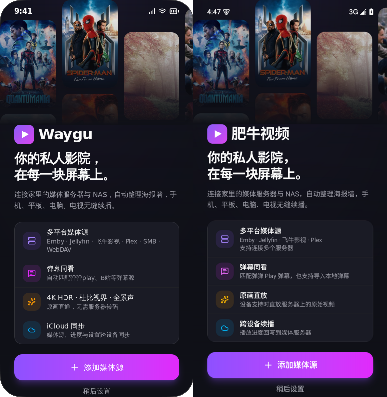
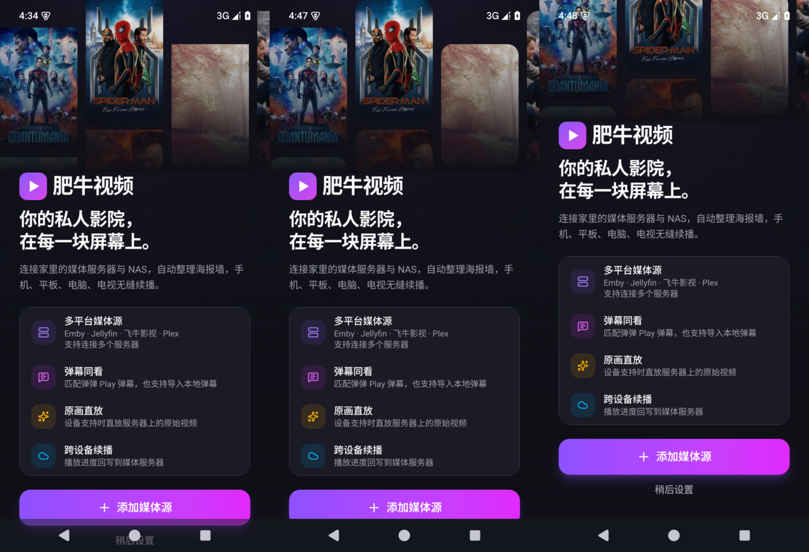
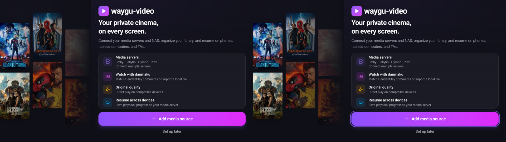
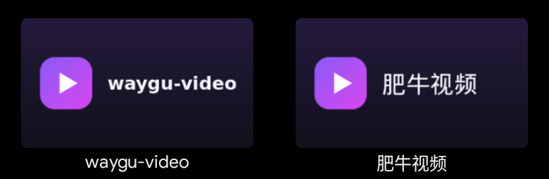

# Welcome screen review

[Scenra design](../../design/welcome.scenra) · 390 × 800 px per image · Linux GTK at 1× scale · `zh-Hans` · fresh profile with no connected sources. The design is rendered with Scenra commit `88548db091cd`. The baseline app is commit `19d6b06`.

Each strip shows the baseline app on the left, the Scenra reference in the center, and the revised app on the right.

## Light

## Dark

## Findings

| Area | Baseline | Revised capture and remaining work |
| --- | --- | --- |
| Poster wall and background | Narrow columns, shorter crop, and a plain background below the posters. | The wall now uses a 250 pt crop with aligned 112 × 176 pt posters and separate light and dark fades. The reference includes a phone bezel and status bar. The Android poster wall extends behind the white system status icons in both appearances. [Android phone captures](#android-phone-viewport) |
| Brand and heading | 36 pt mark, smaller wordmark, and different headline scale. | The mark is now 40 pt and the heading occupies the same two lines as the reference. The localized wordmark reads 肥牛视频. The raster mark, system font, and subpixel rendering retain small edge differences. |
| Feature card | A single provider row. | Four rows use the reference's spacing, tinted icons, and dividers. Copy shows Emby, Jellyfin, 飞牛影视, and Plex, plus the implemented danmaku, original-file playback, and server-backed progress features. |
| Actions | A 32 pt flat button and skip action high on the screen. | The 52 pt gradient button and skip action are within 1 px of the reference vertically in the GTK captures. The reference includes a 1 px device frame. |

## Native interaction checks

`TestWelcomeReview` passed in both appearances. It asserts the hero height, the primary action height, and the four feature rows. It presses **添加媒体源**, confirms the Emby choice is present, goes back, presses **稍后设置**, and checks that the empty home screen offers to add a source. iPhone captures and input checks are still pending.

## Android phone viewport

Scenra is on the left and the Android 35 phone emulator display is on the right. Both show a 390 × 800 pt crop in Simplified Chinese. The emulator uses a 390 × 848 pt display with three-button navigation. The app viewport measures 390 × 800 pt above the system navigation bar. Android clips the poster images to the 16 pt corners and shows white status icons over the top poster wall. Text rendering, system icons and the reference's device frame give the edges different pixels.

On a 390 × 800 pt display, the 48 pt navigation bar covered the lower edge of **添加媒体源** and all of the **稍后设置** touch target in the baseline. The revised scroll viewport ends above the navigation bar. The three frames show the baseline APK, the revised page at launch and the revised page after scrolling to the actions.

The installed x86-64 APK passed a real swipe and tap sequence in the compact viewport. **添加媒体源** opened the provider chooser, Android Back returned to Welcome and **稍后设置** opened the empty Home page. `TestWelcomeScrollKeepsActionsAboveNavigationBar` covers the 48 pt inset and the skip route in the headless runner.

## Android TV viewport

The phone design stacks the poster wall and the actions. On the Android TV emulator's 960 × 540 pt client area, that layout put both actions below the first screen. The TV layout places the poster wall beside the welcome content, keeping both actions visible at launch. The existing light and dark GTK phone-size captures match the revised app pixel for pixel.

Left is commit `445d75b`. Right is the revised APK. Both emulator captures are shown at half size from 1920 × 1080 px on Android 36 in dark appearance. `TestTVNavigation` checks that the complete bounds of both actions fit at 960 × 540 pt in English and Simplified Chinese.

## Android TV remote focus

Both captures follow the first D-pad Down after a cold start on Android TV 36. The left image uses `3965d66`, which leaves focus on the window. The right image shows **Add media source** focused with a violet outline, consistent with the [TV design's focus treatment](../../design/tv-home.scenra). Both captures are shown at half size from 1920 × 1080 px.

The installed x86-64 APK passed `build/android/tv-smoke.py` after a Leanback launch. The remote opens the Emby form, returns to welcome, skips setup, enters Settings, and reopens the provider chooser. The app reports focus through Android's native accessibility tree. Physical remote testing is pending.

## Android TV launcher

These crops show the focused app tile in the Android 36 TV launcher at `en-US` and `zh-Hans-CN`. The launcher is outside the Scenra welcome screen. Its banner uses the existing app mark and the localized app name. In each locale, D-pad Select opened the installed app from the Apps tab. The English run also passed the onboarding and Settings remote test above.

Local builds produced ARM64 and x86-64 APKs and an ARM64 App Bundle. The APK and the binary resources converted from the bundle with `aapt2 convert --output-format binary` contain both 320 × 180 PNGs under `drawable/tv_banner`. The application manifest's `android:banner` points to that resource. [Android TV launcher requirements](https://developer.android.com/training/tv/get-started/create)
