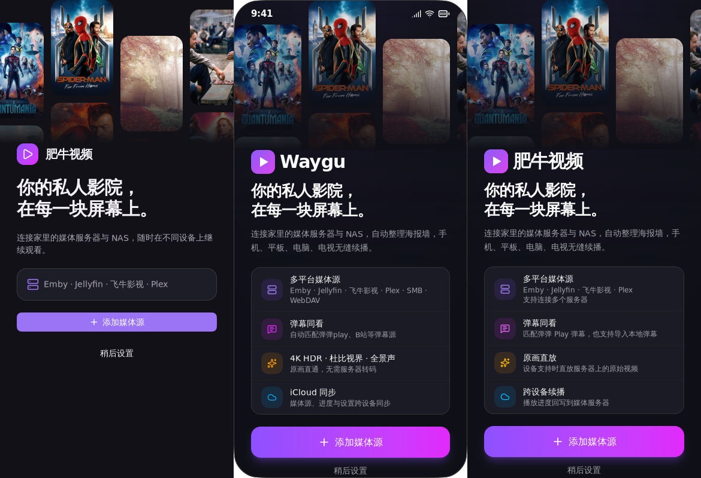
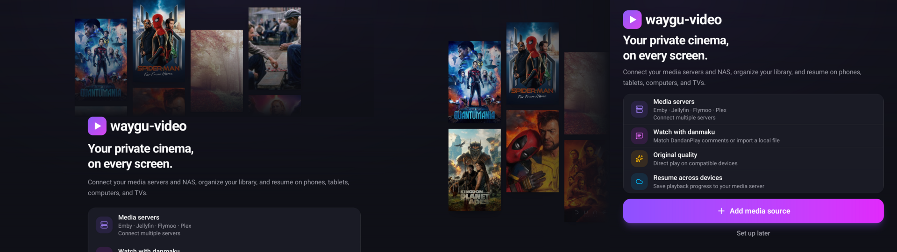

# Welcome screen review

[Scenra design](../../design/welcome.scenra) · 390 × 800 px per image · Linux GTK at 1× scale · `zh-Hans` · fresh profile with no connected sources. The design is rendered with Scenra commit `88548db091cd`. The baseline app is commit `19d6b06`.

Each strip shows the baseline app on the left, the Scenra reference in the center, and the revised app on the right.

## Light

## Dark

## Findings

| Area | Baseline | Revised capture and remaining work |
| --- | --- | --- |
| Poster wall and background | Narrow columns, shorter crop, and a plain background below the posters. | The wall now uses a 250 pt crop with aligned 112 × 176 pt posters and separate light and dark fades. The reference includes a phone bezel and status bar. Confirm placement and icon color with the real system bar on mobile. |
| Brand and heading | 36 pt mark, smaller wordmark, and different headline scale. | The mark is now 40 pt and the heading occupies the same two lines as the reference. The localized wordmark reads 肥牛视频. The raster mark, system font, and subpixel rendering retain small edge differences. |
| Feature card | A single provider row. | Four rows use the reference's spacing, tinted icons, and dividers. Copy shows Emby, Jellyfin, 飞牛影视, and Plex, plus the implemented danmaku, original-file playback, and server-backed progress features. |
| Actions | A 32 pt flat button and skip action high on the screen. | The 52 pt gradient button and skip action are within 1 px of the reference vertically in the GTK captures. The reference includes a 1 px device frame. |

## Native interaction checks

`TestWelcomeReview` passed in both appearances. It asserts the hero height, the primary action height, and the four feature rows. It presses **添加媒体源**, confirms the Emby choice is present, goes back, presses **稍后设置**, and checks that the empty home screen offers to add a source. Native phone captures and input checks are still pending.

## Android TV viewport

The phone design stacks the poster wall and the actions. On the Android TV emulator's 960 × 540 pt client area, that layout put both actions below the first screen. The TV layout places the poster wall beside the welcome content, keeping both actions visible at launch. The existing light and dark GTK phone-size captures match the revised app pixel for pixel.

Left is commit `445d75b`. Right is the revised APK. Both emulator captures are shown at half size from 1920 × 1080 px on Android 36 in dark appearance. `TestTVNavigation` checks that the complete bounds of both actions fit at 960 × 540 pt in English and Simplified Chinese.

The installed APK accepted D-pad Down and Select once a Tab key moved the initial focus from the Android window to the first action. A cold start driven by the D-pad alone still leaves focus on the Android window. The Android TV remote-only launch check remains open.
